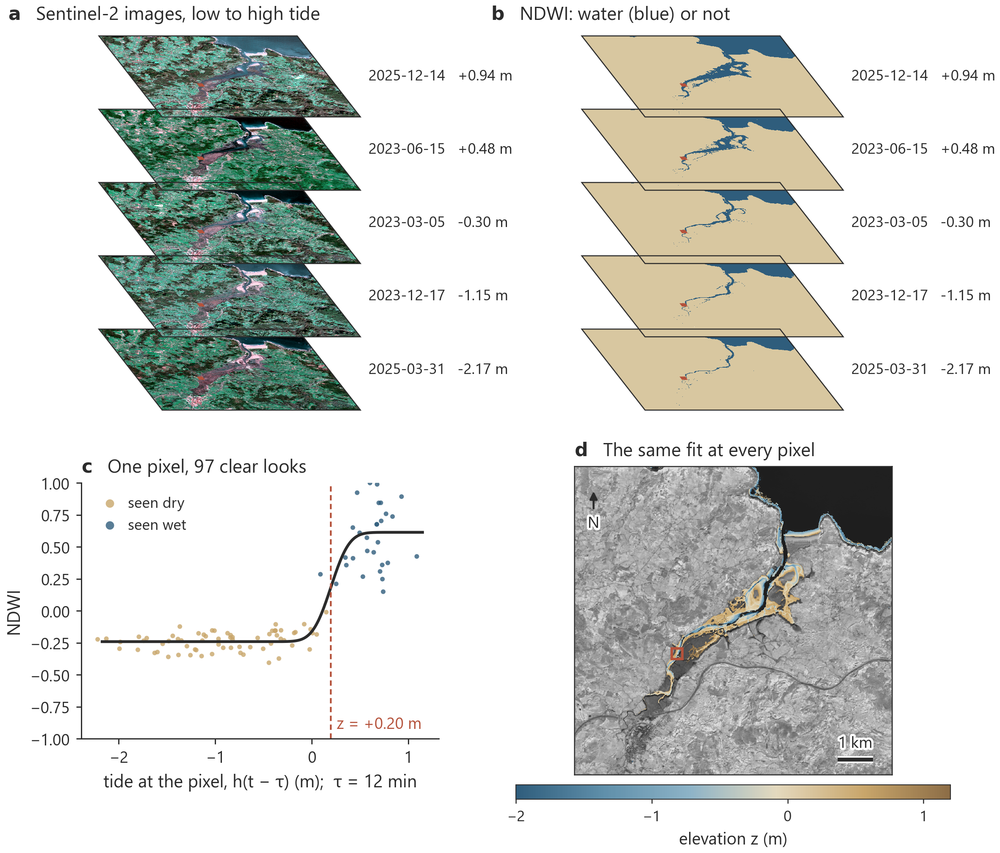

# MAREA: a method for mapping intertidal topography using Sentinel-2 openEO data cubes

*The tide arrives late: MAREA reads the delay from satellite images and corrects the maps for it.*

[](LICENSE)
[](LICENSE-docs.md)
[](https://mybinder.org/v2/gh/coastal-AI/Intertidal_analysis/CARTOGRASS26?labpath=notebooks%2F01_marea_villaviciosa.ipynb)
[](https://nbviewer.org/github/coastal-AI/Intertidal_analysis/tree/CARTOGRASS26/notebooks/)

Companion repository of our poster at **CARTOGRASS 2026**, Simposio Ibérico de
Cartografía y Seguimiento de Praderas Marinas, Cartagena, 24–26 November 2026.

**Jorge Alías Álvarez**¹ · **Fernando García-González**² · **Pablo González**¹<br>
¹ University of Oviedo, Spain · ² Instituto Español de Oceanografía (IEO-CSIC), Spain

* **Interactive maps:** <https://coastal-ai.github.io/Intertidal_analysis/> (online once published)
* **Poster (PDF):** coming soon, in [`poster/`](poster/README.md)
* **Run it yourself:** [quick start](#quick-start) · [notebooks](#notebooks) · [how MAREA works](guide/METHOD.md)



*From Sentinel-2 images to an elevation map, Ría de Villaviciosa, 2023–2025 (real data):
(a) images from low to high tide; (b) water or not; (c) one pixel's 97 looks against the
tide that reaches it, with its fitted flooding curve; (d) the same fit at every pixel.
Heights on the tide model's scale.*

## In short

MAREA maps three things for every 10 m pixel of a tidal flat, from the Sentinel-2
archive: the elevation of the ground, its uncertainty, and its emersion time, the share
of time the ground is out of the water. A pixel on a flat is photographed many times, at
different stages of the tide. Whether it looks wet or dry in each image, together with
the water level at that moment, fixes its elevation.

Global tide models give that water level at the open coast. Inside an estuary, though,
the tide arrives later: by more than an hour at the head of the Ría de Mundaka. MAREA
reads this delay from the images themselves, one delay for each 3-km section along the
channel (zero at the mouth, never decreasing inland). It shifts the tide by that delay
and only then fits the elevation of each pixel.

The images come as openEO data cubes from the Copernicus Data Space Ecosystem. The tide
comes from the global model EOT20, averaged at three of the four sites with the nearest
tide gauge.
Elevation and emersion time together are a base layer for the potential habitat of
*Nanozostera noltei*. (*Marea* is Spanish for tide.)

## Explore the maps

The map viewer shows MAREA's maps of four estuaries of northern Spain, from west to east:
the Ría de Foz, the Ría del Eo, the Ría de Villaviciosa and the Ría de Mundaka (Urdaibai).
Each map is drawn only inside an intertidal mask cleaned by hand, which removes the
water-detection noise at sea and along the open coast.

| layer | what it shows |
|---|---|
| Elevation | height of the ground, in m above NMMA (mean sea level at Alicante) |
| Uncertainty | width σ of each pixel's dry-to-wet transition, in m |
| Emersion time | share of the hours the ground is out of the water, in % |
| Delay | how many minutes after the mouth the tide reaches each pixel; at Mundaka, with lines of equal delay |
| Tide lines | elevation contours at the tidal datums (MLWN, MSL, …) |

How the heights, layers and files are defined: [`guide/DATA.md`](guide/DATA.md).

## Quick start

Python 3.13:

```bash
git clone --depth 1 --branch CARTOGRASS26 https://github.com/coastal-AI/Intertidal_analysis.git
cd Intertidal_analysis
python -m venv .venv
source .venv/bin/activate              # Windows: .venv\Scripts\activate
pip install -r requirements.txt
python -X utf8 scripts/reproduce_villaviciosa.py --from-kit replication
```

With conda or mamba, replace the `venv`, `activate` and `pip install` lines with
`mamba env create -f environment.yml` and `mamba activate marea-cartograss26`.

The last command rebuilds the published 10 m map of the Ría de Villaviciosa
([`products_marea/`](products_marea/README.md)) from the offline kit in
[`replication/`](replication/README.md): the delay of each section, then the elevation
and uncertainty of every pixel. It needs no account, no download and no tide model. It
runs in 1–2 minutes with about 0.6 GB of memory, compares its result with the published
files array by array, and ends with:

```
PASS: 41 of 41 checks passed; total ... s
```

The tests, the full route from the Sentinel-2 cube and what each check compares:
[`guide/REPRODUCE.md`](guide/REPRODUCE.md).

## Notebooks

| notebook | what it does |
|---|---|
| [`01_marea_villaviciosa`](notebooks/01_marea_villaviciosa.ipynb) | MAREA step by step on real data. In a 2.7 km block of the Ría de Villaviciosa: one pixel's looks against the tide at the mouth and against the delayed tide, and its elevation. Then the delays of the whole ría from the kit, and the maps of elevation, uncertainty, delay and emersion time. |
| [`02_tide_per_image`](notebooks/02_tide_per_image.ipynb) | The tide at the moment of each of the 97 images of 2023–2025: flood or ebb, the delayed level of each section, and how much of the tide range the images cover. |
| [`03_new_ria_openeo`](notebooks/03_new_ria_openeo.ipynb) | How to start a new estuary through openEO, shown for the Marismas de Santoña: the area, a credit estimate and the download call. The download is off by default (`RUN_DOWNLOAD = False`). |

The notebooks are stored with their outputs. Open them on
[Binder](https://mybinder.org/v2/gh/coastal-AI/Intertidal_analysis/CARTOGRASS26?labpath=notebooks%2F01_marea_villaviciosa.ipynb)
(nothing to install), read them on
[nbviewer](https://nbviewer.org/github/coastal-AI/Intertidal_analysis/tree/CARTOGRASS26/notebooks/),
or run them locally in JupyterLab (`pip install jupyterlab`, then `jupyter lab`).

## MAREA in six steps

Each look at a pixel is a point on its flooding curve:

$$\mathrm{NDWI} = a + b\,\Phi\left(\frac{h(t-\tau)-z}{\sigma}\right)$$

where h(t − τ) is the tide at the mouth τ minutes before the image, z the elevation
(the midpoint of the curve), σ the width of the curve, a and a + b the NDWI of the pixel
when dry and when wet, and Φ the normal cumulative distribution.

1. **Seen many times.** Each cloud-free Sentinel-2 view of the pixel says wet or dry
   (NDWI, from green and near-infrared light).
2. **Its tide arrives late.** The tide at the mouth (global tide model and gauges)
   reaches its 3-km section some minutes later: the pixel is wet when that water stands
   above its ground. MAREA shifts that tide in time, not in height.
3. **Its section's delay.** One delay for the whole section: the one that best splits
   the wet and dry looks of its pixels, judged together; zero at the mouth, it can only
   grow inland.
4. **Its elevation.** The midpoint of its flooding curve on the corrected tide; the
   width of the curve is the uncertainty. A pixel without both wet and dry looks is left
   empty.
5. **Its emersion time.** The share of time the corrected tide stays below its ground,
   at all times of the tide record, not only at image times.
6. **All pixels: the maps.** Elevation with its uncertainty, and emersion time: the base
   layer for the potential habitat of *Nanozostera noltei*.

The method in more detail, with real figures and the function behind each step:
[`guide/METHOD.md`](guide/METHOD.md).

## Repository structure

```
pyintertidal/            the MAREA library (22 modules)
configs/                 settings the library reads (m2.yaml, overpass_corrections.json)
scripts/                 reproduce_villaviciosa.py and its helpers (marea_tools.py, sites/)
replication/             offline replication kit of the Villaviciosa map (12.5 MB)
products_marea/          the 10 m MAREA product of the Ría de Villaviciosa, 2023–2025
products_villaviciosa/   the reference 10 m grid of Villaviciosa
notebooks/               three example notebooks, with their outputs
data/                    a small real sample for notebook 01
tests/                   unit tests and a fast end-to-end reproduction
guide/                   how MAREA works, how to reproduce it, the data
site/                    source of the map viewer (React, Tailwind CSS, MapLibre GL JS)
docs/                    the built map viewer, served by GitHub Pages
poster/                  the poster (PDF to be added)
```

At the root: `requirements.txt` and `environment.yml` (the pinned environment),
`CITATION.cff`, `CHANGELOG.md`, `LICENSE` and `LICENSE-docs.md`.

## Website

The website is an interactive map viewer of these results, online at
<https://coastal-ai.github.io/Intertidal_analysis/> once published. Its source is in
[`site/`](site/README.md) (React, Tailwind CSS and MapLibre GL JS); `cd site && npm ci &&
npm run build` writes the static site to [`docs/`](docs/), which GitHub Pages serves from
this branch. The path it is served under is one build variable, `SITE_BASE`: by default
`/Intertidal_analysis/`, `/<repo>/` for another repository, `/` for a custom domain or a
local preview.

## Code and data availability

* **Code:** this branch, `CARTOGRASS26`:
  <https://github.com/coastal-AI/Intertidal_analysis/tree/CARTOGRASS26>. Release and
  Zenodo DOI: to be added.
* **The maps of the four sites:** in the map viewer; their layer images and value images
  are in [`site/public/data/`](site/public/data/) (formats in
  [`guide/DATA.md`](guide/DATA.md#6-map-viewer-files)). CC BY 4.0.
* **The Villaviciosa product and its replication kit:**
  [`products_marea/`](products_marea/README.md) and
  [`replication/`](replication/README.md). CC BY 4.0.
* **Notebook sample:** [`data/`](data/README.md), a real 2.7 km block of the Ría de
  Villaviciosa with its 97 images and tide. CC BY 4.0.
* **The Villaviciosa Sentinel-2 cube** (3.09 GB, 2016–2025) from which the kit was made:
  to be archived on Zenodo (DOI to be added).
* **Sentinel-2 L2A:** free from the
  [Copernicus Data Space Ecosystem](https://dataspace.copernicus.eu/), through openEO
  (free account; downloads spend processing credits).
* **EOT20 tide model:** SEANOE, <https://doi.org/10.17882/79489> (CC BY 4.0); not
  redistributed here.
* **Tide gauges:** IOC Sea Level Station Monitoring Facility,
  <https://www.ioc-sealevelmonitoring.org/>.

## Credits

* Contains modified Copernicus Sentinel data (2015–2026), processed with openEO on the
  Copernicus Data Space Ecosystem.
* Tide model EOT20 (Hart-Davis et al. 2021), CC BY 4.0.
* Tide gauges Ferrol 2 and Bilbao 3: IOC Sea Level Station Monitoring
  Facility (VLIZ, IOC-UNESCO); stations of Puertos del Estado.
* Website basemaps: PNOA orthophoto and IGN base map, © Instituto Geográfico Nacional de
  España (CC BY 4.0, scne.es), loaded at run time.

## How to cite

Until the paper on the method is published, please cite the poster:

> Alías Álvarez, J., García-González, F., González, P. (2026). MAREA: a method for
> mapping intertidal topography using Sentinel-2 openEO data cubes. Poster, CARTOGRASS
> 2026, Simposio Ibérico de Cartografía y Seguimiento de Praderas Marinas, Cartagena,
> Spain, 24–26 November 2026. DOI: to be added.

```bibtex
@misc{alias2026marea,
  author       = {Al{\'\i}as {\'A}lvarez, Jorge and Garc{\'\i}a-Gonz{\'a}lez, Fernando and Gonz{\'a}lez, Pablo},
  title        = {{MAREA}: a method for mapping intertidal topography using {Sentinel-2} {openEO} data cubes},
  howpublished = {Poster, CARTOGRASS 2026, Simposio Ib{\'e}rico de Cartograf{\'\i}a y Seguimiento de Praderas Marinas, Cartagena, Spain, 24--26 November 2026},
  year         = {2026},
  month        = nov,
  note         = {Code: \url{https://github.com/coastal-AI/Intertidal_analysis/tree/CARTOGRASS26}. DOI: to be added}
}
```

The software and its data are described in [`CITATION.cff`](CITATION.cff).

## Licences

* Code: MIT ([`LICENSE`](LICENSE)).
* Text, figures and data: CC BY 4.0 ([`LICENSE-docs.md`](LICENSE-docs.md)).
* Third-party data keep their own licences
  ([`guide/DATA.md`](guide/DATA.md#9-licences-and-attribution)).
* The website bundles open-source libraries (MapLibre GL JS, React, Lucide icons, clsx
  and the Inter font); their licences are in [`docs/licenses/`](docs/licenses/).
* The poster: CC BY 4.0, except the institutional and congress logos.

## Acknowledgements

[To be added by the authors.]

## Contact

[To be added by the authors.] Questions about the code: please open an issue.

## References

1. Bishop-Taylor, R. et al. (2019). Between the tides: modelling the elevation of
   Australia's exposed intertidal zone at continental scale. *Estuarine, Coastal and
   Shelf Science* 223, 115–128.
2. Granadeiro, J. P. et al. (2021). Using Sentinel-2 images to estimate topography,
   tidal-stage lags and exposure periods over large intertidal areas. *Remote Sensing*
   13(2), 320.
3. Hart-Davis, M. G. et al. (2021). EOT20: a global ocean tide model from multi-mission
   satellite altimetry. *Earth System Science Data* 13, 3869–3884.
   <https://doi.org/10.5194/essd-13-3869-2021>
4. Schramm, M. et al. (2021). The openEO API – harmonising the use of Earth observation
   cloud services using virtual data cube functionalities. *Remote Sensing* 13(6), 1125.
