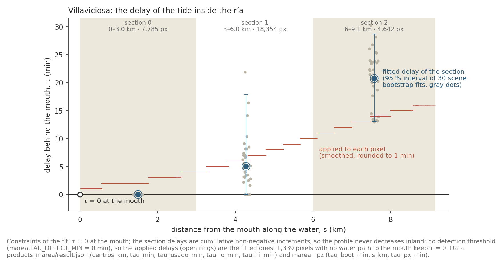
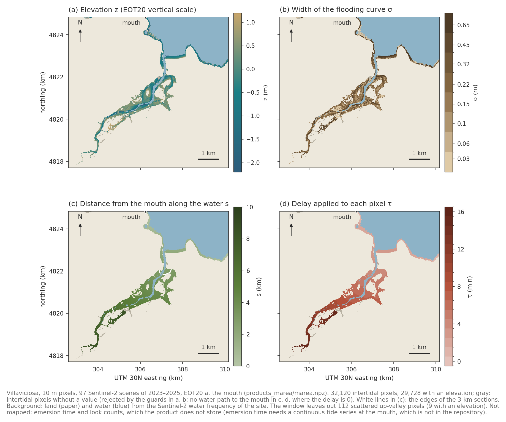
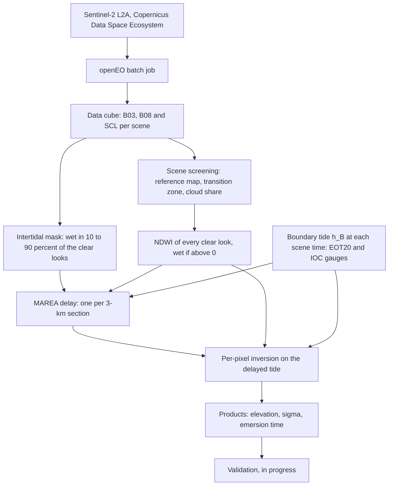

# MAREA: a method for mapping intertidal topography using Sentinel-2 openEO data cubes

*The tide arrives late: MAREA reads the delay from satellite images and corrects the maps for it.*

Research code behind the CARTOGRASS 2026 poster (Cartagena, 24-26 November 2026).

* **What it gives:** maps of intertidal elevation, with its uncertainty, and
  of emersion time (the share of time the ground spends out of the water),
  at 10 m from the Sentinel-2 archive, with the delay of the tide inside
  estuaries and tidal basins corrected.
* **Status:** the validation is in progress (October 2026). This page
  describes the method and the validation design and reports no validation
  result.
* **Poster:** [PDF, A0, 2.3 MB](poster/CARTOGRASS2026_poster_draft_2026-10-20.pdf)
* **Cite:** [how to cite](#how-to-cite) · **Contact:** Jorge Alías Álvarez,
  jorge.alias.alvarez@gmail.com
* **Read more:** [the method](docs/METHOD.md) ·
  [the validation design](docs/VALIDATION_DESIGN.md) ·
  [the products](docs/products.md) · [the code](docs/ARCHITECTURE.md) ·
  [glossary](docs/GLOSSARY.md)

## MAREA in four pictures

|  |  |
|---|---|
| **1. The problem.** Inside an estuary the tide arrives late: read against the mouth level, some looks contradict the ground's elevation; against the delayed level, none do. | **2. The delay, measured.** One delay per 3-km section, read from the images themselves, zero at the mouth and never decreasing inland. |
|  |  |
| **3. One pixel.** On the corrected tide, the midpoint of the pixel's flooding curve is its elevation. | **4. The maps.** Elevation, its uncertainty σ, the distance from the mouth and the delay of every intertidal pixel. |

*Figures 2 and 4 show the Villaviciosa product of the method, not a validation result.*

## What MAREA is

MAREA maps the elevation of intertidal flats, and the share of time each spot
spends out of the water (emersion time), from the Sentinel-2 archive.
(*Marea* is Spanish for tide; in the code the name reads *Mudflat Altimetry
via Remotely-Estimated tides from the Archive*.)

* **The principle.** A 10 m pixel on a tidal flat is seen many times by the
  satellite, at different stages of the tide. Whether it looks wet or dry in
  each image, together with the water level at the time of that image,
  fixes its elevation (Bishop-Taylor et al. 2019; Granadeiro et al. 2021).
* **The problem.** Global tide models give the tide at the open coast, but
  inside estuaries and tidal basins the tide arrives up to 1.5-2 hours
  later, so maps made with the coastal tide misjudge when the flats flood.
  Granadeiro et al. (2021) showed that the Sentinel-2 archive holds this
  delay.
* **What MAREA does.** It measures the delay section by section along the
  channel: one delay for each 3-km section (zero at the mouth, never
  decreasing inland), read from the images themselves. It then reads the
  tide at the mouth that many minutes earlier, and only then works out the
  elevation of every pixel.
* **The inputs.** The images come as openEO data cubes from the Copernicus
  Data Space Ecosystem; the tide at the mouth comes from the global tide
  model EOT20 and, where they exist, from tide gauges at the mouth.

## The pipeline at a glance



Each step's formula is in [`docs/METHOD.md`](docs/METHOD.md), and the
module that runs it in [`docs/ARCHITECTURE.md`](docs/ARCHITECTURE.md).

## The products

| product | what it is | units | where |
|---|---|---|---|
| elevation $z$ | the midpoint of each pixel's flooding curve | m, on the vertical scale of the boundary tide (about mean sea level) | `z` in `marea.npz` |
| uncertainty $\sigma$ | the width of the flooding curve: how gradually the pixel floods | m | `sigma` in `marea.npz` |
| delay of each pixel | the section delays smoothed along the channel | whole minutes | `tau_px_min` in `marea.npz` |
| delay of each section | fitted and applied delay, with its 95 % bootstrap interval | minutes | `tau_min`, `tau_usado_min`, `tau_lo_min`, `tau_hi_min` |
| distance from the mouth | measured along the water | km | `s_km` in `marea.npz` |
| emersion time | share of time the corrected tide stays at or below the ground | 0-1 (times 24 = hours per day) | computed from `z` and a continuous tide series; not stored |
| hypsometric curve | area of mapped ground below each level, with an envelope from $\sigma$ | m against km² | `hyp_z`, `hyp_area`, `hyp_lo`, `hyp_hi` |
| run record | scene count and dates, pixel counts, sections, delays, input hashes | – | `result.json` |

Every array, its type and shape: [`docs/products.md`](docs/products.md).

## How MAREA works: follow one pixel

![Flow chart in six cards: (1) the pixel is seen many times in a Sentinel-2 data cube and each cloud-free look says wet or dry; (2) the tide at the mouth reaches the pixel's 3-km section some minutes later, and the pixel is wet when that water stands above its ground; (3) the section's delay is the one that best splits the wet and dry looks of its pixels; (4) the midpoint of the pixel's flooding curve on the corrected tide is its elevation and the width of the curve its uncertainty; (5) its emersion time is the share of time the corrected tide stays below its ground; (6) all pixels give maps of elevation, uncertainty and emersion time.](poster/figures/cg/method_flow.png)

*How MAREA works, followed for one imaginary pixel (the method panel of the
poster). Schematic: the looks and the tide are simulated and the delays shown
are examples, not results; the outline and the 3-km sections are those of the
Ems-Dollard, from Sentinel-2. Drawn by `poster/tools/cg/fig_method_flow.py`.
Tap the figure to enlarge it.*

1. **Images.** Sentinel-2 L2A at 10 m, 2023-2025, downloaded as openEO data
   cubes. A *look* is a cloud-free view of the pixel (scene classification
   class 4-7), in a scene with little cloud (at most 5 % over the frame or,
   failing that, 10 % over the transition zone between permanent water and
   land). The pixel is wet when NDWI = (B03 - B08) / (B03 + B08), the
   Normalized Difference Water Index from green and near-infrared light, is
   above 0.
2. **Tide at the mouth, $h_B(t)$.** The water level at each image's
   acquisition time, from EOT20, averaged with the tide gauges at the mouth
   where they exist (four of the five study sites). Heights are in meters
   about mean sea level, not on a national datum.
3. **The delay of its 3-km section, $\tau$.** The one for which the mouth
   tide read $\tau$ minutes earlier best explains the wet and dry looks of
   all the section's pixels together: with the right delay, the looks taken
   while the water stood above a pixel's ground come out wet and the others
   dry; with a wrong one, wet and dry looks mix (in statistical terms, a
   profiled Bernoulli likelihood). Zero at the mouth, never decreasing
   inland, with a 95 % interval from 30 bootstrap resamples of the scenes.
   Each pixel reads its own delay from a smooth curve through the section
   delays. MAREA shifts the tide in time, not in height: wet/dry images can
   time the tide but cannot measure its amplification.
4. **Its elevation, $z$.** On the corrected tide the pixel's NDWI follows an
   S-shaped flooding curve, NDWI = a + b Φ((h(t - τ) - z) / σ), where Φ is
   the cumulative normal curve, a the pixel's dry level and b the jump from
   dry to wet. Its midpoint $z$ is the elevation; its width $\sigma$ is
   what the poster shows as the uncertainty. A pixel is left empty unless
   it has at least eight clear looks and a plausible curve, and, under the
   quality rule of 2026-10-06, three looks with the water below its ground
   and three above.
5. **Its emersion time.** The share of time the corrected tide stays at or
   below the ground, over a continuous tide record.
6. **All pixels: the maps.** Elevation with its uncertainty, and emersion
   time: a base layer for the potential habitat of *Zostera noltei*, whose
   limits ecologists set.

Every formula, grid, guard and parameter, with the line of code it comes
from: [`docs/METHOD.md`](docs/METHOD.md). A worked example on one real pixel,
in the development state of September 2026:
[`docs/one_pixel_marea_example.md`](docs/one_pixel_marea_example.md).

**Running it.** `pyintertidal.marea.reconstruct(cube, out_dir)` runs steps 1-4
on a downloaded cube and writes `marea.npz`, `result.json` and `figure.png`.
Two parts are left to the caller:

* **The scene screening.** `reconstruct` uses every scene of the cube that
  has an acquisition time. The production runs screened the scenes first
  (`pyintertidal.stability.reference_and_clouds` and `filter_dates`) and
  passed only the times of the screened scenes. Its default `min_scenes=80`
  refuses shorter records; the production runs used 40.
* **The mouth gauges.** By default its tide at the mouth is EOT20 alone, as at
  Villaviciosa. For the average with the mouth gauges used at the other four
  sites, pass `boundary=pyintertidal.boundary.make_boundary(aoi, n_gauges=1)`
  (two at the Westerschelde; `exclude=` names the gauges kept as checks).
  Each study site's choices are in `experiments/benchmark/config.py`
  (`BOUNDARY`, `HELD_OUT`, `MOUTH_SIDE`).

The quality rule (`marea.QUALITY_MIN_BRACKET = 3`) is the default of
`reconstruct` and of validation v2. The 10 m production products of the
study sites, among them the one in `products_marea/`, were made before the
rule existed: their `result.json` has no `quality_min_bracket` key, which
means no bracket rule.

## The poster

**MAREA: a method for mapping intertidal topography using Sentinel-2 openEO
data cubes.** Jorge Alías Álvarez¹, Fernando García-González², Pablo
González¹. ¹University of Oviedo, Spain; ²Instituto Español de Oceanografía
(IEO-CSIC), Spain. CARTOGRASS 2026, Simposio Ibérico de Cartografía y
Seguimiento de Praderas Marinas, Cartagena, 24-26 November 2026.
Authors as on the poster; the affiliations are being confirmed with the
co-authors.

* The poster as a PDF (A0, 2.3 MB; draft of 20 October 2026):
  [`poster/CARTOGRASS2026_poster_draft_2026-10-20.pdf`](poster/CARTOGRASS2026_poster_draft_2026-10-20.pdf).
  Its Results panels are left blank, and its Conclusions marked pending,
  until the validation is complete.
* The QR code in the poster's bottom strip opens this page.
* Sources, figures and the scripts that draw them: [`poster/`](poster/README.md).

## Validation: design and status

**Status (26 October 2026): in progress.** No result is reported yet; the
results will be added to this repository, and to the poster's Results and
Conclusions, when they are complete. The design is set out in
[`docs/VALIDATION_DESIGN.md`](docs/VALIDATION_DESIGN.md), with diagrams; the
full specification is [`docs/validation_v2_spec.md`](docs/validation_v2_spec.md).


*The five study sites.*

* **Two questions.** Does MAREA's delay agree with the delay that tide gauges
  inside the estuary measure, compared with other ways of estimating it? And
  is MAREA a good method for intertidal elevation compared with the state of
  the art, and where? The non-circular test of the delay is whether the
  correction improves the elevation against independent surveys (MAREA
  against the same inversion with no delay).
* **Five sites**: the Ría de Villaviciosa and the Ría de Ferrol (Spain), the
  Westerschelde, the Vlie basin of the Wadden Sea and the Ems-Dollard (the
  Netherlands and Germany).
* **Independent checks, never used to make the maps**: PNOA airborne LiDAR
  and an RTK-GNSS field survey at Villaviciosa; Rijkswaterstaat's
  Vaklodingen depth surveys of the Dutch coast at the Westerschelde, Wadden
  Sea and Ems-Dollard sites; tide gauges inside four of the sites.
* **Same inputs for every method**, and a fixed-configuration comparison of
  every elevation method on the n most recent screened images before each
  survey (n = 40 to 125).
* **Home advantage, declared**: MAREA's settings were developed on these same
  sites, gauges and surveys; every check that influenced a setting is listed.
* **Only 10 m results will be reported**, and a method that cannot give a
  result at a site is reported as NOT COMPUTABLE there; its rules are never
  relaxed to obtain one.

The "Pilot result" box on the poster is earlier work, from the submitted
abstract (the poster restates the abstract's percentage against the mean
spring range); it is not part of validation v2.

## Documentation

| page | what it holds |
|---|---|
| [`docs/METHOD.md`](docs/METHOD.md) | the full technical method: notation, every formula with its code location, the parameter table, diagrams of the algorithm, the delay fit and the per-pixel guards |
| [`docs/VALIDATION_DESIGN.md`](docs/VALIDATION_DESIGN.md) | the validation design: sites, the delay stage, the elevation stage, the fixed-configuration comparison, the methods compared, the metrics (no results) |
| [`docs/products.md`](docs/products.md) | every file MAREA and the validation write: arrays, types, shapes, units |
| [`docs/ARCHITECTURE.md`](docs/ARCHITECTURE.md) | the modules of `pyintertidal`, how they depend on each other, the data flow from download to product files, the experiments layer |
| [`docs/GLOSSARY.md`](docs/GLOSSARY.md) | plain definitions of the terms a non-specialist meets |
| [`docs/README.md`](docs/README.md) | the index of every document and figure |

## Repository map

| path | what is there |
|---|---|
| [`pyintertidal/`](pyintertidal/README.md) | the MAREA library: data cubes, water detection, tides, the delay estimator, the per-pixel inversion, derived products |
| [`experiments/`](experiments/README.md) | the scripts: validation v2 ([`validation_v2.py`](experiments/validation_v2.py) and [`benchmark/`](experiments/benchmark/README.md)), the method comparison on the existing 10 m inputs (`v14`-`v19`, [`fixedcfg/`](experiments/fixedcfg/README.md)), and the development record |
| [`tests/`](tests/README.md) | unit tests on small synthetic data, and the guard of the reserved RTK points |
| [`configs/`](configs/README.md) | pre-registered thresholds (`configs/m2.yaml` is read by the production engine) |
| [`data/`](data/README.md) | the RTK-GNSS field survey of the Ría de Villaviciosa |
| [`docs/`](docs/README.md) | the method, the validation design and specification, the products guide, the code architecture, a glossary, worked examples and their figures |
| [`notebooks/`](notebooks/README.md) | the notebook that explores the validation cubes, and the one-pixel walkthrough |
| [`poster/`](poster/README.md) | the CARTOGRASS 2026 poster: LaTeX sources, figures, the scripts that draw them, the PDF |
| [`products_marea/`](products_marea/README.md) | the 10 m MAREA product of the Ría de Villaviciosa (97 screened scenes of 2023-2025, EOT20 at the mouth, made before the quality rule), used by the second example below |
| [`products_villaviciosa/hsr_eot20_2023-2025.tif`](products_villaviciosa/README.md) | the canonical 10 m grid of Villaviciosa (EPSG:32630), on which `pyintertidal.rtk.load_rtk` places the RTK survey and the second example writes its GeoTIFF |
| `products_ferrol/`, `products_{escalda,wadden,ems}_10m/` | `overpass_times.json`: the acquisition time of every scene of the Ferrol, Dutch and German sites |
| [`sealed/`](sealed/README.md) | the registry of sealed data files (`pyintertidal.seal`) |
| [`data_v4/gauges/ioc_stations.json`](data_v4/README.md) | the IOC station list read by `pyintertidal.boundary.make_boundary` |
| [`results/`](results/README.md) | verdicts of the development experiments, kept as the record of what had been seen before the validation's pre-registration lock; not validation results |
| [`archive/`](archive/README.md) | legacy code, notebooks and the earlier poster draft, kept for the record and not maintained |

## Installation

```bash
git clone --depth 1 https://github.com/coastal-AI/Intertidal_analysis.git   # current files only; a full clone also fetches the working branch's history (several hundred MB)
cd Intertidal_analysis
python -m venv .venv            # Python 3.13 (the validation runs use 3.13.3)
# Windows: .venv\Scripts\activate      Linux/macOS: source .venv/bin/activate
pip install numpy scipy pandas xarray rasterio shapely matplotlib requests   # enough for the examples
```

* `import pyintertidal` needs numpy, scipy, pandas, xarray, rasterio,
  shapely, matplotlib and requests (enough for examples 1 and 2);
  `marea.reconstruct` on a real cube also needs PyYAML, pyproj, netCDF4 or
  h5netcdf, pyTMD and eo-tides.
* The full, pinned environment of the validation runs is
  [`requirements-cluster.txt`](requirements-cluster.txt) (openEO, pyTMD and
  eo-tides, geopandas, scikit-image, netCDF4, zarr, and more). It pins a CPU
  build of PyTorch for one optional cloud mask, so install in this order (the
  PyPI builds of torch and torchvision are the CUDA ones):

  ```bash
  pip install torch==2.14.0 torchvision==0.29.0 --index-url https://download.pytorch.org/whl/cpu
  pip install -r requirements-cluster.txt
  ```
* `requirements.txt` is an older, shorter list that no longer matches that
  environment.
* Only for parts of the validation: R 4.4 with nplr, lmodel2 and mgcv (the
  re-implementation of Granadeiro et al. 2021), and a separate environment
  with DEA Intertidal 2.5.3 (`experiments/fixedcfg/`).

## Minimal examples

Run from the repository root.

**1. MAREA on synthetic data** (no download, about 15 s). Two 3-km sections:
at the mouth the tide is on time, inland it arrives 60 minutes late. The
script plants that delay, recovers it from the wet/dry looks alone, and
inverts the elevations with and without it.

<details>
<summary>Show the code (Python, 65 lines)</summary>

```python
import numpy as np
import pandas as pd
from scipy.stats import norm

from pyintertidal import marea, tide_estimators as te
from pyintertidal.hydroperiod import hydroperiod

rng = np.random.default_rng(0)

# 1. Images: 300 acquisitions near 11:00 UTC over three years (a sun-synchronous satellite).
t0 = pd.Timestamp("2023-01-01 11:00")
days = np.sort(rng.choice(3 * 365, 300, replace=False))
times = t0 + pd.to_timedelta(days, "D") + pd.to_timedelta(rng.normal(0, 5, days.size), "min")
hours = np.asarray((times - t0) / pd.Timedelta(hours=1))


# 2. Tide at the mouth, h(t): a synthetic semidiurnal tide in meters above mean sea level.
def mouth_tide(t_hours):
    return 1.2 * np.cos(2 * np.pi * t_hours / 12.4206) + 0.3 * np.cos(2 * np.pi * t_hours / 12.6583)


# 3. Two sections of channel: at the mouth the tide is on time; inland it arrives 60 min late.
planted_delay_min = np.array([0.0, 60.0])
section = np.repeat([0, 1], 400)                      # 400 pixels per section
z_true = rng.uniform(-0.9, 0.9, section.size)         # ground elevation of each pixel (m)
water = np.stack([mouth_tide(hours - planted_delay_min[k] / 60.0) for k in section], axis=1)
clear = rng.random(water.shape) < 0.7                 # cloud-free looks (70 %)
ndwi = (-0.3 + 0.6 * norm.cdf((water - z_true) / 0.10)
        + rng.normal(0.0, 0.05, water.shape))         # NDWI of each look
wet = clear & (ndwi > 0)                              # each look: wet or dry

# The tide at the mouth read tau minutes earlier, for every tau the fit may try.
shifts = np.arange(-45.0, 181.0, 15.0)
bank = te.ShiftBank(shifts, [mouth_tide(hours - s / 60.0) for s in shifts])

# 4. One delay per section, from the wet/dry looks alone (zero at the mouth, never decreasing inland).
fit = te.m2a_rasch(wet, clear, bank, section, np.array([1.5, 4.5]), 2,
                   tau_bounds=(-45.0, 180.0), sg_grid=marea.SG_GRID,
                   rng=np.random.default_rng(1))
print("planted delay per section (min):", planted_delay_min)
print("fitted delay per section (min): ", np.round(fit["tau"], 1))

# 5. Each pixel's elevation: the midpoint of its flooding curve on the corrected tide.
Y = np.where(clear, ndwi, 0.0)
lo, hi = bank.at(0.0).min(), bank.at(0.0).max()
z_marea = np.full(section.size, np.nan)
z_nodelay = np.full(section.size, np.nan)
for k, tau in enumerate(fit["tau"]):
    cols = section == k
    z_marea[cols], _ = marea.invert_series(Y[:, cols], clear[:, cols], bank.at(tau), lo, hi,
                                           min_bracket=marea.QUALITY_MIN_BRACKET)
    z_nodelay[cols], _ = marea.invert_series(Y[:, cols], clear[:, cols], bank.at(0.0), lo, hi,
                                             min_bracket=marea.QUALITY_MIN_BRACKET)
inland = section == 1
for label, z in (("without the delay", z_nodelay), ("with the fitted delay", z_marea)):
    err = z[inland] - z_true[inland]
    print(f"inland section, {label}: RMS elevation error {np.sqrt(np.nanmean(err ** 2)):.3f} m, "
          f"{np.isfinite(err).sum()} of {inland.sum()} pixels mapped")

# 6. Emersion time: share of time the corrected tide stays at or below the ground, over one year
#    of continuous tide (every 10 min), not only at image times.
year = np.arange(0.0, 365 * 24, 1 / 6)
emersion = 1.0 - hydroperiod(z_marea[inland], mouth_tide(year - fit["tau"][1] / 60.0))
print("inland section, emersion time of the lowest and highest mapped pixels:",
      np.round([emersion[np.nanargmin(z_marea[inland])], emersion[np.nanargmax(z_marea[inland])]], 2))
```

</details>

With Python 3.13.3 and the versions pinned in `requirements-cluster.txt` it
prints the following. These numbers describe synthetic data only: they are
not a validation result, and the 0.191 m is not the 0.19 m of the poster's
pilot box.

```
planted delay per section (min): [ 0. 60.]
fitted delay per section (min):  [ 0.  59.8]
inland section, without the delay: RMS elevation error 0.191 m, 400 of 400 pixels mapped
inland section, with the fitted delay: RMS elevation error 0.019 m, 400 of 400 pixels mapped
inland section, emersion time of the lowest and highest mapped pixels: [0.22 0.78]
```

**2. Open the Villaviciosa product kept in the repository** and write its
elevation as a GeoTIFF.

```python
import json

import numpy as np

from pyintertidal.raster import grid_of, write_geotiff

prod = np.load("products_marea/marea.npz")
H, W = prod["shape"]
z = np.full(H * W, np.nan, np.float32)
z[prod["keep"]] = prod["z"]                 # elevation (m, tide-model scale) of each intertidal pixel
z = z.reshape(H, W)

info = json.load(open("products_marea/result.json", encoding="utf-8"))
print(info["n_escenas"], "scenes;", info["n_px_cota"], "of", info["n_px"], "intertidal pixels have an elevation")

# marea.npz stores pixel indices on the site's canonical 10 m grid (EPSG:32630),
# which is the grid of this GeoTIFF:
transform, crs, shape = grid_of("products_villaviciosa/hsr_eot20_2023-2025.tif")
assert shape == (H, W), f"marea.npz frame {H}x{W} is not the canonical 10 m grid {shape}"
write_geotiff("villaviciosa_marea_elevation.tif", z, transform, crs)
```

**3. Real data.** To map a site from scratch you need:

* **A Sentinel-2 L2A cube** with the bands B03, B08 and SCL: a free account on
  the [Copernicus Data Space Ecosystem](https://dataspace.copernicus.eu/)
  and an openEO login (OIDC, in the browser on first use). For example
  `cube = pyintertidal.SentinelCube(pyintertidal.sites.get("villaviciosa"), ("2023-01-01", "2025-12-31"), water="ndwi")`
  and `cube.ensure(pyintertidal.scenes.connect())` write one netCDF cube.
  The validation cubes (nine bands, one Zarr store per site and year) are
  downloaded with `python -X utf8 -m experiments.download_cube_zarr --login`,
  then `python -X utf8 -m experiments.download_cube_zarr villaviciosa --years 2023-2025`.
  The Zarr stores are read by the validation harness (`experiments/zarr_cubes.py`),
  not by `reconstruct`, which reads the netCDF cube. Every download uses the
  openEO processing credits of the account; a free account's monthly
  allowance limits how many site-years it can fetch.
* **The acquisition time of every scene**: `pyintertidal.overpass.get_overpass_times`
  reads it from the STAC catalog; the study sites' files are kept as
  `products_*/overpass_times.json`.
* **The EOT20 tide model**: download
  <https://www.seanoe.org/data/00683/79489/data/85762.zip> (2.3 GB), extract
  the inner `ocean_tides.zip` and place the files in
  `tide_models/EOT20/ocean_tides/`.
* **Optionally, tide gauges at the mouth**, from the IOC Sea Level Station
  Monitoring Facility: `boundary = pyintertidal.boundary.make_boundary(aoi, tide_model="EOT20", n_gauges=1)`
  downloads the nearest gauge into `data_v4/gauges/` (station list
  `data_v4/gauges/ioc_stations.json`) and averages it with EOT20; pass it as
  `reconstruct(..., boundary=boundary)`. (`python -X utf8 -m experiments.validation_v2 fetch ioc`
  fills the separate gauge cache of validation v2,
  `data_v4/gauges/ioc_2017-2025/`, which `reconstruct` does not read.)

Then `pyintertidal.marea.reconstruct("ndwi_cube_<site>.nc", "products_<site>", tide_dir="tide_models", overpass_times=...)`.
For validation v2, `python -X utf8 -m experiments.validation_v2 check-env`
lists every input each step needs and how to obtain it.

## Data sources and credits

* Contains modified Copernicus Sentinel data (2016-2025), processed with
  openEO on the Copernicus Data Space Ecosystem.
* Tide gauges: IOC Sea Level Station Monitoring Facility; Rijkswaterstaat;
  WSV (PEGELONLINE); Puertos del Estado (REDMAR).
* Bathymetry: Rijkswaterstaat (Vaklodingen). LiDAR: PNOA, © Instituto
  Geográfico Nacional de España (CC BY 4.0). Tide model: EOT20 (DGFI-TUM).
  Basemap of the poster maps: Natural Earth.
* Validation v2 also reads, where installed, other global tide models (FES2022,
  GOT, TPXO), the Copernicus Marine Service regional models (AMM15, IBI) and
  EMODnet Bathymetry; they will be credited with the results that use them.
  The satellite basemap of `pyintertidal.viz.plot_aoi`, seen in some archived
  notebooks, is Esri World Imagery.
* RTK-GNSS survey of the Ría de Villaviciosa: the authors' field survey
  (`data/`).
* Vendored code: `experiments/benchmark/vendor/spa.py`, the NREL Solar
  Position Algorithm as implemented in pvlib python 0.13.0 (BSD-3-Clause,
  [`LICENSE-pvlib.txt`](experiments/benchmark/vendor/LICENSE-pvlib.txt)).

References cited on the poster:

1. Bishop-Taylor, R. et al. (2019). Between the tides: modelling the
   elevation of Australia's exposed intertidal zone at continental scale.
   *Estuarine, Coastal and Shelf Science* 223, 115-128.
2. Granadeiro, J. P. et al. (2021). Using Sentinel-2 images to estimate
   topography, tidal-stage lags and exposure periods over large intertidal
   areas. *Remote Sensing* 13(2), 320.
3. Schramm, M. et al. (2021). The openEO API – harmonising the use of Earth
   observation cloud services using virtual data cube functionalities.
   *Remote Sensing* 13(6), 1125.
4. Hart-Davis, M. G. et al. (2021). EOT20: a global ocean tide model from
   multi-mission satellite altimetry. *Earth System Science Data* 13,
   3869-3884.

## How to cite

Until the paper is published, please cite the poster:

> Alías Álvarez, J., García-González, F., González, P. (2026). MAREA: a
> method for mapping intertidal topography using Sentinel-2 openEO data
> cubes. Poster, CARTOGRASS 2026, Simposio Ibérico de Cartografía y
> Seguimiento de Praderas Marinas, Cartagena, Spain, 24-26 November 2026.
> Code: https://github.com/coastal-AI/Intertidal_analysis

```bibtex
@misc{alias2026marea,
  author       = {Al{\'\i}as {\'A}lvarez, Jorge and Garc{\'\i}a-Gonz{\'a}lez, Fernando and Gonz{\'a}lez, Pablo},
  title        = {{MAREA}: a method for mapping intertidal topography using {Sentinel-2} {openEO} data cubes},
  howpublished = {Poster, CARTOGRASS 2026, Simposio Ib{\'e}rico de Cartograf{\'\i}a y Seguimiento de Praderas Marinas, Cartagena, Spain},
  month        = nov,
  year         = {2026},
  note         = {Code: \url{https://github.com/coastal-AI/Intertidal_analysis}}
}
```

[`CITATION.cff`](CITATION.cff) describes the software; it will carry a DOI
when one exists.

## License

No license has been chosen yet; the authors will add one. Until then, please
contact the authors before reusing the code or the data. Third-party code
keeps its own license (see Data sources and credits).

<!-- Acknowledgments: to be supplied by the authors (funding, projects, field team), as on the poster (\cgAckBody). -->

## Contact

Jorge Alías Álvarez, jorge.alias.alvarez@gmail.com
