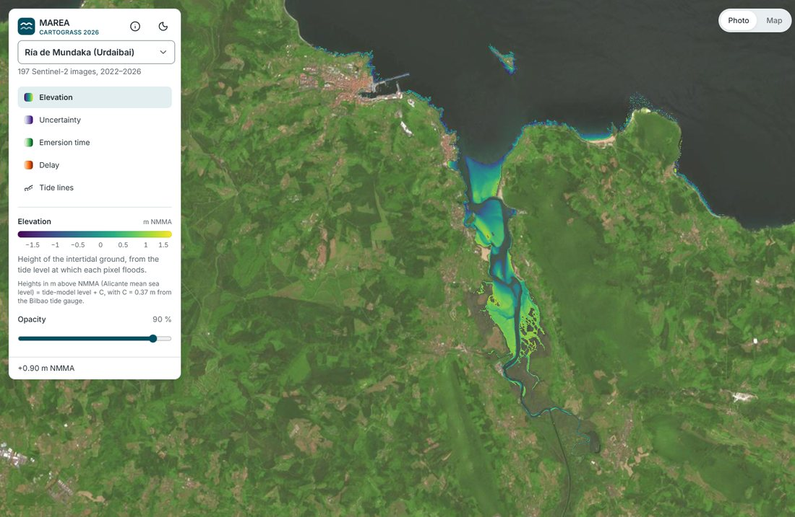
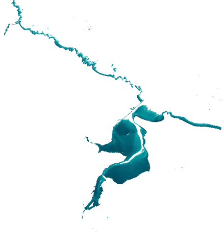
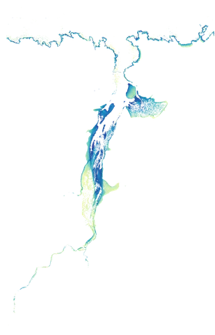
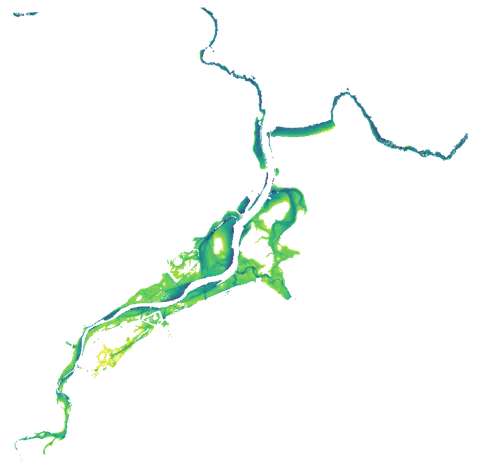
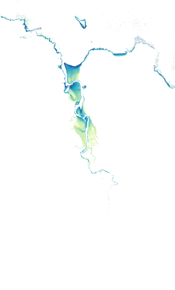

# MAREA: a method for mapping intertidal topography using Sentinel-2 openEO data cubes

MAREA maps the height of tidal flats at 10 m from years of Sentinel-2 images and a tide
record: for every pixel it finds the tide level at which the ground turns from dry to wet.
Inside an estuary the tide arrives late, so MAREA first reads that delay from the same
images, section by section along the channel, and corrects for it; it also gives each
pixel's emersion time, the share of time it is out of the water.

**Explore the maps: <https://coastal-ai.github.io/Intertidal_analysis/>**. Four estuaries
of northern Spain, with the elevation in m above NMMA, its uncertainty, the emersion time
and the delay of the tide.

[](https://coastal-ai.github.io/Intertidal_analysis/#site=mundaka&layer=elevation)

*The map viewer at the Ría de Mundaka (Urdaibai): elevation over the PNOA orthophoto
(© Instituto Geográfico Nacional, CC BY 4.0 scne.es). Contains modified Copernicus
Sentinel data.*

| [Ría de Foz](https://coastal-ai.github.io/Intertidal_analysis/#site=foz&layer=elevation) | [Ría del Eo](https://coastal-ai.github.io/Intertidal_analysis/#site=eo&layer=elevation) | [Ría de Villaviciosa](https://coastal-ai.github.io/Intertidal_analysis/#site=villaviciosa&layer=elevation) | [Ría de Mundaka](https://coastal-ai.github.io/Intertidal_analysis/#site=mundaka&layer=elevation) |
|:-:|:-:|:-:|:-:|
| [](https://coastal-ai.github.io/Intertidal_analysis/#site=foz&layer=elevation) | [](https://coastal-ai.github.io/Intertidal_analysis/#site=eo&layer=elevation) | [](https://coastal-ai.github.io/Intertidal_analysis/#site=villaviciosa&layer=elevation) | [](https://coastal-ai.github.io/Intertidal_analysis/#site=mundaka&layer=elevation) |

Companion repository of our poster at **CARTOGRASS 2026**, Simposio Ibérico de Cartografía
y Seguimiento de Praderas Marinas, Cartagena, 24–26 November 2026, by
**Jorge Alías Álvarez**¹, **Fernando García-González**² and **Pablo González**¹
(¹ University of Oviedo, Spain; ² Instituto Español de Oceanografía, IEO-CSIC, Spain).

**How to cite:** Alías Álvarez, J., García-González, F., González, P. (2026). MAREA: a
method for mapping intertidal topography using Sentinel-2 openEO data cubes. Poster,
CARTOGRASS 2026, Cartagena, Spain. ([BibTeX](#how-to-cite))

**Try it:** [notebook 01 on Binder](https://mybinder.org/v2/gh/coastal-AI/Intertidal_analysis/CARTOGRASS26?labpath=notebooks%2F01_marea_villaviciosa.ipynb)
(nothing to install) · [quick start](#quick-start) (about 10 minutes with the installation) ·
[notebooks](#notebooks) ·
[map your own estuary](guide/NEW_ESTUARY.md) · [how MAREA works](guide/METHOD.md)

[](LICENSE)
[](LICENSE-docs.md)
[](https://mybinder.org/v2/gh/coastal-AI/Intertidal_analysis/CARTOGRASS26?labpath=notebooks%2F01_marea_villaviciosa.ipynb)
[](https://nbviewer.org/github/coastal-AI/Intertidal_analysis/tree/CARTOGRASS26/notebooks/)

## In short

For every 10 m pixel of a tidal flat, MAREA maps the elevation of the ground with its
uncertainty, and its emersion time, the share of time the ground is out of the water. A
pixel on a flat is photographed many times, at different stages of the tide. How wet it
looks in each image, together with the water level at that moment, fixes its elevation.

Global tide models give that water level at the open coast. Inside an estuary, though,
the tide arrives later: by more than an hour at the head of the Ría de Mundaka. MAREA
reads this delay from the images themselves, one delay for each 3-km section along the
channel (zero in the section at the mouth, never decreasing inland). A smooth curve
through those delays then gives every pixel its own delay; MAREA shifts the tide by it and
only then fits the pixel's elevation.

The images come as openEO data cubes from the Copernicus Data Space Ecosystem. The tide
comes from the global model EOT20, averaged at three of the four sites with the nearest
tide gauge. Elevation and emersion time together are a base layer for the potential
habitat of *Nanozostera noltei*. (*Marea* is Spanish for tide.)

## Explore the maps

The map viewer, <https://coastal-ai.github.io/Intertidal_analysis/>, shows MAREA's maps of
four estuaries of northern Spain, from west to east: the Ría de Foz, the Ría del Eo, the
Ría de Villaviciosa and the Ría de Mundaka (Urdaibai). Each map is drawn only inside an
intertidal mask cleaned by hand, which removes the water-detection noise at sea and along
the open coast.

| layer | what it shows |
|---|---|
| Elevation | height of the ground, in m above NMMA (mean sea level at Alicante) |
| Uncertainty | width σ of each pixel's dry-to-wet transition, in m |
| Emersion time | share of the hours the ground is out of the water, in % |
| Delay | how many minutes after the mouth the tide reaches each pixel; at Mundaka, with lines of equal delay |
| Tide lines | elevation contours at the tidal datums (low water of neap tides, mean sea level, …) |

The delay of each pixel comes from a smooth curve through the section delays, which pulls
the innermost values down: at Mundaka the map's delays reach 80 min, while the fitted
delay of the last section is 97 min. How the heights, layers and files are defined:
[`guide/DATA.md`](guide/DATA.md). To run the viewer on your own machine:
[Website](#website).

## Quick start

Python 3.13. Installing takes about 8 minutes and 1 GB of disk (pip's "Installing collected
packages" step stays silent for about 5 minutes); the first map follows in about a minute.

```bash
git clone --depth 1 --branch CARTOGRASS26 https://github.com/coastal-AI/Intertidal_analysis.git
cd Intertidal_analysis
python -m venv .venv
source .venv/bin/activate
pip install -r requirements.txt
python -X utf8 scripts/reproduce_villaviciosa.py --from-kit replication
```

**On Windows**, clone into a short folder such as `C:\src\`: some of the installed files have
long paths, and pip fails when the clone's folder path is longer than about 110 characters
(or enable long paths in Windows, which needs an administrator). Calling the environment's
Python directly avoids PowerShell's activation rules:

```powershell
py -3.13 -m venv .venv
.venv\Scripts\python -m pip install -r requirements.txt
.venv\Scripts\python -X utf8 scripts\reproduce_villaviciosa.py --from-kit replication
```

With conda or mamba, create the environment with `mamba env create -f environment.yml` and
`mamba activate marea-cartograss26` instead of the `venv` and `pip` lines.

Run everything from the repository root: the library is used from the checkout, not
pip-installed, and `marea.reconstruct` reads `configs/m2.yaml` from the source tree. The
packages pyTMD, eo-tides and openeo are needed only for a new estuary and for Route B of
[`guide/REPRODUCE.md`](guide/REPRODUCE.md); `requirements.txt` installs them all the same.

The last command rebuilds the published 10 m map of the Ría de Villaviciosa
([`products_marea/`](products_marea/README.md)) from the offline kit in
[`replication/`](replication/README.md): the delay of each section, then the elevation
and uncertainty of every pixel. It needs no account, no download and no tide model. It
runs in about a minute (55 s on a Windows 10 laptop) with about 0.6 GB of memory,
compares its result with the published files array by array, and ends with:

```
PASS: 41 of 41 checks passed; total ... s
```

It writes into `runs/villaviciosa_repro/`:

* `figure.png`: open it first. The elevation map, the delay against the distance from the
  mouth and the hypsometric curve; its labels are in Spanish (*cota* is elevation).
* `marea.npz` and `result.json`: the product, as described in
  [`guide/DATA.md`](guide/DATA.md#7-the-villaviciosa-product-files).
* `record.json` and `provenance.json`: the record dates, the versions and the inputs.

It writes no GeoTIFF and no emersion time. For a GeoTIFF of the elevation, use the snippet
of [`guide/DATA.md`](guide/DATA.md#7-the-villaviciosa-product-files), pointed at
`runs/villaviciosa_repro/marea.npz`; notebook 01 maps the emersion time.

The tests, the full route from the Sentinel-2 cube and what each check compares:
[`guide/REPRODUCE.md`](guide/REPRODUCE.md).

## Notebooks

| notebook | what it does |
|---|---|
| [`01_marea_villaviciosa`](notebooks/01_marea_villaviciosa.ipynb) | MAREA step by step on real data. In a 2.7 km block of the Ría de Villaviciosa: one pixel's looks against the tide at the mouth and against the delayed tide, and its elevation. Then the delays of the whole ría from the kit, and the maps of elevation, uncertainty, delay and emersion time. |
| [`02_tide_per_image`](notebooks/02_tide_per_image.ipynb) | The tide at the moment of each of the 97 images of 2023–2025: flood or ebb, the delayed level of each section, and how much of the tide range the images cover. |
| [`03_new_ria_openeo`](notebooks/03_new_ria_openeo.ipynb) | How to start a new estuary through openEO, shown for the Marismas de Santoña: the box and its check, a credit estimate and the download call. The download is off by default (`RUN_DOWNLOAD = False`). |

The notebooks are stored with their outputs. Open them on
[Binder](https://mybinder.org/v2/gh/coastal-AI/Intertidal_analysis/CARTOGRASS26?labpath=notebooks%2F01_marea_villaviciosa.ipynb)
(nothing to install), read them on
[nbviewer](https://nbviewer.org/github/coastal-AI/Intertidal_analysis/tree/CARTOGRASS26/notebooks/),
or run them locally. JupyterLab is not in `requirements.txt`: `pip install jupyterlab`,
then `jupyter lab`, or run a notebook without opening it:

```bash
jupyter nbconvert --to notebook --execute notebooks/01_marea_villaviciosa.ipynb
```

which writes `notebooks/01_marea_villaviciosa.nbconvert.ipynb` (git ignores it). Notebook
01 runs in about a minute, 02 and 03 in seconds. On Windows, a pyzmq warning about the
"Proactor event loop" and a numpy warning that "ndarray size changed" may appear; both are
harmless.

## Map your own estuary

Once you have a Sentinel-2 cube of your estuary (notebook 03 shows the openEO download)
and a tide record, [`scripts/quickstart.py`](scripts/quickstart.py) makes the maps in one
call, `map_estuary(cube, tide, out_dir, mouth_side=...)`; its docstring lists every
argument. [`guide/NEW_ESTUARY.md`](guide/NEW_ESTUARY.md) explains the rest: what you need,
the rules for drawing the box (reach the open sea, keep the head of tide inside, one exit
to the sea, one estuary per box), a box check that runs offline on the Villaviciosa kit,
the functions you call, what comes out and how to judge it.

## MAREA in six steps

Each look at a pixel is a point on its flooding curve:

$$\mathrm{NDWI} = a + b\,\Phi\left(\frac{h(t-\tau)-z}{\sigma}\right)$$

where h(t − τ) is the tide at the mouth τ minutes before the image, τ the pixel's delay,
z the elevation (the midpoint of the curve), σ the width of the curve, a and a + b the
NDWI of the pixel when dry and when wet, and Φ the normal cumulative distribution, an
assumed S shape ([`guide/METHOD.md`](guide/METHOD.md#2-one-pixel-seen-many-times)).

1. **Seen many times.** Each cloud-free Sentinel-2 view of the pixel gives its NDWI, a
   water index from green and near-infrared light: high when the pixel is wet, low when
   it is dry.
2. **Its tide arrives late.** The tide at the mouth (global tide model and gauges)
   reaches the pixel some minutes later: the pixel is wet when that water stands above
   its ground. MAREA shifts that tide in time, not in height.
3. **Its delay.** One delay for each 3-km section, the one that best splits the wet and
   dry looks of its pixels, judged together: zero at the mouth, it can only grow inland.
   A smooth curve through the section delays then gives each pixel its own.
4. **Its elevation.** The midpoint of its flooding curve on its delayed tide; the width of
   the curve is the uncertainty. A pixel whose curve its own looks cannot fix is left
   empty.
5. **Its emersion time.** The share of time its delayed tide stays below its ground, at
   all times of the tide record, not only at image times.
6. **All pixels: the maps.** Elevation with its uncertainty, and emersion time: the base
   layer for the potential habitat of *Nanozostera noltei*.


*From Sentinel-2 images to an elevation map, Ría de Villaviciosa, 2023–2025 (real data):
(a) images from low to high tide; (b) water or not; (c) one pixel's 97 looks against the
tide that reaches it, with its fitted flooding curve; (d) the same fit at every pixel.
Heights on the tide model's scale (add 0.38 m for NMMA).*

Reading elevation from the tide at which pixels turn wet follows NDWI–tide methods such as
DEA Intertidal (Bishop-Taylor et al. 2019); reading the delay from the images builds on
Granadeiro et al. (2021). The method in more detail, with real figures:
[`guide/METHOD.md`](guide/METHOD.md). In the code, these six steps run as the 11
processing steps listed in its
[section 10](guide/METHOD.md#10-the-steps-in-the-code), the numbering that the scripts,
the notebooks and the guides use.

## Limits

* Heights are read on the zero of the tide used; the viewer adds a constant per site to
  give m above NMMA, known to 0.04–0.06 m (1σ).
* Sentinel-2 passes at about the same time every day and never sees the highest tides. No
  elevation is read above the highest level the images saw: at Villaviciosa they span
  −2.17 to +1.15 m of a tide that runs from −2.40 to +2.41 m.
* The delay is read in time only; how much the tide is amplified or damped inside the
  estuary is not.
* The S-shaped flooding curve is a modelling assumption
  ([`guide/METHOD.md`](guide/METHOD.md#2-one-pixel-seen-many-times)).
* The checks in this repository compare a run with the published product. They are not
  an accuracy assessment against field surveys, which this repository does not include.

## Repository structure

```
pyintertidal/            the MAREA library (22 modules)
configs/                 settings the library reads (m2.yaml, overpass_corrections.json)
scripts/                 reproduce_villaviciosa.py, quickstart.py and their helpers (marea_tools.py, sites/)
replication/             offline replication kit of the Villaviciosa map (12.5 MB)
products_marea/          the 10 m MAREA product of the Ría de Villaviciosa, 2023–2025
products_villaviciosa/   the reference 10 m grid of Villaviciosa
notebooks/               three example notebooks, with their outputs
data/                    a small real sample for notebooks 01 and 02
tests/                   unit tests and a fast end-to-end reproduction
guide/                   how MAREA works, how to reproduce it, a new estuary, the data
site/                    source of the map viewer (React, Tailwind CSS, MapLibre GL JS)
docs/                    the built map viewer, served by GitHub Pages
poster/                  about the poster: title, authors, format, licence
```

At the root: `requirements.txt` and `environment.yml` (the pinned environment),
`CITATION.cff`, `CHANGELOG.md`, `LICENSE` and `LICENSE-docs.md`.

## Website

The website is the map viewer, <https://coastal-ai.github.io/Intertidal_analysis/>. Its
source is in [`site/`](site/README.md) (React, Tailwind CSS and MapLibre GL JS);
`cd site && npm ci && npm run build` writes the static site to [`docs/`](docs/), which
GitHub Pages serves from this branch. To run the viewer on your own machine, with Node 22
or newer:

```bash
cd site
npm ci
npm run preview          # then open http://localhost:4173/Intertidal_analysis/
```

`npm run preview` serves the built copy in `docs/` (about 30 s for both commands). How to
build it for another address: [`site/README.md`](site/README.md).

## Code and data availability

* **Code:** this branch, `CARTOGRASS26`:
  <https://github.com/coastal-AI/Intertidal_analysis/tree/CARTOGRASS26>.
* **The maps of the four sites:** in the map viewer; their layer images and value images
  are in [`site/public/data/`](site/public/data/) (formats, and how to turn them into
  GeoTIFFs, in [`guide/DATA.md`](guide/DATA.md#6-map-viewer-files)). CC BY 4.0.
* **The Villaviciosa product and its replication kit:**
  [`products_marea/`](products_marea/README.md) and
  [`replication/`](replication/README.md). CC BY 4.0.
* **Notebook sample:** [`data/`](data/README.md), a real 2.7 km block of the Ría de
  Villaviciosa with its 97 images and tide. CC BY 4.0.
* **The Villaviciosa Sentinel-2 cube** (3.09 GB, 2016–2025) from which the kit was made:
  not public yet. The kit holds what the method read from it.
* **Sentinel-2 L2A:** free from the
  [Copernicus Data Space Ecosystem](https://dataspace.copernicus.eu/), through openEO
  (free account; downloads spend processing credits).
* **EOT20 tide model:** SEANOE, <https://doi.org/10.17882/79489> (CC BY 4.0); not
  redistributed here.
* **Tide gauges:** IOC Sea Level Station Monitoring Facility,
  <https://www.ioc-sealevelmonitoring.org/>, <https://doi.org/10.14284/482>, for
  non-commercial use (CC BY-NC 4.0); not redistributed here.

## Credits

* Contains modified Copernicus Sentinel data (2015–2026), processed with openEO on the
  Copernicus Data Space Ecosystem.
* Tide model EOT20 (Hart-Davis et al. 2021), CC BY 4.0.
* Tide gauges Ferrol 2 and Bilbao 3: IOC Sea Level Station Monitoring Facility (VLIZ,
  IOC-UNESCO), for non-commercial use (CC BY-NC 4.0); stations of Puertos del Estado.
* Website basemaps: PNOA orthophoto and IGN base map, © Instituto Geográfico Nacional de
  España (CC BY 4.0, scne.es), loaded at run time.

## How to cite

Until the paper on the method is published, please cite the poster:

> Alías Álvarez, J., García-González, F., González, P. (2026). MAREA: a method for
> mapping intertidal topography using Sentinel-2 openEO data cubes. Poster, CARTOGRASS
> 2026, Simposio Ibérico de Cartografía y Seguimiento de Praderas Marinas, Cartagena,
> Spain, 24–26 November 2026.

```bibtex
@misc{alias2026marea,
  author       = {Al{\'\i}as {\'A}lvarez, Jorge and Garc{\'\i}a-Gonz{\'a}lez, Fernando and Gonz{\'a}lez, Pablo},
  title        = {{MAREA}: a method for mapping intertidal topography using {Sentinel-2} {openEO} data cubes},
  howpublished = {Poster, CARTOGRASS 2026, Simposio Ib{\'e}rico de Cartograf{\'\i}a y Seguimiento de Praderas Marinas, Cartagena, Spain, 24--26 November 2026},
  year         = {2026},
  month        = nov,
  note         = {Code: \url{https://github.com/coastal-AI/Intertidal_analysis/tree/CARTOGRASS26}}
}
```

The software and its data are described in [`CITATION.cff`](CITATION.cff).

## Licences

* Code: MIT ([`LICENSE`](LICENSE)).
* Text, figures and data: CC BY 4.0 ([`LICENSE-docs.md`](LICENSE-docs.md)).
* Third-party data keep their own licences
  ([`guide/DATA.md`](guide/DATA.md#9-licences-and-attribution)).
* The website bundles open-source libraries (MapLibre GL JS, React, Lucide icons, clsx
  and the Inter font); their licences are in [`docs/licenses/`](docs/licenses/).
* The poster: CC BY 4.0, except the institutional and congress logos.

## Acknowledgements

This work has been funded by Agencia de Ciencia, Competitividad Empresarial e Innovación
Asturiana (Sekuens) within the program “Grants for research groups from organizations in
the Principado de Asturias, 2024” (GRU-GIC-24-018).

## Contact

Questions about the code or the maps: please open an issue on GitHub,
<https://github.com/coastal-AI/Intertidal_analysis/issues>.

## References

1. Bishop-Taylor, R. et al. (2019). Between the tides: modelling the elevation of
   Australia's exposed intertidal zone at continental scale. *Estuarine, Coastal and
   Shelf Science* 223, 115–128.
2. Granadeiro, J. P. et al. (2021). Using Sentinel-2 images to estimate topography,
   tidal-stage lags and exposure periods over large intertidal areas. *Remote Sensing*
   13(2), 320.
3. Hart-Davis, M. G. et al. (2021). EOT20: a global ocean tide model from multi-mission
   satellite altimetry. *Earth System Science Data* 13, 3869–3884.
   <https://doi.org/10.5194/essd-13-3869-2021>
4. Schramm, M. et al. (2021). The openEO API – harmonising the use of Earth observation
   cloud services using virtual data cube functionalities. *Remote Sensing* 13(6), 1125.
