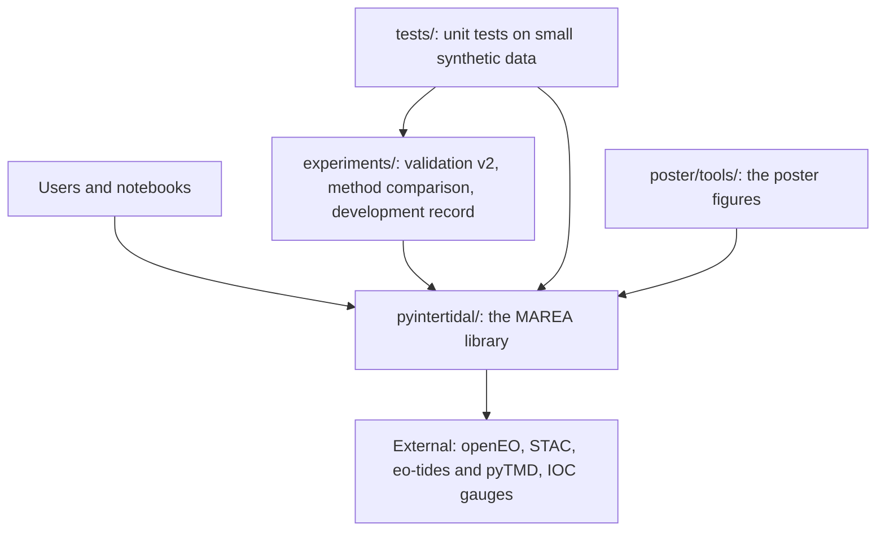
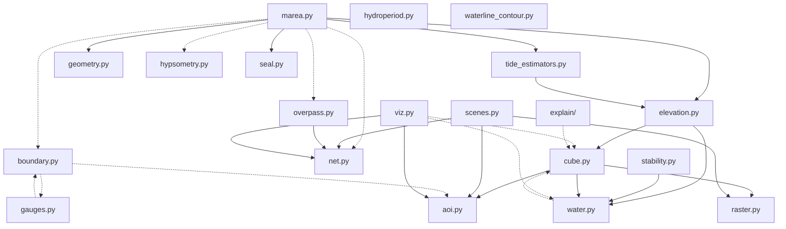
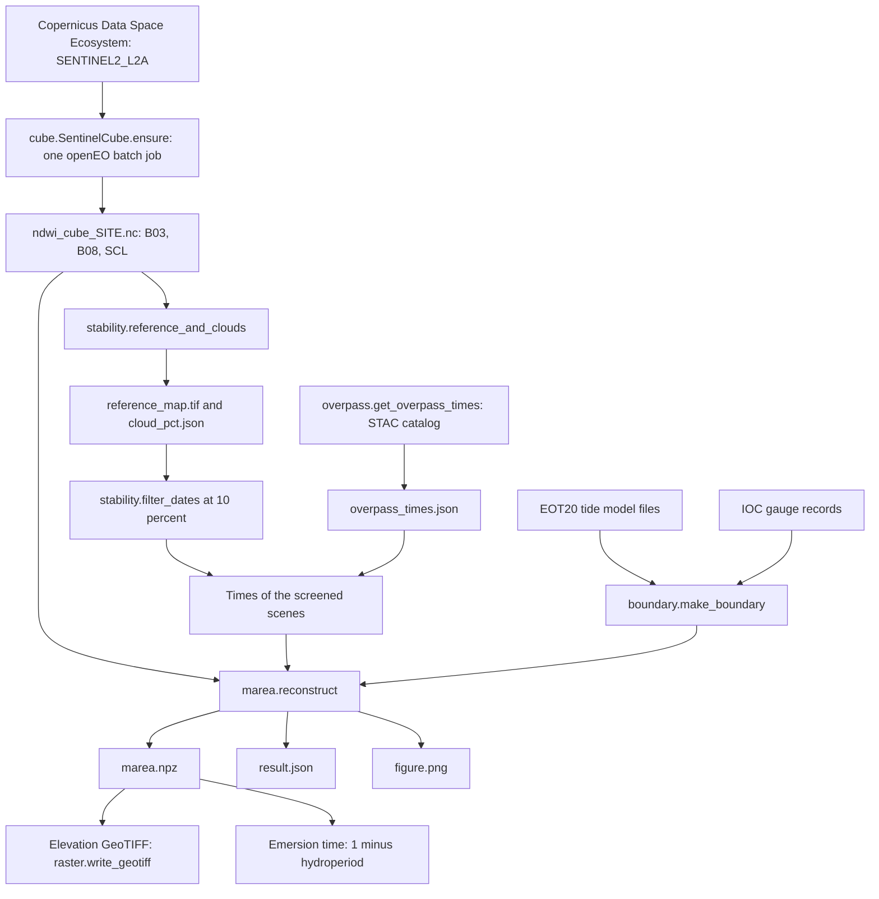
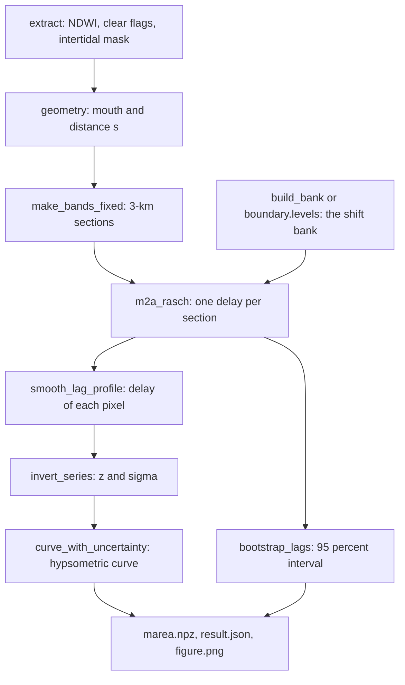
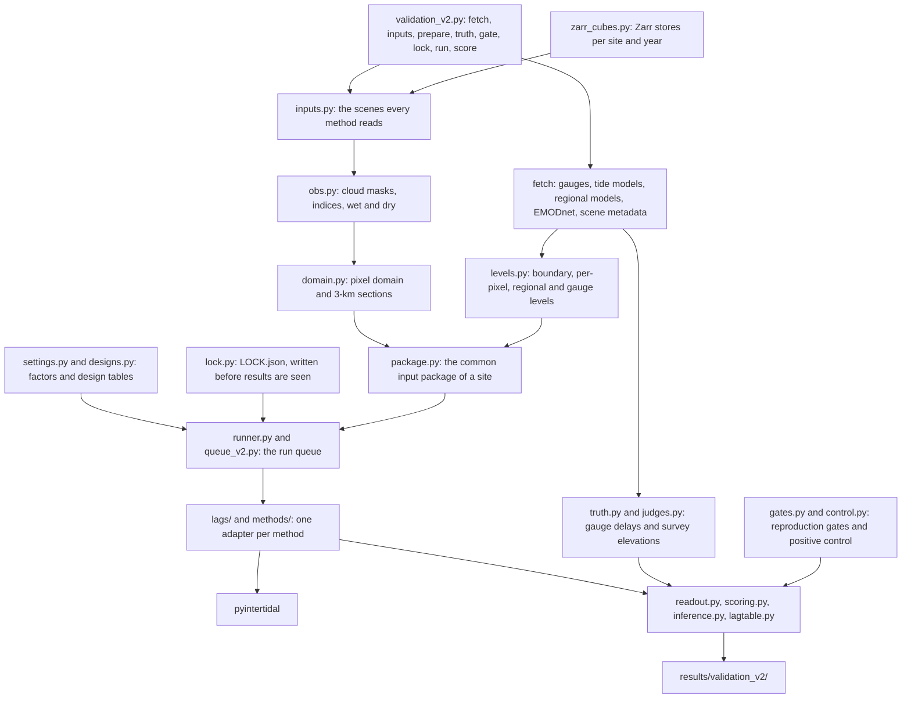
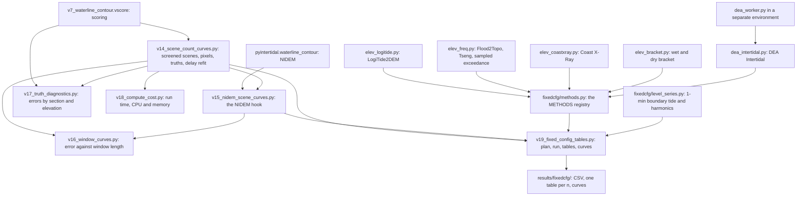

# Architecture of the code

*How the repository is organized: the library, the scripts that use it, and
how data flows from the satellite archive to the product files.*

The method itself is in [`METHOD.md`](METHOD.md); the files the code writes
are in [`products.md`](products.md); the function-by-function reference of
the older layers of the library is [`../pyintertidal/CATALOG.md`](../pyintertidal/CATALOG.md).

## Contents

1. [Three layers](#1-three-layers)
2. [The modules of pyintertidal and how they depend on each other](#2-the-modules-of-pyintertidal-and-how-they-depend-on-each-other)
3. [What each module does](#3-what-each-module-does)
4. [From download to product files](#4-from-download-to-product-files)
5. [The experiments layer](#5-the-experiments-layer)
6. [Design choices](#6-design-choices)

## 1. Three layers

* **`pyintertidal/`** is the library. Every script and test imports it;
  nothing in it imports `experiments/`.
* **`experiments/`** holds the scripts: validation v2 and its harness, the
  method comparison on the existing 10 m inputs, and the development record.
* **`tests/`** checks the library and the harness on small synthetic sites.

## 2. The modules of pyintertidal and how they depend on each other

An arrow means "imports". Dotted arrows are imports made inside a function
(they load only when that function runs).

Three modules stand apart:

* `stability.py` reads a cube through the `SentinelCube` interface it is
  given, so it imports only `water.py`; `marea.reconstruct` does not import
  it: the caller screens the scenes and passes their times.
* `hydroperiod.py` imports nothing from the package: it turns the stored
  elevations into emersion time after `reconstruct`.
* `waterline_contour.py` (the re-implementation of NIDEM, the main
  competitor) imports nothing from the package, so it cannot share code
  with MAREA by accident.

## 3. What each module does

The modules of the MAREA path first, then the ones around it. Function
names link the table to [`METHOD.md`](METHOD.md), section 17.

| module | what it does | key public functions and classes |
|---|---|---|
| `cube.py` | download a Sentinel-2 L2A cube once with openEO, then stream it in time blocks | `SentinelCube` (`ensure`, `stream`, `dates`), `open_cube` |
| `scenes.py` | openEO connection, available dates, single-scene downloads | `connect`, `available_dates`, `download_scenes` |
| `overpass.py` | acquisition time of every scene, from the STAC catalog | `get_overpass_times` |
| `water.py` | water detection (NDWI by default; MNDWI, AWEI, SCL) and the SCL class sets | `index_block`, `water_land_masks`, `BAD_CLASSES`, `CLEAR_CLASSES` |
| `stability.py` | the reference map (stable water, stable land, transition zone) and the cloud share of each scene | `reference_and_clouds`, `filter_dates`, `date_recovery_gain` |
| `geometry.py` | the mouth and the distance along the water | `mouth_seeds`, `along_distance` |
| `gauges.py` | tide-gauge records: loading, cleaning, comparison with a model | `load_gauge`, `load_cached_ioc`, `despike` |
| `boundary.py` | the water level at the mouth from a tide model, the nearest IOC gauges or their consensus | `make_boundary`, `PyTMDBoundary`, `GaugeBoundary`, `EnsembleBoundary`, `alias_periods` |
| `tide_estimators.py` | the delay estimators; MAREA uses `m2a_rasch` | `ShiftBank`, `make_bands_fixed`, `m2a_rasch`, `bootstrap_lags`, `smooth_lag_profile`, `alpha_nll_profile` |
| `elevation.py` | the per-pixel NDWI-against-tide fit, and the earlier HSR and step methods | `_fit_block`, `fit_hsr`, `fit_step` |
| `marea.py` | MAREA end to end for any cube | `extract`, `invert_series`, `build_bank`, `reconstruct`, `QUALITY_MIN_BRACKET`, `SG_GRID` |
| `hypsometry.py` | area-elevation curve, its envelope and the hypsometric integral | `curve_with_uncertainty`, `hypsometric_curve` |
| `hydroperiod.py` | share of time under water, its complement (emersion time), ecological zones | `hydroperiod`, `exposure_time`, `zonation` |
| `waterline_contour.py` | a re-implementation of ITEM/NIDEM (Sagar et al. 2017; Bishop-Taylor et al. 2019) | `nidem`, `nidem_from_arrays`, `stream_composites` |
| `seal.py` | sealed data files: a hash registry written before the evidence is read | `create_seal`, `verify_seal` |
| `raster.py` | GeoTIFF read and write | `write_geotiff`, `grid_of`, `read_band` |
| `aoi.py`, `sites.py` | study areas as polygons; the registry of named sites | `AOI`, `as_aoi`, `sites.get` |
| `net.py` | network settings shared by every remote call | `use_system_certificates` |
| `viz.py` | maps, profiles and tide plots; every function returns `(fig, ax)` | `plot_map`, `plot_dem`, `plot_cotidal`, `plot_tide_record` |
| `explain/` | diagrams of the data cube and of each operation, in the style of the openEO documentation, and a log of what the pipeline did | `draw_cube`, `draw_operation`, `recording`, `summarize` |

The other modules (tide models, marsh, coverage, terrain, morphodynamics,
validation helpers, the RTK reader, the simulator, export, mosaics, the
re-implementation of Granadeiro et al. 2021 and the legacy methods) are
listed in [`../pyintertidal/README.md`](../pyintertidal/README.md).

## 4. From download to product files

Inside `reconstruct` (the full chain is in [`METHOD.md`](METHOD.md),
section 2):

The validation reads a second kind of cube: one Zarr store per site and
year with nine bands (`experiments/download_cube_zarr.py`, read through
`experiments/zarr_cubes.py`). `reconstruct` reads only the netCDF cube.

## 5. The experiments layer

### Validation v2

One command line, `python -X utf8 -m experiments.validation_v2 <command>`,
over the harness in [`experiments/benchmark/`](../experiments/benchmark/README.md).

### Method comparison on the existing 10 m inputs

The scripts `experiments/v14` to `v19` answer the questions the authors put
on 2026-10-20 and 2026-10-26, from the 10 m inputs and products already made
for each site.

An arrow points from the code that is reused to the script that reuses it.

Each script records, next to its outputs, the git commit and the sha256 of
its own source and of its inputs; v15 and v19 also check the sha256 of v14
before reusing it. The development record (series m, b, p, c, v, w) is
listed in [`../experiments/README.md`](../experiments/README.md).

## 6. Design choices

* **No hidden pipeline.** Each function performs one scientific step, takes
  explicit parameters and returns plain arrays; `reconstruct` is only the
  chain of those steps.
* **One download, then streaming.** Imagery is fetched once per area as a
  cached cube; every product streams it in time blocks, so long archives
  cost time, not memory.
* **Every threshold named.** The delay estimator reads its grids, pixel
  sample and seed from `configs/m2.yaml`; its delay bounds and the other
  thresholds are named constants or function defaults in `marea.py`,
  `tide_estimators.py` and `stability.py`. All of them, with file and line,
  are in the parameter table of [`METHOD.md`](METHOD.md#16-parameter-table).
* **One implementation per idea.** Where several versions of an algorithm
  existed, the package keeps one; `legacy/` keeps the superseded ones that
  the comparisons still need.
* **Code keys.** The validation harness hashes the source files each product
  rests on, so a change to a file, even to a comment, marks the products
  that rest on it as stale.
