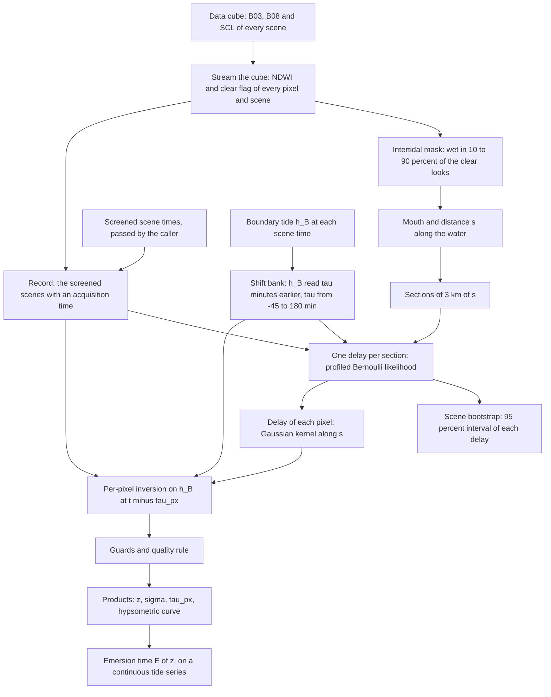
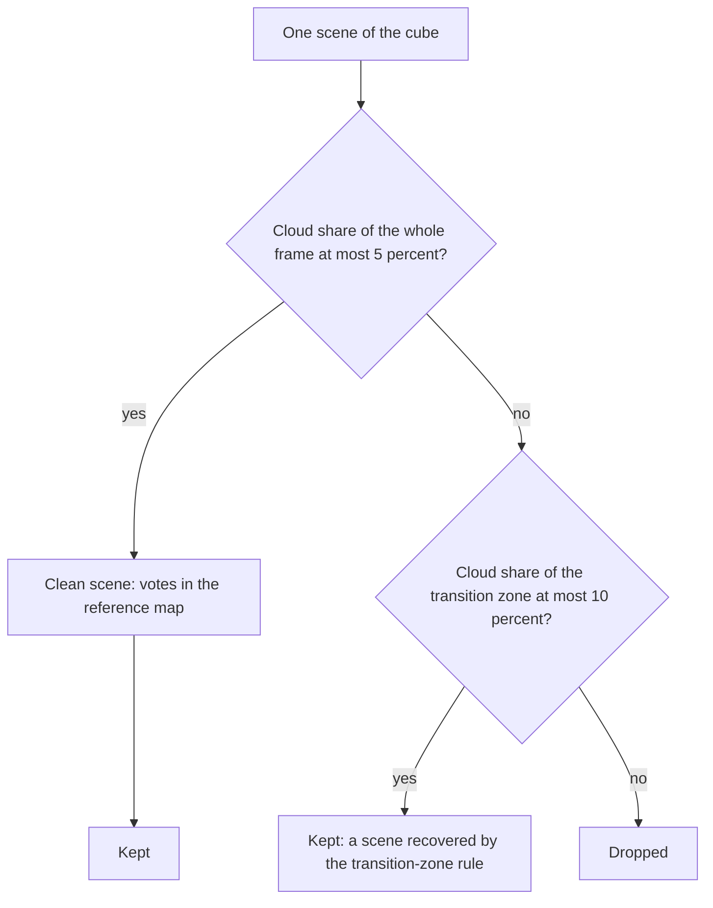
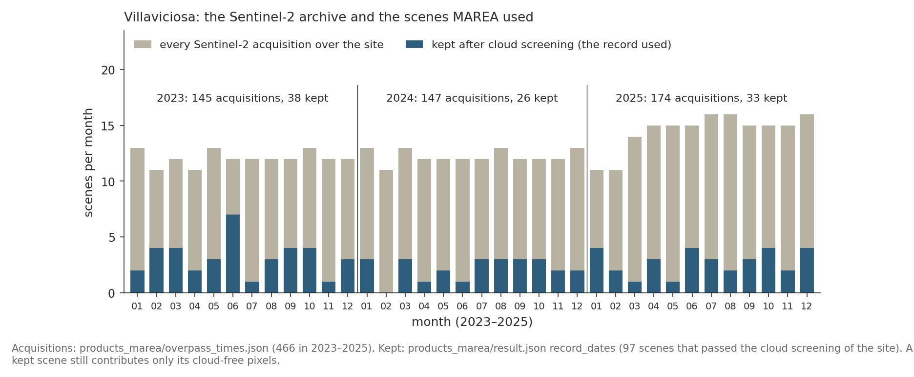
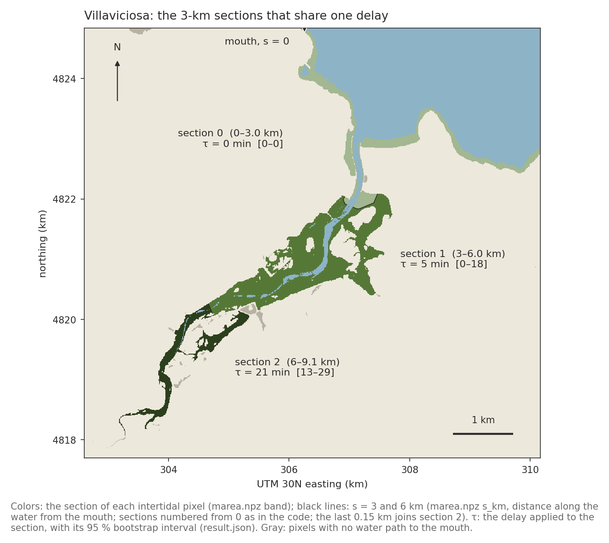
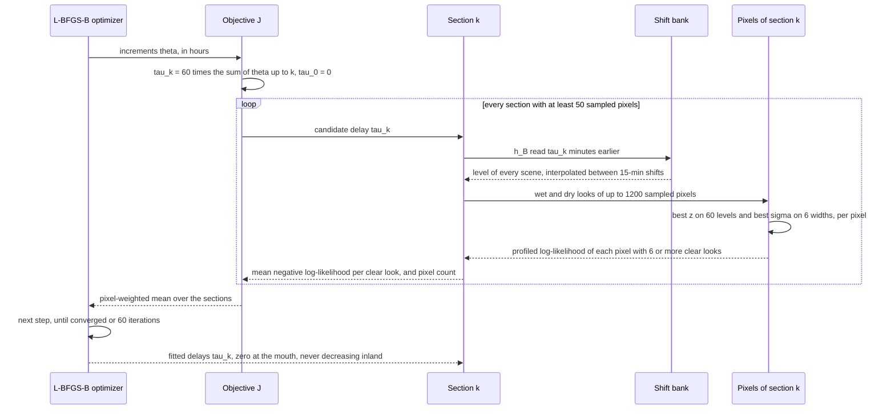
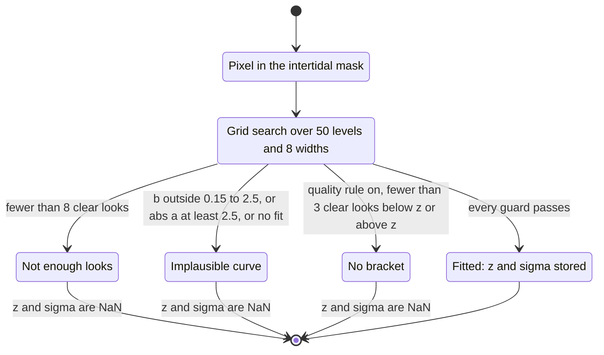
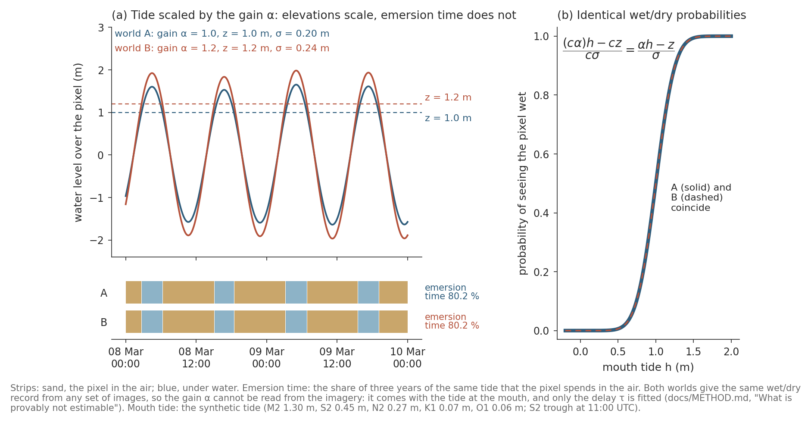
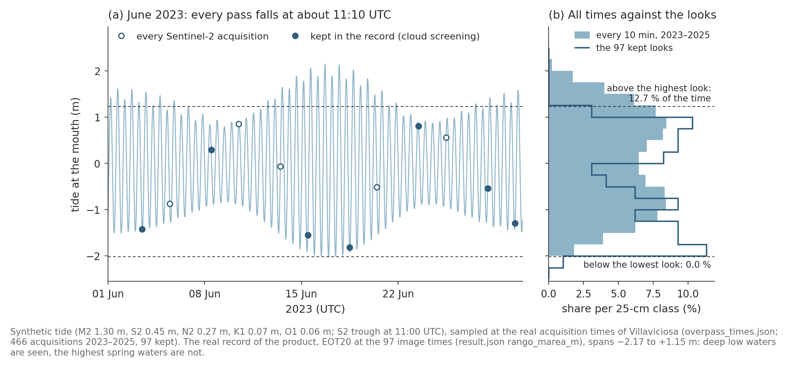

# The MAREA method

*How MAREA turns the Sentinel-2 archive into maps of intertidal elevation,
its uncertainty and emersion time, step by step and formula by formula.*

* **What this page is.** The reference for what the code computes. Every
  formula was checked against the code at the commit that holds this page;
  each one names the function and file it comes from.
* **How to read it.** Sections 1, 2, 7 and 12 carry the ideas in words and
  pictures; the other sections are the reference, step by step.
* **Status.** The validation is in progress (October 2026). This page gives
  no validation result; the design of the validation is in
  [`VALIDATION_DESIGN.md`](VALIDATION_DESIGN.md).
* **Other pages.** The words a non-specialist meets are defined in
  [`GLOSSARY.md`](GLOSSARY.md); the code layout is in
  [`ARCHITECTURE.md`](ARCHITECTURE.md); the files MAREA writes are in
  [`products.md`](products.md); one real pixel followed through the method
  is in [`one_pixel_marea_example.md`](one_pixel_marea_example.md)
  (development state of September 2026).

## Contents

1. [The idea](#1-the-idea)
2. [The algorithm at a glance](#2-the-algorithm-at-a-glance)
3. [Notation](#3-notation)
4. [Looks: NDWI, clear sky and wet or dry](#4-looks-ndwi-clear-sky-and-wet-or-dry)
5. [Scene screening](#5-scene-screening)
6. [The boundary tide](#6-the-boundary-tide)
7. [The pixel model](#7-the-pixel-model)
8. [The delay of each 3-km section](#8-the-delay-of-each-3-km-section)
9. [From sections to pixels: smoothing](#9-from-sections-to-pixels-smoothing)
10. [The per-pixel inversion](#10-the-per-pixel-inversion)
11. [Emersion time and hypsometry](#11-emersion-time-and-hypsometry)
12. [What is provably not estimable](#12-what-is-provably-not-estimable)
13. [Uncertainty](#13-uncertainty)
14. [Sampling limits](#14-sampling-limits)
15. [How elevations are scored](#15-how-elevations-are-scored)
16. [Parameter table](#16-parameter-table)
17. [Where each step lives in the code](#17-where-each-step-lives-in-the-code)

## 1. The idea

A 10 m pixel on a tidal flat is seen by Sentinel-2 hundreds of times, at
every stage of the tide. Each cloud-free view of it (a *look*) says wet or
dry. If the water level at each look is known, the elevation of the pixel is
the level at which it turns from dry to wet. Global tide models give the
level at the open coast, at the mouth of the estuary. Inside the estuary the
tide arrives later, so the level a pixel really saw at time $t$ is the mouth
level of some minutes earlier, $h_B(t - \tau)$. MAREA reads that delay
$\tau$ from the looks themselves, one delay for each 3-km section of
channel, and only then works out the elevation of every pixel.

*Why the delay matters: given the mouth level, some looks of a flat contradict its elevation; given the level inside the estuary, none do. Synthetic tide at the real acquisition times of Villaviciosa.*

## 2. The algorithm at a glance

From the looks to the products. Each box is one step; section 17 gives the
function and the file that run it.

## 3. Notation

| symbol | meaning | units | in the code |
|---|---|---|---|
| $t$ | acquisition time of a scene: the datatake start written in the product name | UTC | `overpass_times.json`; `t_real` in `marea.reconstruct` |
| $T$ | number of scenes in the record | count | `n_escenas` in `result.json` |
| $p$ | an intertidal pixel | – | a column of `Y` and `C`; `keep` |
| $y_{pt}$ | NDWI of pixel $p$ in scene $t$ (NaN set to 0 before fitting) | – | `Y` |
| $c_{pt}$ | 1 if the look is clear (SCL class 4, 5, 6 or 7), else 0 | – | `C` |
| $w_{pt}$, $d_{pt}$ | 1 if the look is clear and wet (or clear and dry) | – | `wet`; `W`, `D` in `_band_nll` |
| $N_p$ | number of clear looks of pixel $p$ | count | `N` in `_fit_block`; `n` in `_band_nll` |
| $f_p$ | water frequency: share of the clear looks seen wet | 0-1 | `wf` in `marea.extract` |
| $s_p$ | distance from the mouth along the water | km | `s_km` |
| $k$ | index of a 3-km section (band), 0 at the mouth | – | `band`, `band_of` |
| $\tilde s_k$ | center of section $k$: the median $s$ of its pixels | km | `centros_km`, `centers` |
| $h_B(t)$ | boundary tide: water level at the mouth | m | `h0 = bank.at(0.0)`, `boundary.levels` |
| $h_B(t; \tau)$ | the boundary tide read $\tau$ minutes earlier | m | `ShiftBank.at(tau)` |
| $\tau_k$ | delay of section $k$ (positive: the water inside is late) | min | `tau_min`, `tau_usado_min` |
| $\theta_j$ | increment of the delay from section $j-1$ to section $j$ | h | `theta` in `m2a_rasch` |
| $\tau_p$ | delay applied to pixel $p$ | whole min | `tau_px_min` |
| $z_p$ | elevation of pixel $p$: midpoint of its flooding curve | m, on the scale of $h_B$ | `z` |
| $\sigma_p$ | width of the flooding curve | m | `sigma` |
| $a_p$, $b_p$ | dry level of NDWI and dry-to-wet jump | NDWI units | `a`, `b` in `_fit_block` |
| $\Phi$ | cumulative standard normal distribution | – | `_phi`, `erf` |
| $E_p$ | emersion time: share of time the corrected tide stays at or below $z_p$ | 0-1 | `1 - hydroperiod(z, h)` |

## 4. Looks: NDWI, clear sky and wet or dry

**NDWI.** The Normalized Difference Water Index (McFeeters 1996): high
over water, low over dry ground. For every pixel and scene it is computed
from the green (B03) and near-infrared (B08) bands, both native 10 m
(`marea.extract`, `pyintertidal/marea.py` lines 88-95):

$$
y_{pt} = \mathrm{NDWI}_{pt} = \frac{\mathrm{B03}_{pt} - \mathrm{B08}_{pt}}{\mathrm{B03}_{pt} + \mathrm{B08}_{pt}}
$$

It is NaN where the denominator is 0; `reconstruct` sets NaN to 0 before
any fit (`marea.py` line 290), so such a clear look counts as dry.

**Clear sky and wet or dry.** A look counts only if the scene
classification (SCL) of the pixel is vegetation, bare soil, water or
unclassified. The wet/dry rule is a fixed threshold at 0
(`marea.py` lines 37, 72-74 and 292):

$$
c_{pt} = \mathbf{1}\left[ \mathrm{SCL}_{pt} \in \lbrace 4, 5, 6, 7 \rbrace \right], \qquad w_{pt} = c_{pt} \cdot \mathbf{1}\left[ y_{pt} \gt 0 \right], \qquad d_{pt} = c_{pt} - w_{pt}
$$

| SCL class | meaning | a MAREA look (`marea.CLEAR`) | cloud in the screening (`water.BAD_CLASSES`) | votes in the reference map (`water.CLEAR_CLASSES`) |
|---|---|---|---|---|
| 0 | no data | no | no | no |
| 1 | saturated or defective | no | no | no |
| 2 | dark area | no | no | no |
| 3 | cloud shadow | no | **yes** | no |
| 4 | vegetation | **yes** | no | **yes** |
| 5 | bare soil | **yes** | no | **yes** |
| 6 | water | **yes** | no | **yes** |
| 7 | unclassified | **yes** | no | no |
| 8 | cloud, medium probability | no | **yes** | no |
| 9 | cloud, high probability | no | **yes** | no |
| 10 | thin cirrus | no | **yes** | no |
| 11 | snow or ice | no | no | no |

(`water.CLEAR_CLASSES` also lists class 12, a project extension for flooded
marsh that Sentinel-2's own SCL never contains.)

**The intertidal mask.** From the water frequency of every pixel over
**every scene of the cube**, before any screening
(`marea.extract`, `marea.py` lines 65-80):

$$
f_p = \frac{\sum_t w_{pt}}{\sum_t c_{pt}}, \qquad \text{defined where } \sum_t c_{pt} \gt 30
$$

* intertidal: $0.10 \lt f_p \lt 0.90$ (the pixels MAREA maps, `keep`);
* permanent sea: $f_p \ge 0.90$.

A cube with fewer than 3,000 intertidal pixels stops here
(`result.json` status `sin_intermareal`, `marea.py` line 259).

**The mouth and the distance along the water.** The mouth is the set of
permanent-sea pixels on the frame edge (all edges, or the edges named by
`mouth_side`; `geometry.mouth_seeds`). The distance $s_p$ is the shortest
path from the mouth to the pixel through sea and intertidal pixels only,
moving between 8-connected neighbors, each step costing its length (10 m,
or $10\sqrt{2}$ m on a diagonal; `geometry.along_distance`, which uses
`skimage.graph.MCP_Geometric`). Pixels that water cannot reach have no $s$.

**The record.** `reconstruct` keeps the scenes of the cube that have an
acquisition time in the `overpass_times` it is given (or, without it, in
the STAC catalog). The production runs passed only the times of the
screened scenes (section 5), so the record is the screened scenes. A record
shorter than `min_scenes` is refused (default 80; the production runs used
40; `result.json` status `pocas_escenas`).

## 5. Scene screening

A scene that is overcast over the whole frame can still be clear over the
estuary. The screening keeps such scenes. It is done by the caller, before
`reconstruct`, with two streaming passes over the cube
(`stability.reference_and_clouds`, then `stability.filter_dates`).

**Pass 1: the reference map.** The cloud share of scene $t$ over the whole
frame of $H \times W$ pixels is

$$
g_t = \frac{1}{HW} \sum_{\text{pixels}} \mathbf{1}\left[ \mathrm{SCL} \in \lbrace 3, 8, 9, 10 \rbrace \right]
$$

A scene is *clean* when $g_t \le 0.05$. Only clean scenes vote. In each, a
pixel votes wet if it is clear (SCL 4, 5, 6) and its NDWI is above 0, and
votes dry if it is clear and its NDWI is at or below 0. With $V^{w}_p$ wet
votes and $V^{d}_p$ dry votes:

* class 1, stable water: $V^{w}_p / (V^{w}_p + V^{d}_p) \ge 0.95$;
* class 2, stable land: $V^{d}_p / (V^{w}_p + V^{d}_p) \ge 0.95$;
* class 0, transition zone: every other pixel (including pixels with no
  vote), then grown by 10 pixels (10 iterations of a binary dilation,
  `transition_buffer_px`) so that narrow fringes are not missed.

**Pass 2: the cloud share of each scene.** For a clean scene it is $g_t$.
For any other scene it is the share of the transition-zone pixels whose SCL
class is 3, 8, 9 or 10. Call it $\kappa_t$ (`cloud_pct`, in percent in the
file).

**The rule.** A scene is kept when $\kappa_t \le 0.10$
(`filter_dates(cloud_pct, 0.10)`). In words: a scene is kept if at most 5 %
of the frame is cloudy, or, failing that, if at most 10 % of the transition
zone is cloudy.

*The archive and the record at Villaviciosa, month by month: every acquisition, and the scenes kept by the screening.*

## 6. The boundary tide

$h_B(t)$ is the water level at the mouth at the acquisition time of each
scene, in meters about mean sea level. It comes from the global tide model
EOT20 and, where they exist, from tide gauges at the mouth
(`boundary.make_boundary`).

**EOT20.** Predicted with eo-tides and pyTMD at the center of the area of
interest (`boundary.PyTMDBoundary`; `reconstruct` without a boundary uses
the center of the cube's bounding box, `marea.build_bank`), with
extrapolation to the nearest ocean cell switched on.

**Gauges.** The $n$ nearest stations of the IOC Sea Level Station
Monitoring Facility within 400 km, skipping the stations held out as checks
(`exclude`). Each record is cleaned (`gauges.despike`: a sample more than
0.75 m from the 61-minute rolling median, more than 6 m from the record
median, or more than 2.5 m from the record's own harmonic fit is dropped)
and centered on its median, which removes each harbor's datum:

$$
\tilde g_i(t) = g_i(t) - \operatorname{median}_{t'} g_i(t')
$$

A gauge is read at any instant by linear interpolation in time, and is
missing (NaN) at an instant more than 1 h from both neighboring samples
(`GaugeBoundary`). The gauges are blended by inverse squared distance $d_i$
(km, at least 1 km), over the gauges $F(t)$ that have a value at $t$
(`InterpolatedGauges`):

$$
h_G(t) = \frac{\sum_{i \in F(t)} \omega_i \tilde g_i(t)}{\sum_{i \in F(t)} \omega_i}, \qquad \omega_i = \frac{d_i^{-2}}{\sum_j d_j^{-2}}, \qquad d_i \ge 1\ \mathrm{km}
$$

**The consensus.** With both a model and gauges, $h_B$ is the plain mean of
the members that have a value at $t$ (`EnsembleBoundary`, `numpy.nanmean`):
where no gauge has data, $h_B$ is EOT20 alone.

$$
h_B(t) = \frac{1}{\lvert M(t) \rvert} \sum_{m \in M(t)} h_m(t), \qquad M(t) \subseteq \lbrace h_{\mathrm{EOT20}}, h_G \rbrace
$$

| site | boundary members | gauges held out as checks (`exclude`) |
|---|---|---|
| Ría de Villaviciosa | EOT20 alone | – |
| Ría de Ferrol | EOT20 + 1 gauge (IOC `fer1`) | `fer2` |
| Westerschelde | EOT20 + 2 gauges (IOC `vlis`, `brsk`) | `trnz` |
| Wadden Sea (Vlie) | EOT20 + 1 gauge (IOC `ters`) | `harl` |
| Ems-Dollard | EOT20 + 1 gauge (IOC `bork`) | `delf` |

(`experiments/benchmark/config.py`, `BOUNDARY` and `HELD_OUT`; the member
codes are those of `docs/validation_v2_spec.md` §1.1.)

**The vertical scale.** EOT20 is a tide prediction about mean sea level and
the gauges are centered on their median, so $h_B$, and every elevation inverted on it, is
on that scale, not on a national datum such as Alicante (Spain) or NAP (the
Netherlands). A comparison with a survey removes the median offset first
and reports it separately as the bias.

**The shift bank.** The delay fit needs $h_B$ read $\tau$ minutes earlier
for any $\tau$. The bank stores the series at 16 shifts
$\tau_j = -45, -30, \dots, 180$ min (`marea.BANK_TAUS`, 15-min steps) and
interpolates linearly between them (`tide_estimators.ShiftBank.at`):

$$
h_B(t; \tau) = (1 - \lambda) h_B(t - \tau_j) + \lambda h_B(t - \tau_{j+1}), \qquad \lambda = \frac{\tau - \tau_j}{\tau_{j+1} - \tau_j}, \qquad \tau_j \le \tau \le \tau_{j+1}
$$

with $\tau$ first clipped to $[-45, 180]$ min.

## 7. The pixel model

The model is derived in four steps.

**Step 1. Linear mixing: where the shape a + b f comes from.** A 10 m pixel
is not simply wet or dry: the sensor averages whatever is inside it. With a
fraction $f$ of the pixel flooded,

$$
\mathrm{NDWI} = (1 - f) \cdot \mathrm{NDWI}_{\mathrm{dry}} + f \cdot \mathrm{NDWI}_{\mathrm{wet}} = a + b f
$$

where $a$ is this pixel's own dry level (its sediment, its brightness) and
$b$ the jump from dry to wet. Because $a$ and $b$ are fitted per pixel,
differences of brightness between pixels are absorbed.

**Step 2. The flooded fraction is a cumulative distribution: geometry, not
hypothesis.** Inside the pixel the ground is not flat. At water level $h$,
exactly the part of the internal terrain lying below $h$ is flooded:
$f(h) = \Pr(\text{internal elevation} \le h)$.

**Step 3. The one real assumption.** The internal micro-elevations are
taken as Gaussian, with mean $z$ (the pixel's elevation) and spread
$\sigma$ (its internal roughness). Micro-relief is the sum of many small
independent irregularities, and the real curves do have that symmetric S
shape. The flooded fraction is then $\Phi\left( (h - z)/\sigma \right)$.

**Step 4. Put together:**

$$
\mathrm{NDWI}(h) = a + b \Phi\left( \frac{h - z}{\sigma} \right)
$$

Read it physically. Far below the ground ($h \ll z$), $\Phi \approx 0$: the
dry pixel, $a$. Far above it, $a + b$: the flooded pixel. At $h = z$ exactly
half of the internal terrain is under water, $\Phi = 1/2$: **the midpoint
of the transition is the elevation.** A flat pixel (small $\sigma$) floods
almost as a step; a rough one floods gradually (a wide S). Two caveats: the
fitted $\sigma$ also absorbs any error in the water level of each look
(`experiments/b2_sigma.py` separates the two), and the wet plateau is not
truly flat: NDWI keeps rising over the first meter of water
(`experiments/p11_ndwi_depth_curve.py`; a richer model,
`experiments/p12_extended_pixel_model.py`, was tried and not adopted).

*The pixel model: the flooded fraction of one pixel at three tide stages, and the S curve they trace.*

*The per-pixel inversion on synthetic looks: the flooding curve, the grid search, and the quality rule.*

## 8. The delay of each 3-km section

### 8.1 Sections of 3 km

The intertidal pixels are cut into sections (*bands* in the code) of
$L = 3$ km of $s$ (`tide_estimators.make_bands_fixed`, `marea.py`
line 312):

$$
k_p^{\mathrm{raw}} = \left\lfloor \frac{s_p}{L} \right\rfloor, \qquad L = 3\ \mathrm{km}
$$

* a section with fewer than 500 pixels is merged with the next one, and a
  thin last section with the one before it, so every section has enough
  pixels to fix its own delay; the number of sections is set by the length
  of the estuary, not chosen;
* the center $\tilde s_k$ of a section is the median $s$ of its pixels;
* section 0 is the one that starts at the mouth;
* pixels without $s$ belong to no section (`band = -1` in `marea.npz`) and
  keep a delay of 0.

*The three 3-km sections of the Villaviciosa product, numbered from 0 as in the code. A product of the method, not a validation result.*

If 5,000 or fewer intertidal pixels have an $s$ (no usable mouth), no delay
is fitted: one section, $\tau = 0$ (`marea.py` line 308).

### 8.2 The likelihood that is maximized

*The binary reduction.* To estimate the tide rather than the terrain, each
clear look is reduced to wet or dry, and the amplitudes $a$, $b$ are fixed
at 0 and 1. Under a candidate delay $\tau_k$ for section $k$, the
probability that pixel $p$ looks wet in scene $t$ is the flooded fraction
at the delayed level, kept away from 0 and 1 (`_band_nll`,
`tide_estimators.py` lines 376-378):

$$
\pi_{pt}(z, \sigma) = \min\left( \max\left( \Phi\left( \frac{h_B(t; \tau_k) - z}{\sigma} \right), 10^{-4} \right), 1 - 10^{-4} \right)
$$

*Profiling.* Each pixel's Bernoulli log-likelihood is maximized over its
own elevation and width, on fixed grids (lines 376-381):

$$
\ell_p(\tau_k) = \max_{z \in \mathcal{Z},\ \sigma \in \mathcal{S}} \sum_{t=1}^{T} \Big[ w_{pt} \log \pi_{pt}(z, \sigma) + d_{pt} \log\left( 1 - \pi_{pt}(z, \sigma) \right) \Big]
$$

The grids (`m2a_rasch`, line 540; `configs/m2.yaml`): $\mathcal{Z}$ is 60
evenly spaced levels from 0.3 m below the lowest to 0.3 m above the highest
zero-delay level of the record, and $\mathcal{S}$ the six widths of
`sigma_perfil_m`:

$$
\mathcal{Z} = \left\lbrace \min_t h_B(t) - 0.3 + \frac{i}{59} \left( \max_t h_B(t) - \min_t h_B(t) + 0.6 \right) : i = 0, 1, \dots, 59 \right\rbrace\ \mathrm{m}
$$

$$
\mathcal{S} = \lbrace 0.06, 0.10, 0.15, 0.22, 0.32, 0.45 \rbrace\ \mathrm{m}
$$

*The score of a section* is its mean negative log-likelihood per clear look,
over its sampled pixels with at least 6 clear looks (lines 382-384). $P_k$
is a seeded random sample of at most 1,200 pixels of section $k$
(`max_px_banda`, seed `20260819 + 31`):

$$
L_k(\tau_k) = - \frac{\sum_{p \in Q_k} \ell_p(\tau_k)}{\sum_{p \in Q_k} N_p}, \qquad Q_k = \lbrace p \in P_k : N_p \ge 6 \rbrace, \qquad N_p = \sum_t c_{pt}
$$

*The objective* weighs the sections by their number of scored pixels, over
the sections with at least 50 sampled pixels (lines 553-566):

$$
J(\theta) = \frac{\sum_k \lvert Q_k \rvert L_k(\tau_k)}{\sum_k \lvert Q_k \rvert}
$$

*Why profile.* To judge a candidate delay, every pixel refits its own
$(z, \sigma)$ to the values that best explain its record under that delay.
Without it, terrain fitted once with no delay and then frozen would make
every other candidate carry a terrain that is wrong through no fault of its
own, and terrain error would pass for evidence about the delay. With it,
each candidate shows its best case, and what decides between delays is what
terrain cannot absorb: a level shift is absorbed by $z$, but a wrong delay
makes the wet/dry pattern contradict the order of the tide across dates
(scene A had more water than scene B, yet A is dry and B wet), and no fixed
elevation can repair a contradiction that changes sign between scenes. Each
pixel's parameters enter only its own terms, so the maximization is
thousands of small independent fits inside a search over a handful of
delays, not one joint fit of tens of thousands of unknowns.

### 8.3 The constraints

The delays are parametrized as non-negative increments from the mouth,
optimized in hours so that every free parameter is of order 1
(`unpack`, lines 543-551):

$$
\tau_0 = 0, \qquad \tau_k = 60 \sum_{j=1}^{k} \theta_j\ \mathrm{min}, \qquad 0 \le \theta_j \le \frac{180}{60}\ \mathrm{h}
$$

$$
\hat\theta = \arg\min_{\theta} J(\theta)
$$

with L-BFGS-B from $\theta = 0$, at most 60 iterations, finite-difference
step $10^{-3}$ h (lines 570-579). What each constraint does:

| constraint | rule | where |
|---|---|---|
| zero at the mouth | $\tau_0 = 0$: the section at the mouth is the anchor, where the ocean model is trusted | `m2a_rasch`, `unpack` |
| monotone, never decreasing inland | $\theta_j \ge 0$, so $\tau_k \ge \tau_{k-1}$; a propagation delay accumulates | `monotone=True` |
| `TAU_BOUNDS` $= (-45, 180)$ min | with the monotone fit only the upper end acts, as the bound of each increment; the shift bank clips any delay to $[-45, 180]$ min, so a summed delay beyond 180 min reads the 180-min tide | `marea.py` line 191; `tide_estimators.py` lines 75, 570 |
| detection threshold `TAU_DETECT_MIN` $= 0$ | $\tau_k^{\mathrm{used}} = \tau_k$ if $\lvert \tau_k \rvert \gt 0$, else 0: every fitted delay is applied as measured | `marea.py` lines 39, 344 |
| causality clip | $\tau_k^{\mathrm{used}} \leftarrow \max(\tau_k^{\mathrm{used}}, 0)$, section by section; `veto_fisico` is true if any was clipped. With the monotone parametrization a fitted delay cannot be negative, so the clip is a guard | `marea.py` lines 351-353 |

The 180-min upper bound was widened from 120 min after the Wadden Sea
comparison with the Harlingen gauge (`marea.py` lines 188-191); the
validation declares it (see [`VALIDATION_DESIGN.md`](VALIDATION_DESIGN.md)).
`configs/m2.yaml` still lists `tau_limites_min: [-30, 120]`, which
`reconstruct` does not read.

### 8.4 The interval of each delay

An estimator always returns some number: with cloud gaps, pixel noise and
uneven sampling, the maximum lands somewhere even where the true delay is
zero. Each section's delay is therefore stated with an interval. A scene
bootstrap draws $B = 30$ resamples of the $T$ scenes with replacement
(`tide_estimators.bootstrap_lags`, seed 20260819, at most 600 pixels per
section, pixel sample seed $20260819 + 100 + b$), refits the delays on each,
and takes the percentiles (`marea.py` lines 327-331):

$$
\tau_k^{\mathrm{lo}} = Q_{0.025}\left( \hat\tau_k^{(1)}, \dots, \hat\tau_k^{(30)} \right), \qquad \tau_k^{\mathrm{hi}} = Q_{0.975}\left( \hat\tau_k^{(1)}, \dots, \hat\tau_k^{(30)} \right)
$$

stored as `tau_lo_min`, `tau_hi_min` and every draw as `tau_boot_min`.
There is no detection threshold, no null gate and no physics veto: the
fitted profile is the applied profile. The simulated null (replica worlds
with the same pixels, cloud masks and acquisition times but no delay by
construction, `pyintertidal.simulator`) remains an experiment that checks
the estimator returns about zero where nothing exists; it is not a gate.

*The delay profile of the Villaviciosa product: one delay per section with its interval, and the delay each pixel receives. A product of the method, not a validation result.*

## 9. From sections to pixels: smoothing

The section is the unit of estimation; the pixel is the unit of
application. The applied section delays are smoothed along $s$ by a
Gaussian kernel whose bandwidth $\rho$ is the section length, with an extra
anchor point $(\tilde s_{-1}, \tau_{-1}) = (0, 0)$ at the mouth
(`tide_estimators.smooth_lag_profile`, lines 454-460):

$$
\tilde\tau(s) = \frac{\sum_{k=-1}^{K-1} \omega_k(s) \tau_k^{\mathrm{used}}}{\sum_{k=-1}^{K-1} \omega_k(s)}, \qquad \omega_k(s) = \exp\left( -\frac{1}{2} \left( \frac{s - \tilde s_k}{\rho} \right)^2 \right), \qquad \rho = 3\ \mathrm{km}
$$

The curve is then made exactly monotone and non-negative, as a running
maximum over the pixels sorted by $s$ (lines 463-467), and rounded to the
nearest whole minute (`numpy.round`, which rounds halves to even;
`marea.py` line 368):

$$
\hat\tau(s_p) = \max\left( 0, \max_{q : s_q \le s_p} \tilde\tau(s_q) \right), \qquad \tau_p = \operatorname{round}\left( \hat\tau(s_p) \right)
$$

Pixels without $s$ get $\tau_p = 0$; with a single section, every pixel gets
$\tau_p = 0$.

## 10. The per-pixel inversion

**The level of each look** is the boundary tide read the pixel's own delay
earlier:

$$
h_p(t) = h_B(t - \tau_p)
$$

With a boundary object (`reconstruct(..., boundary=...)`) it is the exact
level at $t - \tau_p$; with the built-in EOT20 bank it is the bank's linear
interpolation between 15-min shifts (a delay beyond 180 min reads the
180-min series); at $\tau_p = 0$ it is the zero-delay
series (`marea.py` lines 376-391). Pixels sharing a delay are inverted
together.

**The flooding curve** fitted to the NDWI of the clear looks
(`marea.invert_series`, which calls `elevation._fit_block`):

$$
y_{pt} \approx a_p + b_p \Phi\left( \frac{h_p(t) - z_p}{\sigma_p} \right)
$$

**The grid search.** $z$ takes 50 evenly spaced levels from the lowest to
the highest zero-delay level of the record (`rango_marea_m` in
`result.json`; `marea.py` line 373), the same for every pixel whatever its
delay. $\sigma$ takes the eight values of `marea.SG_GRID`: 0.03, 0.06, 0.10,
0.15, 0.22, 0.32, 0.45 and 0.65 m.

**The closed form of a and b.** For each candidate $(z, \sigma)$, with
$\phi_t = \Phi\left( (h_p(t) - z)/\sigma \right)$ and the clear flags
$c_t$ as weights (`elevation.py` lines 236-257):

$$
N = \sum_t c_t, \quad S_y = \sum_t c_t y_t, \quad S_{yy} = \sum_t c_t y_t^2, \quad S_\phi = \sum_t c_t \phi_t, \quad S_{\phi\phi} = \sum_t c_t \phi_t^2, \quad S_{y\phi} = \sum_t c_t y_t \phi_t
$$

$$
\hat b = \frac{N S_{y\phi} - S_\phi S_y}{N S_{\phi\phi} - S_\phi^2}, \qquad \hat a = \frac{S_y - \hat b S_\phi}{N}
$$

$$
\mathrm{SSR}(z, \sigma) = \sum_t c_t \left( y_t - \hat a - \hat b \phi_t \right)^2 = S_{yy} - 2 \hat a S_y - 2 \hat b S_{y\phi} + \hat a^2 N + 2 \hat a \hat b S_\phi + \hat b^2 S_{\phi\phi}
$$

A candidate counts only where $N S_{\phi\phi} - S_\phi^2 \gt 10^{-9}$. The
pair with the smallest sum of squared residuals is kept (the first one met
in a tie; $z$ outer loop, $\sigma$ inner):

$$
(\hat z_p, \hat\sigma_p) = \arg\min_{z \in \mathcal{Z}_{50},\ \sigma \in \mathcal{S}_{8}} \mathrm{SSR}(z, \sigma)
$$

**The guards.** $\hat z_p$ and $\hat\sigma_p$ are kept only if all of these
hold; otherwise both are NaN (`marea.py` lines 135-144):

| guard | rule | parameter |
|---|---|---|
| enough looks | $N_p \ge 8$ | `min_obs=8` |
| a real wet-dry contrast | $0.15 \lt \hat b_p \lt 2.5$ | `min_b`, `max_b` |
| a plausible dry level | $\lvert \hat a_p \rvert \lt 2.5$ | `max_a` |
| a fit exists | some candidate passed the $10^{-9}$ test (otherwise $\hat a = \hat b = 0$ and the contrast guard rejects the pixel) | `_fit_block` |
| quality rule (bracket) | at least $m$ clear looks with $h_p(t) \lt \hat z_p$ and at least $m$ with $h_p(t) \gt \hat z_p$ | `min_bracket` $= m$ |

**The quality rule.** `marea.QUALITY_MIN_BRACKET = 3` (added on
2026-10-06): an elevation is kept only if it is interpolated from the
pixel's own record, with at least three clear looks taken while the water
stood below it and three while it stood above. Fewer than three on a side
cannot tell a wet/dry transition from one misclassified or misleveled
scene; the rule removes elevations pinned to the edge of the sampled range.
It is the default of `reconstruct` and of validation v2.
`invert_series` itself defaults to `min_bracket=0` (no rule), which keeps
older experiments unchanged.

**Which products used no bracket rule (`min_bracket` 0).** Every 10 m
production product (Villaviciosa, Ferrol, Westerschelde, Wadden Sea,
Ems-Dollard) and the copy in [`products_marea/`](../products_marea/README.md)
were made before the rule existed: their `result.json` has no
`quality_min_bracket` key, which means no rule. The method-comparison
scripts score them with that rule (`min_bracket` 0, the headline of
`experiments/v19_fixed_config_tables.py`) and report the rule of three as a
declared variant.

(The guards are evaluated together, not in sequence; the diagram names the
reason a pixel is left empty.)

## 11. Emersion time and hypsometry

**Emersion time** is the share of time the corrected tide stays at or below
the ground. It is computed on a **continuous** tide series $t_1, \dots, t_M$
(for example every 10 minutes over a year or more), not at the image
times, which sample the tide unevenly
(`1 - pyintertidal.hydroperiod.hydroperiod(z, h)`):

$$
E_p = \frac{1}{M} \sum_{m=1}^{M} \mathbf{1}\left[ h_B(t_m - \tau_p) \le z_p \right], \qquad \text{hydroperiod}_p = 1 - E_p
$$

Multiply by 24 for hours per day. `reconstruct` does not store it: compute
it from the stored `z` and `tau_px_min` and a continuous series of the same
boundary. It is a base layer for the potential habitat of *Zostera noltei*,
whose limits ecologists set.

**The hypsometric curve** is the area of mapped ground below each level
(`hypsometry.curve_with_uncertainty`). With 80 levels
$\ell_1, \dots, \ell_{80}$ evenly spaced from the 0.5th to the 99.5th percentile of the
mapped elevations, and a pixel area $a_{\mathrm{px}} = (10\ \mathrm{m})^2 = 10^{-4}\ \mathrm{km}^2$:

$$
A(\ell_j) = a_{\mathrm{px}} \cdot \left\lvert \lbrace p : z_p \lt \ell_j \rbrace \right\rvert
$$

Its envelope (`hyp_lo`, `hyp_hi`) is the 5th and 95th percentile of 30
curves in which every elevation is moved by a normal draw of standard
deviation $\sigma_p$ (seed 20260820). Strahler's hypsometric integral
(`hipsometria.integral` in `result.json`), by the trapezoid rule:

$$
\mathrm{HI} = \int_0^1 \left( 1 - \frac{A(\ell)}{A(\ell_{80})} \right) dx, \qquad x = \frac{\ell - \ell_1}{\ell_{80} - \ell_1}
$$

## 12. What is provably not estimable

Propagating into an estuary, the tide does not only arrive late (the delay
$\tau$, which MAREA estimates). It can also arrive amplified or damped:
channel convergence amplifies it, friction damps it. Call that factor the
**gain** $\alpha$, and allow a datum shift $\delta$:

$$
h_{\mathrm{int}}(t) = \alpha h_B(t - \tau) + \delta
$$

**The affine theorem.** For a pixel of elevation $z$ and width $\sigma$,
the probability of a wet look is

$$
\Phi\left( \frac{\alpha h_B(t - \tau) + \delta - z}{\sigma} \right) = \Phi\left( \frac{h_B(t - \tau) - z^{\prime}}{\sigma^{\prime}} \right), \qquad z^{\prime} = \frac{z - \delta}{\alpha}, \qquad \sigma^{\prime} = \frac{\sigma}{\alpha}
$$

so every look has exactly the same probability under $(\alpha, \delta, z, \sigma)$
as under $(1, 0, z^{\prime}, \sigma^{\prime})$: the likelihood cannot tell
them apart. Equivalently, multiplying the gain, the elevation and the width
by the same $c$ changes nothing:

$$
\frac{(c \alpha) h - c z}{c \sigma} = \frac{\alpha h - z}{\sigma} \qquad \text{for every } c \gt 0
$$

For example, a world with $\alpha = 1.2$ over a pixel with
$(z, \sigma) = (1.2, 0.24)$ m produces exactly the same wet/dry record as a
world with $\alpha = 1$ over $(1.0, 0.20)$ m.

**The conditions** under which this holds:

1. the data are the looks of each pixel: wet or dry, or NDWI through the
   flooding curve, whose $a$ and $b$ are free per pixel, so the argument of
   $\Phi$ is all that the data constrain;
2. the flooding curve is a location-scale function of the level,
   $\Phi\left( (h - z)/\sigma \right)$;
3. $z$ and $\sigma$ are free per pixel (profiled on grids that, in the
   numerical check, scale with $\alpha$: `tide_estimators.alpha_nll_profile`);
4. $\alpha \gt 0$ and $\delta$ are the same for all the looks of the pixel
   (one gain and one datum per section).

**What survives is the phase.** A time shift reorders the levels across
dates, and no static rescaling of $(z, \sigma)$ can mimic a reordering.
MAREA therefore takes gain and datum from the boundary at the mouth and
only the delay from the imagery (`m2a_rasch(..., fit_alpha=False)`, the
default). The numerical check is `experiments/m2_gate_sim.py`: it plants a
gain of 1.0 to 1.3 (`configs/m2.yaml`, `plantado`) and requires the profile
of the negative log-likelihood against $\alpha$, with $(z, \sigma)$
profiled, to be flat (range below 0.004, `puerta`). A profile that stopped
being flat would mean a coding error, not that the gain had become
measurable.

**The consequence for the maps.** This follows from the theorem; it is a
derivation, not a step the code computes. MAREA's model assumes
$\alpha = 1$ and $\delta = 0$. If the true interior tide has a gain
$\alpha \ne 1$ or a datum $\delta \ne 0$, a pixel of true elevation $z$
produces exactly the looks that the model expects from a pixel at
$z^{\prime}$, so, with a perfect fit, MAREA maps

$$
z^{\prime} = \frac{z - \delta}{\alpha} = \frac{1}{\alpha} z - \frac{\delta}{\alpha}
$$

Against the true heights, the map then has an offset $-\delta / \alpha$,
which the comparison with a survey removes as the bias, and a slope
$1/\alpha$, which it does not remove: an amplified reach ($\alpha \gt 1$)
maps with compressed relief. MAREA cannot see or correct this; the
validation reports its errors by amplification class for that reason.

*Two worlds, one record: an amplified tide over a rescaled terrain gives the same wet/dry probabilities, so the gain cannot be read from the images.*

## 13. Uncertainty

### Uncertainty of the delay

The 95 % bootstrap interval of each section's delay (section 8.4):
`tau_lo_min`, `tau_hi_min` in `marea.npz`.

### Uncertainty of the elevation: the `sigma` of the product

The per-pixel uncertainty that the MAREA product stores, `sigma` in
`marea.npz` (meters), is the width $\sigma$ of the pixel's fitted flooding
curve, $\mathrm{NDWI} = a + b \Phi\left( (h - z)/\sigma \right)$: the
$\sigma$ of the pixel model above. It comes from the elevation inversion
(`marea.invert_series`, which calls `elevation._fit_block`). It does not
come from the delay estimator, whose per-pixel $\sigma_p$ (profiled over six
widths from 0.06 to 0.45 m, `configs/m2.yaml`) is not stored, nor from the
scene bootstrap. It is found together with $z$, pixel by pixel, by a grid
search:

1. The candidate elevations are 50 levels evenly spaced between the lowest
   and the highest level of the mouth tide at the image times, with no
   delay (`rango_marea_m` in `result.json`). The candidate widths are the
   eight values of `marea.SG_GRID`: 0.03, 0.06, 0.10, 0.15, 0.22, 0.32, 0.45
   and 0.65 m.
2. The level of each look is the mouth tide read the pixel's own delay
   earlier, $h(t - \tau)$ with $\tau$ = `tau_px_min`.
3. For every candidate pair $(z, \sigma)$, $a$ and $b$ are solved in closed
   form by least squares on the NDWI of the pixel's cloud-free looks (the
   other looks carry zero weight).
4. The pair with the smallest sum of squared residuals gives the stored $z$
   and $\sigma$.

So $\sigma$ is always one of the eight grid values; a transition sharper
than 0.03 m or more gradual than 0.65 m is reported at that end of the
grid. $\sigma$ is NaN exactly where $z$ is NaN, because the same guards
reject both: fewer than eight cloud-free looks, $b$ not between 0.15 and
2.5, $\lvert a \rvert \ge 2.5$, and the quality rule when it is applied.

How to read it: $\sigma$ says how gradually the pixel turns from dry to wet
as the water rises. In the pixel model it is the spread of the ground inside
the pixel; in practice it also absorbs any error in the water level given
to each look, which blurs the transition in the same way
(`experiments/b2_sigma.py` separates the two). It is not a standard error
of $z$: it is not derived from the scatter of the fit, and it does not tend
to zero as more looks are added. The product uses it in one place, the
envelope of the hypsometric curve (`hyp_lo`, `hyp_hi`): the 5th and 95th
percentiles of 30 curves in which every elevation is moved by a normal draw
with standard deviation $\sigma$ (`hypsometry.curve_with_uncertainty`). The
poster shows $\sigma$ as the uncertainty of the elevation. Whether it works
as a calibrated error bar (about 68 % of the elevation errors within
$\pm\sigma$) is an open question:
[`experiments/v17_truth_diagnostics.py`](../experiments/v17_truth_diagnostics.py)
tests it against the surveys, and this repository reports no result of that
test.

Two per-pixel error bars of the development phase are not part of the
product: the analytic Cramér-Rao bound of each fit
(`experiments/p13_sigma_uncertainty.py`) and a bar tabulated from planted
recoveries in a simulator calibrated on the archive
(`experiments/b7_incertidumbre.py`). [`PHASE_LOG.md`](PHASE_LOG.md) records
how both were tested.

## 14. Sampling limits

Sentinel-2 is sun-synchronous: it passes each site at nearly the same solar
time. A tidal constituent of period $P$ hours is then seen at its aliased
period (`boundary.alias_periods`):

$$
T_a = \frac{1}{\lvert f - \operatorname{round}(f) \rvert}\ \mathrm{days}, \qquad f = \frac{24}{P}\ \text{cycles per day}
$$

| constituent | period $P$ (h) | aliased period | seen by a daily-at-fixed-hour archive? |
|---|---|---|---|
| M2 | 12.42 | 14.8 days | yes: the workhorse |
| N2 | 12.66 | 9.6 days | yes |
| O1 | 25.82 | 14.2 days | yes |
| K1, P1 | 23.93, 24.07 | about 365 days | confounded with the seasons |
| S2 | 12.00 | infinite | no: frozen at one phase |

S2's period divides the solar day exactly, so the satellite always sees the
same S2 phase. Consequences, such as extreme low tides that are never
observed, are declared, not interpolated away.

*Why a sun-synchronous archive sees only part of the tide.*

*What the satellite samples: the levels at the acquisition times against the full tide record (synthetic tide, real acquisition times of Villaviciosa).*

## 15. How elevations are scored

Elevations are judged by a triad, over the $n$ scored units with a product
value $z_i$ and a truth $z^{\ast}_i$:

* the median-centered RMSE, with product and truth each centered on its own
  median ($\tilde z$, $\tilde z^{\ast}$), so that the datum drops out:
  $\sqrt{\frac{1}{n} \sum_i \left( (z_i - \tilde z) - (z^{\ast}_i - \tilde z^{\ast}) \right)^2}$;
* the OLS slope of product on truth (1 = undistorted relief);
* Pearson's $r$.

The bias, the median of $z_i - z^{\ast}_i$ (the datum offset), is reported
separately (`experiments/v7_waterline_contour.vscore`). Optimizing RMSE
alone repeatedly produced flattened relief with better numbers (three
separate incidents in the [phase log](PHASE_LOG.md)). The full set of metrics, with formulas, is in
[`VALIDATION_DESIGN.md`](VALIDATION_DESIGN.md#9-metrics).

## 16. Parameter table

Paths are relative to the repository root; line numbers refer to the files
at the commit that holds this page.

| name | value | what it sets | file:line |
|---|---|---|---|
| `CLEAR` | SCL 4, 5, 6, 7 | a clear look of MAREA | `pyintertidal/marea.py:37` |
| NDWI wet threshold | 0 | wet = clear and NDWI above 0 | `pyintertidal/marea.py:74`, `:292` |
| water-frequency floor | more than 30 clear looks | where $f_p$ is defined | `pyintertidal/marea.py:77` |
| intertidal window | $0.10 \lt f_p \lt 0.90$; sea $f_p \ge 0.90$ | the pixels MAREA maps; the mouth | `pyintertidal/marea.py:78-79` |
| minimum intertidal pixels | 3,000 | else status `sin_intermareal` | `pyintertidal/marea.py:259` |
| `min_scenes` | 80 (production runs: 40) | shortest record accepted | `pyintertidal/marea.py:198`, `:282` |
| `BAD_CLASSES` | SCL 3, 8, 9, 10 | cloud in the screening | `pyintertidal/water.py:55` |
| `CLEAR_CLASSES` | SCL 4, 5, 6 (and 12) | votes of the reference map | `pyintertidal/water.py:57` |
| `threshold` | 0.0 | NDWI threshold of the reference map | `pyintertidal/stability.py:34` |
| `clean_scene_max_bad` | 0.05 | a clean scene: frame cloud share at most 5 % | `pyintertidal/stability.py:37` |
| `stable_threshold` | 0.95 | share of votes for stable water or land | `pyintertidal/stability.py:38` |
| `transition_buffer_px` | 10 px | dilation of the transition zone | `pyintertidal/stability.py:39` |
| `cloud_threshold` | 0.10 | scene kept if its cloud share is at most 10 % | `pyintertidal/stability.py:120` |
| gauge search radius | 400 km | nearest IOC stations considered | `pyintertidal/boundary.py:407` |
| gauge weights | $d^{-2}$, $d \ge 1$ km | inverse-distance blend | `pyintertidal/boundary.py:486-487` |
| gauge datum | median of the record | de-meaning | `pyintertidal/boundary.py:536` |
| gauge gap | 1 h | NaN beyond it | `pyintertidal/boundary.py:232` |
| despike | 61 min, 0.75 m, 6 m, 2.5 m | gauge cleaning | `pyintertidal/gauges.py:133-134` |
| `BANK_TAUS` | -45 to 180 min, every 15 min | shifts of the bank | `pyintertidal/marea.py:186-187` |
| `band_km` | 3.0 km | section length and kernel bandwidth | `pyintertidal/marea.py:198`, `:365` |
| `min_px_band` | 500 px | thinner sections are merged | `pyintertidal/marea.py:198` |
| minimum pixels with $s$ | more than 5,000 | else no delay is fitted | `pyintertidal/marea.py:308` |
| `seed` | 20260819 | delay fit (+31), bootstrap | `configs/m2.yaml:15`; `pyintertidal/marea.py:323`, `:328` |
| `max_px_banda.m2a` | 1,200 px | pixel sample per section, main fit | `configs/m2.yaml:42` |
| bootstrap pixel sample | 600 px | per section and resample | `pyintertidal/marea.py:329` |
| `sigma_perfil_m` | 0.06, 0.10, 0.15, 0.22, 0.32, 0.45 m | widths $\mathcal{S}$ profiled in the delay fit | `configs/m2.yaml:33` |
| `z_puntos` | 60 | levels $\mathcal{Z}$ profiled in the delay fit | `configs/m2.yaml:35` |
| margin of $\mathcal{Z}$ | 0.3 m | beyond the zero-delay range | `pyintertidal/tide_estimators.py:540` |
| `sigma0_m` | 0.20 m | fallback width, unused when widths are profiled | `configs/m2.yaml:32` |
| probability clip | $10^{-4}$ | keeps $\log \pi$ finite | `pyintertidal/tide_estimators.py:377-378` |
| looks per pixel in the delay fit | at least 6 | pixels that score a section | `pyintertidal/tide_estimators.py:383` |
| pixels per section in the objective | at least 50 | sections that score | `pyintertidal/tide_estimators.py:558` |
| `TAU_BOUNDS` | (-45, 180) min | delay bounds | `pyintertidal/marea.py:191` |
| optimizer | L-BFGS-B, 60 iterations, step $10^{-3}$ h | delay fit | `pyintertidal/tide_estimators.py:570-579` |
| `TAU_DETECT_MIN` | 0 min | no detection threshold | `pyintertidal/marea.py:39` |
| `n_boot` | 30 | scene bootstrap | `pyintertidal/marea.py:198` |
| bootstrap percentiles | 2.5, 97.5 | 95 % interval | `pyintertidal/marea.py:330-331` |
| kernel | Gaussian, anchor (0, 0), running maximum, at least 0 | per-pixel delay | `pyintertidal/tide_estimators.py:454-467` |
| `SG_GRID` | 0.03, 0.06, 0.10, 0.15, 0.22, 0.32, 0.45, 0.65 m | widths of the inversion | `pyintertidal/marea.py:36` |
| `mu_points` | 50 | levels of the inversion | `pyintertidal/marea.py:110` |
| level range of the inversion | lowest to highest zero-delay level | grid of $z$ | `pyintertidal/marea.py:373` |
| `min_obs` | 8 | guard | `pyintertidal/marea.py:111` |
| `min_b`, `max_b` | 0.15, 2.5 | guard on the wet-dry contrast | `pyintertidal/marea.py:111` |
| `max_a` | 2.5 | guard on the dry level | `pyintertidal/marea.py:111` |
| determinant floor | $10^{-9}$ | closed form defined | `pyintertidal/elevation.py:253` |
| `QUALITY_MIN_BRACKET` | 3 | quality rule; `reconstruct` default | `pyintertidal/marea.py:52`, `:199` |
| `min_bracket` default of `invert_series` | 0 | no rule | `pyintertidal/marea.py:111` |
| hypsometry | 80 levels, 0.5th to 99.5th percentile; 30 draws; 5th-95th envelope; seed 20260820 | hypsometric curve | `pyintertidal/hypsometry.py:56-57`, `:76-77`, `:90-91` |

**Do not edit `configs/m2.yaml`.** The validation harness hashes it into the
code key of every MAREA product; to try other values, pass them as
arguments (see [`configs/README.md`](../configs/README.md)).

## 17. Where each step lives in the code

| step | function | file |
|---|---|---|
| download the cube (openEO) | `SentinelCube.ensure` | `pyintertidal/cube.py` |
| acquisition times | `get_overpass_times` | `pyintertidal/overpass.py` |
| reference map and cloud share | `reference_and_clouds` | `pyintertidal/stability.py` |
| scene rule | `filter_dates` | `pyintertidal/stability.py` |
| NDWI, clear flags, intertidal mask | `extract` | `pyintertidal/marea.py` |
| mouth and distance along the water | `mouth_seeds`, `along_distance` | `pyintertidal/geometry.py` |
| boundary tide | `make_boundary`, `build_bank` | `pyintertidal/boundary.py`, `pyintertidal/marea.py` |
| shift bank | `ShiftBank` | `pyintertidal/tide_estimators.py` |
| 3-km sections | `make_bands_fixed` | `pyintertidal/tide_estimators.py` |
| delay per section | `m2a_rasch`, `_band_nll` | `pyintertidal/tide_estimators.py` |
| bootstrap | `bootstrap_lags` | `pyintertidal/tide_estimators.py` |
| per-pixel delay | `smooth_lag_profile` | `pyintertidal/tide_estimators.py` |
| per-pixel inversion | `invert_series`, `_fit_block` | `pyintertidal/marea.py`, `pyintertidal/elevation.py` |
| hypsometry | `curve_with_uncertainty` | `pyintertidal/hypsometry.py` |
| emersion time | `hydroperiod` | `pyintertidal/hydroperiod.py` |
| the whole chain | `reconstruct` | `pyintertidal/marea.py` |

The module map and the data flow are in [`ARCHITECTURE.md`](ARCHITECTURE.md).

---

*History of this page.* Moved here from the repository README on
2026-09-21; updated on 2026-09-23 for sections of fixed length, monotone
delays, the bootstrap interval and the kernel application; the "Uncertainty"
paragraph rewritten on 2026-10-26 for the `sigma` that the product stores;
rewritten on 2026-10-26 with every formula checked against the code, the
notation and parameter tables, and the diagrams.
