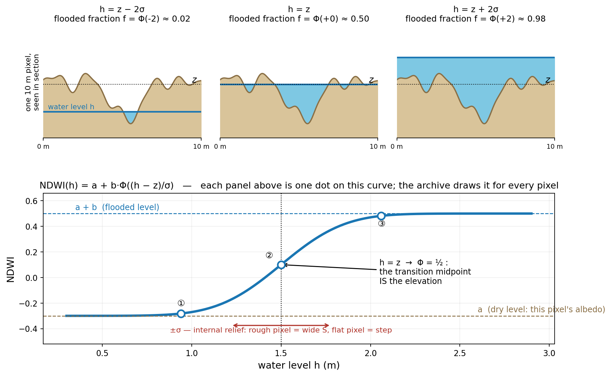
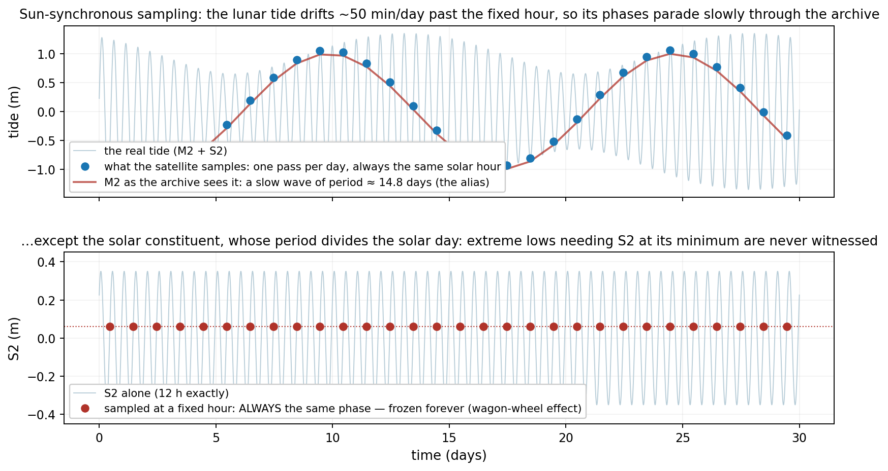

# The method, in equations

Moved here from the repository README when the README was rewritten as the paper companion (2026-09-21). Updated on 2026-09-23 for the fixed-band product: bands of fixed length, monotone lags, the bootstrap interval and the kernel application replace the adoption gate; the derivations are unchanged. On 2026-10-26 the "Uncertainty" paragraph was rewritten to describe the `sigma` that the product stores, and how it is computed.

**The pixel model, derived in four steps.**

1. *Linear mixing* — where the shape a + b·f comes from. A 10 m pixel is
   not wet or dry — the sensor averages whatever is inside. With a fraction
   $f$ of the pixel flooded:

   $$\mathrm{NDWI} \;=\; (1-f)\cdot\mathrm{NDWI_{dry}} \;+\; f\cdot\mathrm{NDWI_{wet}} \;=\; a + b\,f$$

   where $a$ is this pixel's own dry level (its albedo, its sediment) and
   $b$ the dry→wet jump. Because $a$ and $b$ are fitted per pixel, albedo
   differences between pixels are normalised for free.
2. *The flooded fraction is a CDF — geometry, not hypothesis.* Inside the
   pixel the ground is not flat; at water level $h$, exactly the part of
   the internal terrain lying below $h$ is flooded:
   $f(h) = \Pr(\text{internal elevation} \le h)$, the cumulative
   distribution of the pixel's internal relief.
3. *The one real assumption.* The internal micro-elevations are modelled
   as Gaussian with mean $z$ (the pixel's median elevation) and spread
   $\sigma$ (its internal roughness) — defensible because micro-relief is
   the sum of many small independent irregularities, and because the real
   curves do have that symmetric S shape. The Gaussian CDF is
   $\Phi\!\left(\frac{h-z}{\sigma}\right)$.
4. *Put together:*

$$\mathrm{NDWI}(h) \;=\; a + b\,\Phi\!\left(\frac{h-z}{\sigma}\right).$$

Read it physically: $h \ll z$ gives $\Phi\approx 0$ → you see $a$, the dry
pixel; $h \gg z$ gives $a+b$, the flooded pixel; and at $h=z$ exactly half
the internal terrain is under water, $\Phi=\tfrac12$ — **the transition
midpoint IS the elevation**. A flat pixel (small $\sigma$) floods almost
as a step; a rough one floods gradually (wide S). Fitting this curve to a
pixel's archive therefore reads off $z$ and $\sigma$ — with the caveats
that the fitted $\sigma$ also absorbs water-level error (deconvolved in
`b2_sigma`) and that the wet plateau is not truly flat (the first
submerged metre keeps rising — `p11`'s master curve; a richer model was
tried and gated out in `p12`).

**The binary reduction.** For estimating the *tide* rather than the
terrain, each observation is reduced to wet/dry ($y_{pt}\in\{0,1\}$) and
the amplitudes are fixed at 0/1, leaving two parameters per pixel. Under a
candidate interior clock $\tau$ (the water level each scene "really" had is
$h(t-\tau)$), the probability of seeing pixel $p$ wet in scene $t$ is
$P_{pt}=\Phi\!\left(\frac{h(t-\tau)-z_p}{\sigma_p}\right)$ and the
Bernoulli log-likelihood of the whole record is

$$\ell(\tau) \;=\; \sum_p \max_{z_p,\sigma_p} \sum_t
\Big[\,y_{pt}\log P_{pt} + (1-y_{pt})\log(1-P_{pt})\Big].$$

In compact form this is a *profile likelihood*: the bracket is just the
log of the Bernoulli pmf,
$y\log P + (1-y)\log(1-P) = \log\big[P^{y}(1-P)^{1-y}\big]$,
sums of logs are the log of the joint
product, and gathering the terrain parameters as nuisances
$\eta=\{z_p,\sigma_p\}$,

$$\ell(\tau) \;=\; \max_{\eta}\, \log L(\tau,\eta).$$

The per-pixel and global maxima coincide because each pixel's parameters
appear only in its own terms — which is also what makes the problem
computable: thousands of independent 2-parameter mini-fits inside a 1-D
sweep over $\tau$, instead of one joint optimisation of ~24,000 unknowns.

The inner $\max$ is the *profiling*, and "best terrain" means exactly
this: to evaluate a candidate clock, every pixel re-fits its own
$(z_p,\sigma_p)$ to the values that best explain its record *under that
clock*. Without it the contest would be rigged — terrain fitted once
under $\tau=0$ and frozen would make every other candidate carry a
mis-fitted terrain that is not its fault, and terrain error would
masquerade as clock evidence. With it, every candidate presents its best
case, and the only thing left to decide between clocks is what terrain
*cannot absorb*: a level shift is absorbed by $z$ (datum invariance), but
the wrong clock makes the wet/dry pattern contradict the tide's *ordering
across dates* — scene A carried more water than B yet A is dry and B wet —
and no fixed elevation can fix a contradiction that changes sign between
scenes. The estimator (M2a, `tide_estimators.m2a_rasch`) maximises
$\ell(\tau)$ per band of along-channel distance $s$, with $\tau=0$
anchored at the mouth, where the ocean model is trusted. The bands are
fixed 3-km intervals of geodesic (through-water) distance from the mouth
(`tide_estimators.make_bands_fixed`); a band with fewer than 500 pixels is
merged into its neighbour, so the number of bands is set by the estuary's
length. The lags are parametrised as cumulative non-negative increments
from the mouth, so the profile is monotone and causal by construction: a
lag can neither decrease nor be negative going inland. The band lags are
optimised jointly with L-BFGS-B.

**What is provably not estimable.** Propagating into an estuary, the tide
does not only arrive *late* (the phase $\tau$, which we estimate) — it can
also arrive *amplified or damped*: channel convergence amplifies it,
friction damps it. That factor is the **gain** $\alpha$, and the interior
level is modelled as
$h_{\mathrm{int}}(t) = \alpha\,h_{\mathrm{mouth}}(t-\tau) + \mathrm{datum}$. Any hydraulician would love to read $\alpha$ off
the imagery too — and the theorem says it cannot be done. With gain, the
wet probability is $P=\Phi\!\big(\frac{\alpha h - z}{\sigma}\big)$;
multiply all three of $(\alpha, z, \sigma)$ by the same $c$ and

$$\frac{(c\alpha)h - (cz)}{c\sigma} = \frac{\alpha h - z}{\sigma}$$

— the $c$ cancels, every margin and hence the entire likelihood is
unchanged. Concretely: a world with $\alpha=1.2$ over terrain
$(z,\sigma)=(1.2\,\mathrm{m}, 0.24\,\mathrm{m})$ produces *exactly the
same wet/dry record* as a world with $\alpha=1$ over
$(1.0\,\mathrm{m}, 0.20\,\mathrm{m})$. They are observationally the same
world: no amount of binary data distinguishes them. The same holds for a
datum shift, absorbed by $z$. Only *phase* survives, because a time shift
reorders the pattern across dates and no static rescaling can mimic a
reordering. This affine theorem is enforced as a specification (gain and
datum come from the boundary model at the mouth; phase comes from the
imagery) and verified numerically in `m2_gate_sim`: a gain of 1.0–1.3 is
planted and the $\mathrm{NLL}(\alpha)$ profile comes out flat to machine
precision — the theorem as an executable test. If that profile ever
stopped being flat, it would not mean the gain became measurable; it
would mean a bug.

**Uncertainty of the clock.** An estimator always returns *some* number —
with cloud gaps, pixel noise and capricious sampling, the argmax lands
somewhere even when the true lag is zero. The uncertainty of each band's
lag is therefore stated with it: a scene bootstrap (30 resamples of the
scenes with replacement, `tide_estimators.bootstrap_lags`) refits the
band lags on each resample, and the 2.5th and 97.5th percentiles give a
95 % interval per band (`tau_lo_min`, `tau_hi_min` in `marea.npz`). There
is no detection threshold, no null gate and no physics veto: the fitted
profile is the applied profile (`marea.TAU_DETECT_MIN = 0`). The
simulated null — replica worlds with the **same pixels**, the **same
cloud masks** and the **same acquisition times** but a uniform tide, no
interior lag by construction — remains only as an experiment that checks
the estimator returns about zero where nothing exists; it is not a gate.

**Application.** The band is the estimation unit; the pixel is the
application unit. The band lags are smoothed by a Gaussian kernel whose
bandwidth is the band length, anchored at $\tau=0$ at the mouth
(`tide_estimators.smooth_lag_profile`), and every pixel receives the
smoothed lag at its own distance $s$, rounded to the minute
(`tau_px_min`). The elevation inversion is then run once with the
boundary read that many minutes earlier for each pixel.

**Scoring.** Elevations are always judged by the triad — median-centred
RMSE $\sqrt{\overline{(e-\tilde e)^2}}$ (datum-free), OLS slope of
product on truth (1 = undistorted relief), and Pearson $r$ — with the
bias (datum offset) reported separately, because optimising RMSE alone
repeatedly produced flattened relief with better numbers (three separate
incidents in the phase log).

**Uncertainty: the `sigma` of the product.** The per-pixel uncertainty
that the MAREA product stores, `sigma` in `marea.npz` (meters), is the
width $\sigma$ of the pixel's fitted flooding curve,
$\mathrm{NDWI} = a + b\,\Phi\big((h-z)/\sigma\big)$: the $\sigma$ of the
pixel model above. It comes from the elevation inversion
(`marea.invert_series`, which calls `elevation._fit_block`). It does not
come from the delay estimator, whose per-pixel $\sigma_p$ (profiled over six
widths from 0.06 to 0.45 m, `configs/m2.yaml`) is not stored, nor from the
scene bootstrap. It is found together with $z$, pixel by pixel, by a grid
search:

1. The candidate elevations are 50 levels evenly spaced between the lowest
   and the highest level of the mouth tide at the image times, with no delay
   (`rango_marea_m` in `result.json`). The candidate widths are the eight
   values of
   `marea.SG_GRID`: 0.03, 0.06, 0.10, 0.15, 0.22, 0.32, 0.45 and 0.65 m.
2. The level of each look is the mouth tide read the pixel's own delay
   earlier, $h(t-\tau)$ with $\tau$ = `tau_px_min`.
3. For every candidate pair $(z, \sigma)$, $a$ and $b$ are solved in closed
   form by least squares on the NDWI of the pixel's cloud-free looks (the
   other looks carry zero weight).
4. The pair with the smallest sum of squared residuals gives the stored $z$
   and $\sigma$.

So $\sigma$ is always one of the eight grid values; a transition sharper
than 0.03 m or more gradual than 0.65 m is reported at that end of the
grid. $\sigma$ is NaN exactly where $z$ is NaN, because the same guards
reject both: fewer than eight cloud-free looks, $b$ not between 0.15 and
2.5, $|a| \ge 2.5$, and the quality rule when it is applied.

How to read it: $\sigma$ says how gradually the pixel turns from dry to wet
as the water rises. In the pixel model it is the spread of the ground inside
the pixel; in practice it also absorbs any error in the water level given
to each look, which blurs the transition in the same way
(`experiments/b2_sigma.py` separates the two). It is not a standard error
of $z$: it is not derived from the scatter of the fit, and it does not tend
to zero as more looks are added. The product uses it in one place, the
envelope of the hypsometric curve (`hyp_lo`, `hyp_hi`): the 5th and 95th
percentiles of 30 curves in which every elevation is moved by a normal draw
with standard deviation $\sigma$ (`hypsometry.curve_with_uncertainty`). The
poster shows $\sigma$ as the uncertainty of the elevation. Whether it works
as a calibrated error bar (about 68 % of the elevation errors within
$\pm\sigma$) is an open question:
[`experiments/v17_truth_diagnostics.py`](../experiments/v17_truth_diagnostics.py)
tests it against the surveys, and this repository reports no result of that
test.

Two per-pixel error bars of the development phase are not part of the
product: the analytic Cramér–Rao bound of each fit
(`experiments/p13_sigma_uncertainty.py`) and a bar tabulated from planted
recoveries in a simulator calibrated on the archive
(`experiments/b7_incertidumbre.py`). [`PHASE_LOG.md`](PHASE_LOG.md) records
how both were tested.

**Sampling limits.** A sun-synchronous satellite samples each tidal
constituent at its aliased period
$T_a = \left|\,1/(f \bmod 1\,\mathrm{day}^{-1})\,\right|$. S2's period divides the solar day exactly
($T_a=\infty$: frozen), K1/P1 alias onto the annual cycle; M2 aliases to
14.8 days and is the workhorse. Consequences — such as the never-observed
extreme low tides — are declared, not interpolated away.

