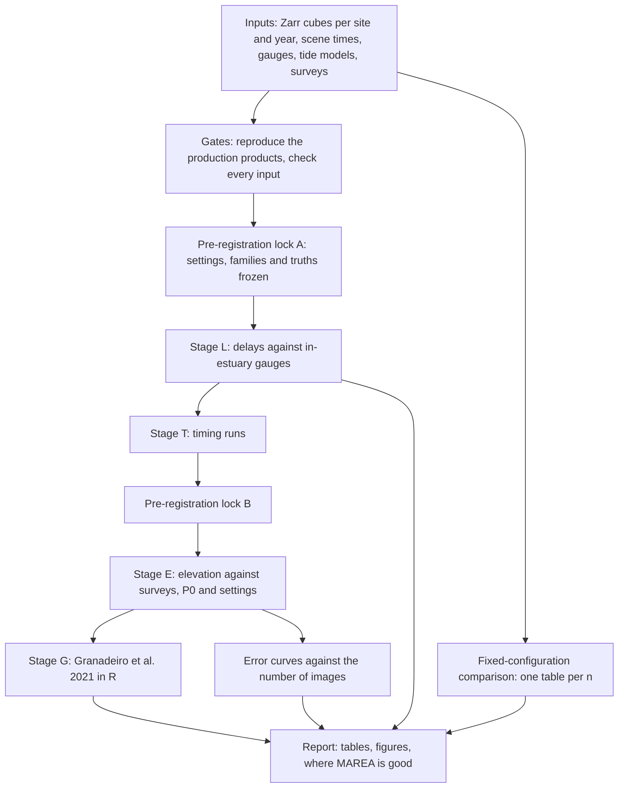
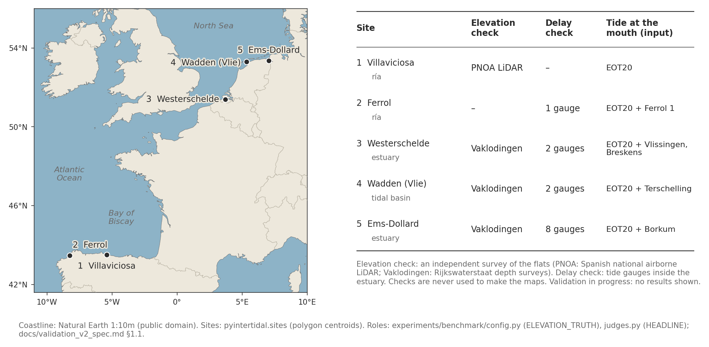
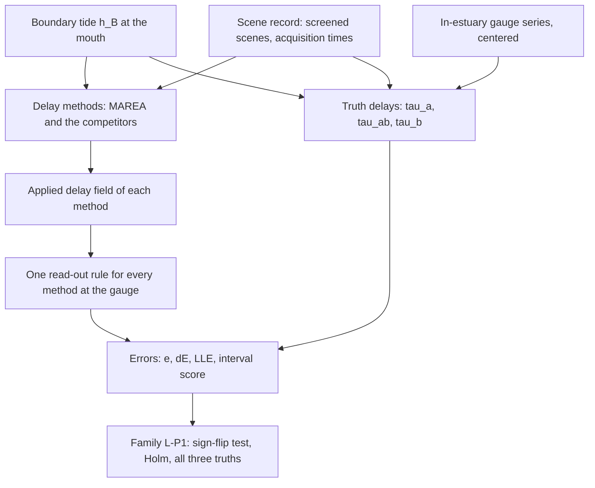
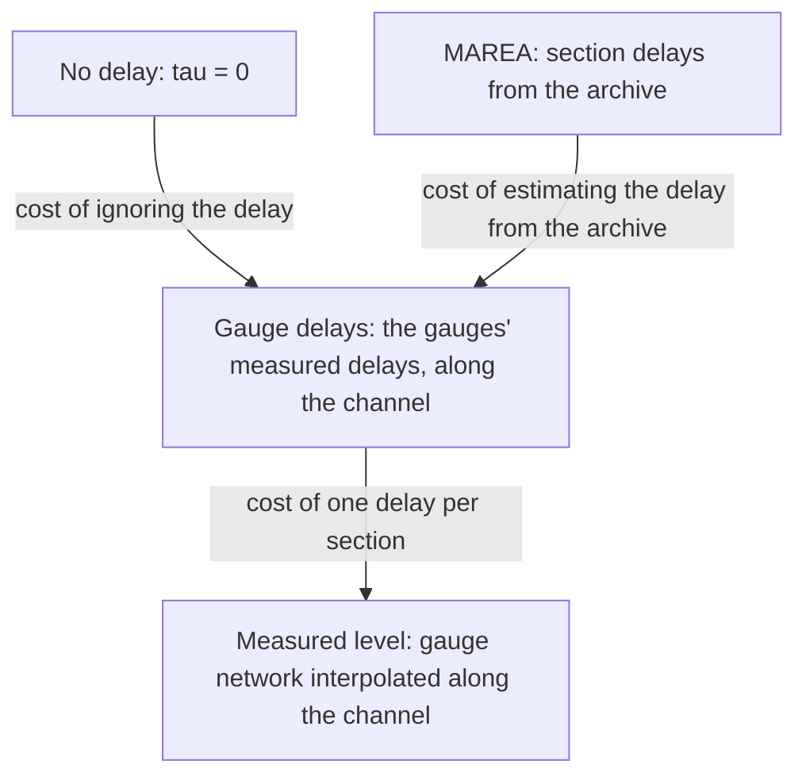
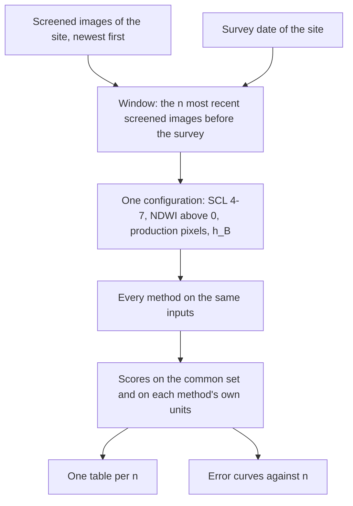

# Validation design

*How MAREA is being tested: the sites, the independent checks, the two
stages, the comparison with other methods and the metrics.*

> **Status (26 October 2026): in progress.** This page describes the design
> only. It reports no result and no error number. The results will be added
> to this repository, and to the poster, when the validation is complete.

The full specification, with every rule and its rationale, is
[`validation_v2_spec.md`](validation_v2_spec.md) (revision 2, with the
authors' decisions of 2026-10-13 to 2026-10-15 at its top). The
fixed-configuration comparison is specified in the docstring of
[`experiments/v19_fixed_config_tables.py`](../experiments/v19_fixed_config_tables.py).
The method being tested is in [`METHOD.md`](METHOD.md); unfamiliar terms are
in [`GLOSSARY.md`](GLOSSARY.md).

## Contents

1. [Questions](#1-questions)
2. [The design at a glance](#2-the-design-at-a-glance)
3. [Sites](#3-sites)
4. [The independent checks](#4-the-independent-checks)
5. [Stage L: delays against in-estuary gauges](#5-stage-l-delays-against-in-estuary-gauges)
6. [Stage E: elevation against independent surveys](#6-stage-e-elevation-against-independent-surveys)
7. [The fixed-configuration comparison](#7-the-fixed-configuration-comparison)
8. [The methods compared](#8-the-methods-compared)
9. [Metrics](#9-metrics)
10. [Rules that keep the comparison fair](#10-rules-that-keep-the-comparison-fair)
11. [Status](#11-status)

## 1. Questions

| question | answered by |
|---|---|
| Does MAREA's delay agree with the delay that tide gauges inside the estuary measure, as well as or better than other ways of estimating it (from images, from global and regional tide models, from physics)? | Stage L (section 5) |
| Does the delay correction itself improve the elevation (MAREA against the same inversion with no delay)? This is the non-circular test of the delay. | Stage E, family P1 (section 6) |
| With identical inputs and only a boundary tide, is MAREA's elevation more accurate than each state-of-the-art method? | Stage E, family P2; the fixed-configuration comparison (section 7) |
| Is MAREA, given only the boundary tide, competitive with methods given a per-pixel tide model or a regional hydrodynamic model? | Stage E, family P3 |
| How many images does each method need? | error curves against the number of images (sections 6 and 7) |
| Where is MAREA good: along the estuary, by delay, by elevation zone, slope, substrate, turbidity, amplification? | strata defined before any score (section 6) |
| What does each method cost to run? | timing of every run |

Gauge agreement is weak evidence about MAREA's delay, because the delay
fitted from wet/dry looks also absorbs departures from a simple flooding
(water held back on the ebb, drainage, high flats lagging low flats). The
decisive test of the delay is the elevation contrast, MAREA against no
delay, against heights that MAREA never saw.

## 2. The design at a glance

The delays are scored before any elevation. No delay result can change an
elevation setting, because every elevation configuration is frozen at
lock A. In the specification, Stage E is split into Stages B (the base
configuration), S' (the settings), K (the curves) and G (Granadeiro).

## 3. Sites

*The five study sites.*

| site | area (frame at 10 m) | type | years | elevation truth | gauges at the mouth (boundary) | gauges inside (judges of the delay) |
|---|---|---|---|---|---|---|
| Ría de Villaviciosa (Asturias, Spain) | 9.2 × 9.2 km | ría | 2023-2025; 2017-2022 in Campaign 2 | PNOA airborne LiDAR (MDT02, ground returns aggregated to 10 m); RTK-GNSS development points, descriptive only | none: EOT20 alone | none: its delays are descriptive |
| Ría de Ferrol (Galicia, Spain) | 9.1 × 17.1 km | ría | as above | none (delay only) | IOC `fer1` | `fer2` |
| Westerschelde (the Netherlands) | 14.7 × 21.0 km | alluvial estuary | as above | Rijkswaterstaat's Vaklodingen depth surveys of the Dutch coast, every year 2016-2025 | IOC `vlis`, `brsk` | Gat van Borssele; Terneuzen (a pair, one location) |
| Wadden Sea, Vlie basin (the Netherlands) | 34.3 × 27.8 km | multi-inlet tidal basin | as above | Vaklodingen (Vlie 2016, 2019, 2022, 2025; inner sheets to 2022) | IOC `ters` | West-Terschelling; Harlingen |
| Ems-Dollard (the Netherlands and Germany) | 32.1 × 34.1 km | alluvial estuary | as above | Vaklodingen (Dutch and German sheets 2020; outer sheets 2019, 2022, 2025) | IOC `bork` | Emshoern, Eemshaven Waddenzee, Dukegat, Knock, Delfzijl, Emden, Pogum, Nieuwe Statenzijl |

* **Years.** Campaign 1 uses 2023-2025 (Sentinel-2A, 2B and 2C). Campaign 2
  adds 2017-2022, after that download is complete.
* **Vaklodingen** are 20 m grids of the sea bed and the tidal flats,
  interpolated from echo-sounding and, where it exists, LiDAR, compiled per
  map sheet and year. At the Dutch and German sites
  the 20 m truth cell is the scoring unit: a product's value in a cell is
  the mean of its mapped 10 m pixels, and the cell counts if at least 2 of
  its 4 pixels are mapped.
* **Scope.** Every site is one of MAREA's development sites; all are
  temperate, meso- to macrotidal estuaries, basins or rías in north-western
  Europe. The conclusions are scoped to these conditions.

## 4. The independent checks

| check | what it measures | used to make any map? |
|---|---|---|
| Vaklodingen (Westerschelde, Wadden Sea, Ems-Dollard) | bed elevation on 20 m cells, per survey year | never |
| PNOA LiDAR, MDT02 (Villaviciosa) | ground elevation; water surfaces at flight time masked | never |
| RTK-GNSS field survey (Villaviciosa) | point elevations, development points only | never |
| in-estuary tide gauges (13 locations at four sites) | the real delay of the tide inside the estuary | never as a method input in the delay stage; as a labeled upper bound only in Stage E |

* **Survey heights keep their own datum.** Every comparison removes the
  median offset first and reports it separately as the bias.
* **Epoch.** Each truth cell takes the survey nearest the window center, and
  carries its epoch gap. The error that truth noise and epoch mismatch add
  is estimated from the truths alone, before any product is scored, and
  used to correct the slope for attenuation (section 9).
* **The RTK survey.** Validation v2 reads only its development points,
  through `pyintertidal.rtk.load_rtk()`; `tests/test_r1_guard.py` checks that
  no other code asks for the rest. One earlier run, on 2026-08-21, opened
  the reserved points to score four development maps
  (`experiments/v3_open_reserved.py`, logged in `results/v3_aperturas.jsonl`
  and reported in [`PHASE_LOG.md`](PHASE_LOG.md)); the reserved points are
  therefore not an untouched blind test, and validation v2 does not score
  them. The survey files in `data/` hold every point: the guard binds this
  repository's code, not the files.

## 5. Stage L: delays against in-estuary gauges

**What is compared.** The delay each method applies at the location of an
in-estuary gauge (a *judge*) against the delay that gauge measures, at 13
locations: Westerschelde 2, Wadden Sea 2, Ems-Dollard 8, Ferrol 1.

**The truth delays** (positive: the water inside is later than $h_B$):

*Truth (a).* $\tau_a$ is the delay that best aligns the boundary tide with
the gauge at the Sentinel-2 instants $t_i$ of the window, with $g_i$ the
gauge value nearest $t_i$ (within 6 min), searched every minute, with a
200-draw calendar-month block bootstrap:

$$
d_i(\tau) = h_B(t_i - \tau) - g_i, \qquad E(\tau) = \sqrt{\frac{1}{n} \sum_{i=1}^{n} \left( d_i(\tau) - \operatorname{median}_j d_j(\tau) \right)^2}, \qquad \tau_a = \arg\min_{-60 \le \tau \le 240} E(\tau)
$$

*Truth (ab).* $\tau_{ab}$ is the same with a free gain $b \in [0, 4]$ on
the boundary tide.

*Truth (b).* $\tau_b$ is the M2 phase lag between the gauge and the
boundary, from a harmonic analysis of both 10-min series
(`pyTMD.solve.constants`, 52 constituents), with $\phi$ the M2 phases in
degrees and 28.9841042 degrees per hour the M2 angular speed:

$$
\tau_b = \frac{60}{28.9841042} \operatorname{wrap}_{180}\left( \phi_g - \phi_B \right)\ \mathrm{min}
$$

**The read-out.** One rule for every method: the median of the method's
applied delay field over the gauge's neighborhood if at least 30 pixels are
defined; else the median over the gauge's section; else 0. Each step is
flagged.

**The lag metrics**, per judge, method, truth and window ($\tau_m$ the
method's delay, $\tau^{\ast}$ the truth):

$$
e = \tau_m - \tau^{\ast}, \qquad \mathrm{dE} = E(\tau_m) - E(\tau_a), \qquad \mathrm{LLE} = \sqrt{\frac{1}{n} \sum_{i} \left( h_B(t_i - \tau_m) - h_B(t_i - \tau_a) \right)^2}
$$

dE is the extra misfit of the level at the gauge left by the method's delay
(cm); LLE is the vertical consequence of the delay error at the actual
image times, free of gauge noise (cm). MAREA's 30-draw bootstrap also gives
an interval score.

**The confirmatory family L-P1.** Per truth, MAREA against five
alternatives: zero delay, the primary global tide model, the regional
hydrodynamic model, Geyman and Maloof (2020) and Hart-Davis et al. (2026).

* paired quantity per location: $\Delta = \lvert e_{\mathrm{MAREA}} \rvert - \lvert e_X \rvert$;
* statistic: the mean over the judged sites of the site-mean $\Delta$ (each site
  weighs 1, so the eight Ems-Dollard locations count once);
* test: an exact sign-flip permutation over the 13 locations
  ($2^{13} = 8192$ flips), two-sided, with Holm over the five comparisons;
* a confirmatory result also needs the same direction at 3 of the 4 judged
  sites; a ranking is claimed only if it holds under all three truths.

**Delay methods, by family** (all scanning methods use one window, -45 to
+180 min every 5 min): likelihood (MAREA); order statistics on the wet/dry
looks (concordance, flooded-area rank correlation, lagged
cross-correlation, Bishop-Taylor et al. 2026 shift); self-consistency of the
flood and ebb limbs (Granadeiro et al. 2021 and two in-house variants);
harmonic phase (Geyman and Maloof 2020; Hart-Davis et al. 2026; a
phase-plane logistic); global and regional tide models at the gauge; physics
(zero delay, shallow-water celerity on EMODnet depths); and labeled
references that are never ranked. The full catalog is §3.3 of the
specification.

**Development-free judges.** Harlingen influenced a MAREA setting (the
upper delay bound was widened to 180 min after the Wadden Sea comparison
with it), so every delay result is also reported without the judges that
influenced MAREA's development, and without the judges closer than 3 km to
the mouth.

## 6. Stage E: elevation against independent surveys

**The base configuration P0.** Per-pixel clear mask SCL 4-7 (MAREA's own),
reflectances floored at 0, NDWI, a fixed threshold of 0, the boundary tide
$h_B$ for every method, the window 2023-2025, all images.

**The four rows that split the error** (at the sites with in-estuary
gauges: Westerschelde, Wadden Sea, Ems-Dollard), on the same pixels, scenes
and settings:

What remains with the measured level is the error of the elevation
estimation itself.

**The confirmatory families.**

| family | contrast | why |
|---|---|---|
| P1 | MAREA against no delay, at P0 | the non-circular test of the delay |
| P2 | MAREA against each state-of-the-art method, all given only the boundary tide | the state of the art under identical inputs |
| P3 | MAREA (boundary tide) against each method given a per-pixel global tide model or a regional hydrodynamic model | the practical comparison |

* **Pair views.** Every contrast is scored on the cells mapped by both
  methods, after and before their own quality rules; a contrast is
  confirmed only if both views agree (intersection-union).
* **Multiplicity.** Romano-Wolf step-down on a shared-weight bootstrap
  ($B$ = 20,000), family-wise error 0.05.
* **Verdicts against practical margins**: EQUIVALENT, BETTER, WORSE or
  INCONCLUSIVE, with a margin of 2 cm of method-term RMSE and 0.05 on the
  slope.

**Settings.** One factor at a time, and small full factorials, over cloud
handling (pixel masks and scene rules, including the transition-zone rule
and an independent cloud mask, OmniCloudMask), the spectral index (NDWI,
MNDWI, NIR and others), water detection (fixed threshold, Otsu variants,
majority vote), band preprocessing and the time window. Within each setting
only the method changes, so every comparison is paired.

**Number of images.** Error curves against the number of archive images
given to each method (20, 45, 90, 180, 330 and all, in 2023-2025), with
disjoint batches where the archive allows.

**Strata, defined before any score:** section and distance from the mouth,
reference delay class, amplification class, emersion zone of the truth
elevation, position inside or outside the sampled tide range, slope,
substrate brightness, vegetation, turbidity, epoch gap.

## 7. The fixed-configuration comparison

The first author's design of 2026-10-20 (truths and window ends,
2026-10-26), run by `experiments/v19_fixed_config_tables.py` on the existing
10 m inputs of each site.

**One configuration for every method**, external to all of them and
identical to MAREA's production one:

| element | value |
|---|---|
| scene filter | MAREA's transition-zone screening (`stability.reference_and_clouds`, `filter_dates(0.10)`), then an acquisition time and a finite boundary level |
| per-pixel mask | clear = SCL 4, 5, 6, 7 |
| index and detection | NDWI = (B03 - B08) / (B03 + B08); wet = clear and NDWI above 0 |
| pixels | the production intertidal pixels of the site |
| water level | the production boundary tide $h_B$ at the acquisition times; MAREA keeps its delay model, refitted on every window; every other method reads $h_B$ with no delay |

**Windows.** For each site and each $n$ in 125, 100, 75, 60, 50 and 40,
the window holds the $n$ most recent screened images on or before the
site's survey date: a flexible time window that starts wherever it holds
$n$ screened images. A window that cannot hold $n$ screened images before
the survey is reported as not reachable, with the count.

| site | truth | window end |
|---|---|---|
| Westerschelde, Ems-Dollard | Vaklodingen cells surveyed in 2025 | 2025-12-31 (the surveys give the year only) |
| Wadden Sea | Vaklodingen, grouped by the most recent survey year under each pixel (2023, 2024, 2025), one row per group | the end of each group's survey year |
| Villaviciosa | PNOA LiDAR (never the RTK points) | the flight date |

**Scoring.** One fixed set $F$ of units per site: the intertidal pixels with
a truth value inside the range filter, decided by no product. Each method is
scored on the *common set* (the units where every headline method has a
value) and on its *own* valid units of $F$. MAREA's headline column uses the
rule of the production products (`min_bracket` 0); the rule of three is a
declared variant.

**Outputs.** One table per $n$ (one column per method), and error curves
against $n$. The wall time of every estimator call is recorded.

## 8. The methods compared

The elevation methods of the fixed-configuration comparison, with the
catalog identifier of the specification (§3.2).

| id | method | principle, in one line | reference |
|---|---|---|---|
| E0b | MAREA | per-pixel flooding curve fitted on the boundary tide delayed by the section's delay read from the archive | this repository; [`METHOD.md`](METHOD.md) |
| E0a | no delay (internal reference) | the same inversion with $\tau = 0$ | this repository |
| E1 | NIDEM / ITEM | median NDWI composites in 9 tide intervals, contours of the wet/dry extents tagged with each interval's median tide, joined into a surface (TIN) | Sagar et al. 2017, doi:10.1016/j.rse.2017.04.009; Bishop-Taylor et al. 2019, doi:10.1016/j.ecss.2019.03.006 |
| E2 | DEA Intertidal 2.5.3 | per-pixel rolling median of NDWI along tide height; the elevation is the lowest tide at which the smoothed NDWI exceeds 0.1 (the authors' code is run) | Bishop-Taylor et al. 2026, doi:10.1016/j.rse.2026.115663; dataset doi:10.26186/149403 |
| E4 | LogiTide2DEM | per-pixel logistic regression of land against tide height; the elevation is the 50 % crossing $-a/b$ | Chen and Wang 2025, doi:10.1016/j.jag.2025.104561 |
| E5a | Flood2Topo | the water frequency of the pixel read as an exceedance level of the full 1-min tide series | Fassoni-Andrade et al. 2020, doi:10.1029/2019WR026362; 2021, doi:10.1016/j.rse.2020.112065 |
| E5b | Tseng et al. | linear scaling of the water frequency between the lowest and highest level | Tseng et al. 2017, doi:10.1016/j.isprsjprs.2017.07.008 |
| E5c | sampled exceedance | the $(1 - f)$ quantile of the levels at the pixel's own clear looks (a declared sensitivity of E5a) | specification §3.2 |
| E7 | Coast X-Ray | median NDWI composites per tidal-stage bin; the elevation is the lowest mean tide of the bins where the pixel is water | Fitton et al. 2021, doi:10.1016/j.rsase.2021.100499 |
| E12 | wet/dry bracket | the midpoint between the highest level seen dry and the lowest level seen wet | in-house legacy openEO UDF (`pyintertidal/legacy/udf.py`) |

In the formulas below, $f$ is the share of a pixel's clear looks seen wet,
$H$ the window's level series and $h_t$ the level of look $t$:

$$
z_{\mathrm{E5b}} = H_{\max} - f \left( H_{\max} - H_{\min} \right), \qquad z_{\mathrm{E5c}} = Q_{1 - f}\left( h_t : c_t = 1 \right), \qquad z_{\mathrm{E12}} = \frac{1}{2} \left( \max_{t\ \mathrm{dry}} h_t + \min_{t\ \mathrm{wet}} h_t \right)
$$

$$
\operatorname{logit} P(\mathrm{land}) = \alpha_0 + \alpha_1 h, \qquad z_{\mathrm{E4}} = - \frac{\alpha_0}{\alpha_1}
$$

Every method's card (deviations from the paper, fidelity, expected offsets)
is in the docstring of its module in
[`experiments/fixedcfg/`](../experiments/fixedcfg/README.md); NIDEM is in
`pyintertidal/waterline_contour.py`. Stage E also includes Granadeiro et al.
(2021), Costa et al. (2023), Bué et al. (2020) and the optical waterline
method of Salameh et al. (2020) (specification §3.2).

## 9. Metrics

For the $n$ scored units $i$ where both the product $z_i$ and the truth
$t_i$ are finite, with $e_i = z_i - t_i$ and $\tilde z$, $\tilde t$ the
medians (`experiments/v7_waterline_contour.vscore`, used through
`v14_scene_count_curves.score` and `v19_fixed_config_tables.score_values`;
no score below 30 units):

| metric | formula | reads as |
|---|---|---|
| RMSE | $\sqrt{\frac{1}{n} \sum_i e_i^2}$ | total error, datum included |
| bias | $\operatorname{median}_i e_i$ | the datum offset |
| centered RMSE (cRMSE) | $\sqrt{\frac{1}{n} \sum_i \left( (z_i - \tilde z) - (t_i - \tilde t) \right)^2}$ | error of the relief, datum removed |
| slope | $\hat\beta = \frac{\sum_i (t_i - \bar t)(z_i - \bar z)}{\sum_i (t_i - \bar t)^2}$ | 1 = undistorted relief; below 1 = compressed |
| $r$ | Pearson correlation of $z$ and $t$ | shared pattern |
| coverage | $\frac{1}{\lvert F \rvert} \sum_{i \in F} \mathbf{1}\left[ z_i \text{ finite} \right]$ | share of the scored set with an estimate |

The bias is a median, so $\mathrm{RMSE}^2$ is not $\mathrm{cRMSE}^2 + \mathrm{bias}^2$.

**Primary quantities of Stage E** (specification §7.2), on a pair view of
methods A and B, with $\sigma_T^2$ the truth-error variance (survey noise
plus epoch mismatch), estimated from the truths alone:

$$
\Delta\mathrm{MSE}_c(A, B) = \operatorname{Var}(e_A) - \operatorname{Var}(e_B)
$$

$$
b^{\ast} = \frac{b}{\hat\lambda}, \qquad \hat\lambda = 1 - \frac{\sigma_T^2}{\operatorname{Var}(t)}
$$

The first is unbiased for the difference of the methods' own error
variances whenever the truth error is independent of them; the second
corrects the OLS slope $b$ for its attenuation by the error in the truth.

**Emersion-time error (proposed).** Each elevation is turned into the share
of time it is submerged, $H(z) = \frac{1}{K} \sum_k \mathbf{1}\left[ h_{\mathrm{ref}}(t_k) \gt z \right]$
over the window at 10 min, and the error is scored in hours per day:
$\mathrm{HPE}_c = 24 \cdot \operatorname{mean}_i \left\lvert H(z_i - \hat b) - H(t_i) \right\rvert$,
with $\hat b$ the bias.

## 10. Rules that keep the comparison fair

* **Same inputs for every method.** Within a setting, only the method
  changes. Each competitor also gets an "as published" row with its own
  settings; every deviation from a paper is declared.
* **One row per method.** No method receives MAREA's delay; methods are
  never combined.
* **No tuning on truth**, except a symmetric, labeled tuning budget for
  every method.
* **Pre-registration.** Settings, families, truths and margins are frozen
  in `LOCK.json` before any result is seen; every later change is a logged
  amendment.
* **NOT COMPUTABLE is a result.** A method that its own rules stop is
  reported as such, never relaxed.
* **Home advantage, declared.** MAREA's settings were developed on these
  sites, gauges and surveys; the checks that influenced a setting are
  listed, and the delay results are also reported without them.
* **Only 10 m results are reported.**
* **Reproduction gates.** Every adapter must reproduce its method's
  production output, and every method must recover a planted delay or
  elevation in a synthetic positive control, before its row prints.

## 11. Status

* **In progress (26 October 2026).** The code of validation v2 is committed
  up to milestone V2: the inputs, the processing settings, the water levels,
  the truths, the command line, and the comparison of the delay with the
  in-estuary gauges. The runs on the 10 m data cubes are under way.
* The fixed-configuration comparison and the other method-comparison
  scripts (`experiments/v14` to `v19`) are running on the existing 10 m
  inputs of each site; their outputs are not in this repository.
* **Results will be added later.** This page states no number from any
  run.
