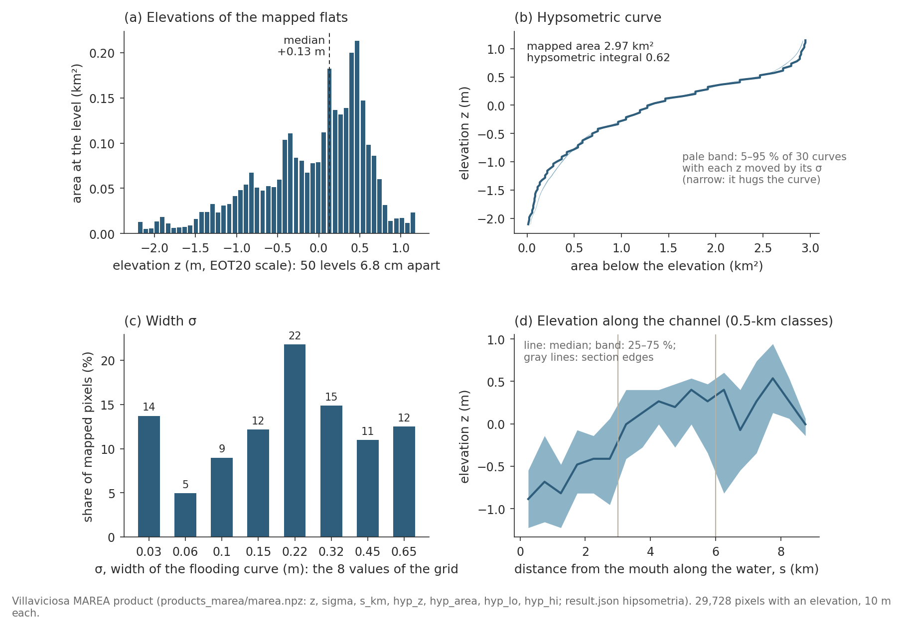

# Products: what each generated file contains

Every file a user may meet in this repository or on the authors' disks,
grouped by the step that writes it. For each: contents, units and vertical
datum, and the script and command that produce it; for the MAREA product and
its inputs, a schema table of every array (type, shape, units, meaning).
Commands run from the repository root. Validation v2 is in progress: this
guide describes files, not results. Terms are defined in
[`GLOSSARY.md`](GLOSSARY.md).

**What is in this repository.** `products_marea/` (`marea.npz`,
`result.json`, `figure.png`, `overpass_times.json`: the 10 m MAREA product of
the Ría de Villaviciosa), `products_villaviciosa/hsr_eot20_2023-2025.tif`,
the `overpass_times.json` of `products_ferrol/` and
`products_{escalda,wadden,ems}_10m/`, `results/<experiment>/result.json`
(development verdicts), `poster/figures/cg/` and the integrity files of
section 10. Every other file below is written on your machine by the command
given, or exists only on the authors' disks.

## Conventions

* **Vertical datum.** MAREA elevations are on the vertical scale of the
  water-level series they were inverted on: EOT20 tide heights (about mean
  sea level) at Villaviciosa, the consensus of EOT20 and the mouth gauges at
  the other sites. Survey truths keep their own datum; every comparison
  removes the median offset first and reports it separately as the bias.
* **Units.** Elevations, levels and uncertainties in meters; delays in
  minutes (positive: the water inside is late); distances along the channel
  in kilometers from the mouth; areas in km²; times in UTC; emersion time as
  a share of time (0-1).
* **Grids.** 10 m pixels in the UTM zone of each site (the CRS is recorded in
  every GeoTIFF and cube); a few development products are on 20 m grids.
  Pixel arrays stored "on keep" are 1-D over the intertidal pixels; `keep`
  holds their flat row-major indices into the `shape = (H, W)` frame
  (`row = keep // W`, `col = keep % W`).
* **Missing values.** NaN where a method gives no estimate (pixels that fail
  the guards, the quality rule or a method's own rule).
* **Language.** Keys of files written before the code was translated keep
  their Spanish names; they are translated below.

## 1. Inputs written by the download steps

| file | contents | made by |
|---|---|---|
| `ndwi_cube_<site>[_<period>].nc` (not versioned, 0.1-6 GB) | Sentinel-2 L2A cube from openEO: bands B03, B08 and SCL (and B04, B11 for some sites) as integers, dimensions (t, y, x), a `crs` variable | `pyintertidal.SentinelCube(aoi, period, water="ndwi").ensure(conn)`; `python -X utf8 -m experiments.download_cube <site>` for the Dutch and German sites |
| `cubes/<site>/<year>.zarr` and `<year>.angles.zarr` (not versioned) | the validation cubes: one Zarr store per site and year with nine bands (B02, B03, B04, B08, B8A, B11, B12, SCL, CLD) on the reference 10 m grid, and a small store of sun and view angles | `python -X utf8 -m experiments.download_cube_zarr <site> --years 2023-2025` (format and reader: `experiments/zarr_cubes.py`) |
| `overpass_times.json` (versioned for the study sites: `products_marea/` for Villaviciosa, `products_ferrol/`, `products_{escalda,wadden,ems}_10m/`) | `{date: acquisition time}` of every scene, the catalog (product-name) time in UTC | `pyintertidal.overpass.get_overpass_times`, written by the site notebooks and the Zarr downloader |
| `products_<site>/marea_extract.npz` (not versioned; 0.1-0.8 GB for the cubes on the laptop, more for the 10 m Dutch and German cubes) | the streamed extraction of a cube: `Y` (T, P) NDWI, `C` (T, P) clear look (SCL 4-7), `keep`, `dates`, `shape`, `sea` and `inter` (H, W) masks; the files saved by the comparison notebooks add `s_km` (distance from the mouth, km), `bbox` and `crs_wkt` (the older `products_marea/marea_extract.npz` has only the first seven keys) | `pyintertidal.marea.extract(cube_path)` (it returns the masks, `bbox` and `crs_wkt`, not `s_km`), saved by the site notebooks |
| `products_<site>/water_frequency.tif`, `intertidal_mask.tif`, `reference_map.tif`, `cloud_pct.json` (not versioned) | water frequency (0-1, share of clear looks seen wet); the intertidal mask (uint8, 0/1); the reference map (uint8: 0 transition zone, 1 stable water, 2 stable land); `{date: cloud percentage}` (0-100; SCL 3, 8, 9 and 10, measured over the whole frame for scenes at most 5 % cloudy and over the transition zone for the others) | the site notebooks and `experiments/rebuild_site_masks.py` (`pyintertidal.stability`, `pyintertidal.frequency`) |

**`marea_extract.npz`**, as returned by `pyintertidal.marea.extract` ($T$
scenes of the cube, $P$ intertidal pixels):

| array | dtype | shape | units | meaning |
|---|---|---|---|---|
| `Y` | float32 | (T, P) | NDWI | NDWI of every look; NaN where B03 + B08 = 0 |
| `C` | bool | (T, P) | – | clear look: SCL class 4, 5, 6 or 7 |
| `keep` | int64 | (P,) | – | flat row-major indices of the intertidal pixels |
| `dates` | string | (T,) | dates | the date of each scene |
| `shape` | integers | (2,) | pixels | (H, W) |
| `sea`, `inter` | bool | (H, W) | – | permanent sea (water frequency at least 0.90) and intertidal (between 0.10 and 0.90) |
| `bbox`, `crs_wkt` | dict, string | – | degrees | bounding box in EPSG:4326, and the cube's CRS (returned by `extract`; not in the older saved file) |

**`products_villaviciosa/hsr_eot20_2023-2025.tif`** (versioned; read with
`pyintertidal.raster.grid_of`): one float32 band of 915 × 915 pixels, 10 m,
EPSG:32630, upper-left corner (301020, 4824840), NaN as no-data. It is kept
for its grid, the canonical 10 m grid of Villaviciosa (section 6).

## 2. The MAREA product: `marea.npz`, `result.json`, `figure.png`

Written by `pyintertidal.marea.reconstruct(cube_path, out_dir, ...)` into
`out_dir`. Where they are:

* `products_marea/` in this repository: the 10 m product of the Ría de
  Villaviciosa (97 screened scenes of 2023-2025, EOT20 at the mouth, no
  quality rule), a copy of the production run below.
* The 10 m production products, on the authors' server (laptop mirror
  `results/server_10m/`): `products_marea/marea_eot20_g0_2023-2025/`
  (Villaviciosa, with `record.json`, the dates of its record),
  `products_ferrol/marea_eot20_g1/`, `products_escalda_10m/marea_eot20_g2/`
  (the Westerschelde), `products_wadden_10m/marea_eot20_g1/` and
  `products_ems_10m/marea_eot20_g1/` (`<tag>` names the tide boundary:
  `eot20_g1` = EOT20 with one mouth gauge). At the Dutch and German sites,
  `products_<site>/marea_<tag>/` holds the earlier 20 m runs.
* `runs/<cell>/marea/` (not in the public repository): the north-coast
  campaign (`nc2_cell<NNN>`: the 130 cells of
  `experiments/campaign_north_v2.py`; `north_coast_cell<NNN>`: the earlier v1
  run).

*The Villaviciosa product (`products_marea/`): elevation, the width sigma, the distance from the mouth and the delay of each pixel. A product of the method, not a validation result.*

*The same product as distributions over its intertidal pixels.*

### `marea.npz`

$P$ is the number of intertidal pixels, $K$ the number of 3-km sections and
$(H, W)$ the frame. In `products_marea/marea.npz`, $P$ = 32,120, $K$ = 3,
$(H, W)$ = (915, 915) and `n_boot` = 30; the keys and types below were read
from that file.

| array | dtype | shape | units | meaning |
|---|---|---|---|---|
| `z` | float32 | (P,) | m, on the scale of the boundary tide | elevation of each intertidal pixel; NaN where the guards (or the quality rule) reject it |
| `sigma` | float32 | (P,) | m | width of the fitted flooding curve: one of the eight values of `marea.SG_GRID`, NaN where `z` is NaN; the poster calls it the uncertainty of z; what it is and how it is computed: [`METHOD.md`](METHOD.md), paragraph "Uncertainty" (section 13) |
| `s_km` | float32 | (P,) | km | distance from the mouth along the water; NaN where water cannot reach |
| `band` | int16 | (P,) | – | index of the 3-km section of each pixel (0 at the mouth); -1 for pixels without a distance |
| `keep` | int64 | (P,) | – | flat row-major index of each intertidal pixel in the (H, W) frame |
| `shape` | int64 | (2,) | pixels | (H, W) |
| `tau_min` | float64 | (K,) | min | delay fitted per section |
| `tau_usado_min` | float64 | (K,) | min | delay applied per section (*usado* = used; negative values clipped to 0) |
| `tau_lo_min`, `tau_hi_min` | float64 | (K,) | min | 2.5th and 97.5th percentiles of the scene bootstrap |
| `tau_boot_min` | float64 | (n_boot, K) | min | every bootstrap fit; absent when `n_boot` = 0 |
| `tau_px_min` | float32 | (P,) | whole min | delay applied to each pixel: the section profile smoothed along the channel, rounded to the minute; 0 for pixels without a distance |
| `band_km` | float64 | (1,) | km | section length |
| `hyp_z` | float64 | (80,) | m | levels of the hypsometric curve |
| `hyp_area` | float64 | (80,) | km² | area of mapped pixels below each level |
| `hyp_lo`, `hyp_hi` | float64 | (80,) | km² | 5th and 95th percentiles of that area when each elevation is jittered by its sigma |

### `result.json`

Spanish keys are translated in the last column.

| key | type | units | meaning |
|---|---|---|---|
| `sitio` | string | – | site name |
| `estado` | string | – | status: `ok`; `sin_intermareal` = fewer than 3,000 intertidal pixels; `pocas_escenas` = fewer than `min_scenes` scenes with an acquisition time (a refused run writes only the site, the status and the count) |
| `n_escenas` | integer | scenes | scenes in the record |
| `record_dates` | list of strings (T) | dates | the dates of the record |
| `n_px` | integer | pixels | intertidal pixels |
| `n_px_cota` | integer | pixels | pixels with an elevation (*cota*) |
| `min_scenes` | integer | scenes | the shortest record accepted |
| `overpass_source` | string | – | `given` (times passed by the caller) or `stac` |
| `s_max_km` | number | km | the largest distance from the mouth |
| `band_km` | number | km | section length |
| `min_px_band` | integer | pixels | thinner sections are merged |
| `quality_min_bracket` | integer | looks | the quality rule applied: 3 = at least three clear looks with the water below the elevation and three above (the default since 2026-10-06); 0 = no rule |
| `centros_km` | list (K) | km | section centers |
| `tau_min`, `tau_usado_min`, `tau_lo_min`, `tau_hi_min` | lists (K) | min | as in `marea.npz` |
| `n_boot` | integer | resamples | scene bootstrap |
| `tau_px_median_min`, `tau_px_max_min` | number | min | median and largest delay applied to a pixel |
| `con_operador` | boolean | – | true when any pixel received a non-zero delay |
| `veto_fisico` | boolean | – | true when a negative section delay was clipped to 0 |
| `hipsometria` | object | – | `integral` (Strahler's hypsometric integral, 0-1) and `area_total_km2` (km²) |
| `rango_marea_m` | list of 2 numbers | m | the lowest and highest zero-delay level of the record: the range the inversion searches |
| `inputs_sha` | object | – | `cube`: sha256 of the cube file |
| `duracion_s` | number | s | run time |

Older files lack some of these keys: `record_dates`, `min_scenes` and
`overpass_source` are written since the commit of 2026-09-30,
`quality_min_bracket` since 2026-10-06. A file without that key was made
with no quality rule (as `min_bracket = 0`); every 10 m production product
(Villaviciosa, Ferrol, Westerschelde, Wadden, Ems) and the product in
`products_marea/` are such files.

### `figure.png`

A PNG (1950 × 598 pixels in `products_marea/`) with three panels and
Spanish titles: the elevation map (*cota*), the fitted and applied delay
against distance from the mouth (*marea interior*), and the hypsometric
curve with its envelope (*hipsometría*).

### `overpass_times.json`

| content | type | units | meaning |
|---|---|---|---|
| object `{date: time}` | `"YYYY-MM-DD"` to `"YYYY-MM-DD HH:MM:SS"` | UTC | the acquisition time of every scene (the datatake start written in the product name); 1,380 scenes of 2016-2025 in `products_marea/` |

### Emersion time (computed, not stored)

| quantity | type | shape | units | meaning |
|---|---|---|---|---|
| emersion time | float | (P,) | 0-1 (times 24 = hours per day) | share of a continuous tide record, read the pixel's delay earlier, at or below the pixel's elevation |

`reconstruct` does not store it: for a pixel at elevation z it is
`1 - pyintertidal.hydroperiod.hydroperiod(z, h)`, with h the mouth tide
read the pixel's delay (`tau_px_min`) earlier, over a continuous record (the
README's first example uses the section's fitted delay). The formula is in
[`METHOD.md`](METHOD.md#11-emersion-time-and-hypsometry).

## 3. Per-site comparison products: `products_<site>/comparison_<tag>/`

Not in the public repository. Written by the per-site comparison notebooks
(`archive/notebooks/tide_boundary_comparison_<site>.ipynb`) and read by
`experiments/v9_method_comparison.py`, v14 and v17 (whose docstrings call
them "the published 10 m products": the stored production products, not
published elsewhere).

| file | contents |
|---|---|
| `products.npz` | on keep: `z_plain` (the inversion with no delay), `z_marea` (MAREA), `z_marea_fit` (MAREA with the fitted delays applied without the threshold used then), `z_gran` (Granadeiro et al. 2021), `z_cross` (Granadeiro's delay in MAREA's inversion), `lag_all` (Granadeiro's delay per pixel, min), `s_km`, `band`; plus `record_dates` and `level_range` (m) |
| `judge_metrics.csv` | per method, the delay at the in-estuary gauge (min), the level error there (m) and n |
| `lag_pair_metrics.csv`, `lag_pair_by_level.csv` | the delay between the mouth gauge and the inner gauge, overall and by level |
| `marea_effect_by_band.csv` | per section: fitted and applied delay, pixels, and the median and 10-90 % of the elevation change the delay makes |
| `lidar_metrics.csv`, `vaklodingen_metrics*.csv`, `vaklodingen_by_band*.csv` | each product against the site's survey (PNOA LiDAR at Villaviciosa; Rijkswaterstaat's Vaklodingen depth surveys of the Dutch coast at the other sites): n, median-centered RMSE, slope, intercept, r, bias, and the same on the common pixels |

## 4. NIDEM (the main competitor): `nidem.npz`, GeoTIFFs, diagnostics

Not in the public repository. Written by
`python -X utf8 -m experiments.v7_waterline_contour <site>` with
`pyintertidal.waterline_contour` (a re-implementation of ITEM/NIDEM: Sagar et
al. 2017; Bishop-Taylor et al. 2019). Villaviciosa: `products_marea/nidem/`,
with the variants `sensitivity_marea_record/` (on exactly MAREA's scenes,
`--sensitivity-marea-record`) and `s2_scene_rule/` (`--s2-scene-rule`). Other
sites: `products_<site>/nidem_<tag>/` and the same variants.

| file | contents | units |
|---|---|---|
| `nidem_filtered.tif` | the NIDEM elevation where the relative extent is 1-8 and the mean NDWI standard deviation of the interval composites is at most 0.25 (the published, validated product) | m, tide-model scale |
| `nidem_unfiltered.tif` | the elevation where the relative extent is 1-8, without the confidence filter | m |
| `nidem_filtered_bounded_conf.tif` | supplementary: the filtered elevation with the confidence recomputed on NDWI clipped to [-1, 1] (composites, R and the DEM are unchanged) | m |
| `nidem_uncertainty.tif` | interpolated standard deviation of the tide heights of each interval | m |
| `item_relative_extents.tif` | ITEM relative extent R: how many of the nine tide-interval composites see the pixel wet (0-9; 255 invalid) | count |
| `item_confidence.tif`, `item_confidence_bounded.tif` | mean per-interval NDWI standard deviation (raw, and with NDWI clipped to [-1, 1]) | NDWI units |
| `nidem.npz` | the same layers as full frames and on keep (`R`, `conf`, `filtered`, `unfiltered`, `uncertainty`, `valid`, `non_monotone`, `*_keep`), the interval edges and their median tides `Z`, `U`, the scene levels `h`, dates and times, the contour vertices and their levels, per-scene shares | as above |
| `nidem_preflight.json`, `nidem_diagnostics.json` | the record rule, boundary, constants of the method, interval statistics, coverage, timings, input hashes | - |
| `rtk_metrics_with_nidem.csv` (Villaviciosa), `vaklodingen_*_with_nidem.csv` (other sites) | each product against the survey: product, subset, role, record, scenes, n, RMSE, slope, intercept, r, bias | m |

A run that the method's own rule stops (for example an empty tide interval)
is written and reported as NOT COMPUTABLE, never relaxed.

## 5. Granadeiro et al. (2021)

Not in the public repository. Two implementations write two kinds of file.

* `products_<site>/granadeiro_products_<period>_<tag>.npz` (Villaviciosa:
  `granadeiro_products_<period>.npz` at the repository root): the
  development implementation `experiments/sota_granadeiro.py` (scipy fits
  with the substitutions its docstring declares), run per site by
  `python -X utf8 -m experiments.e0_escalda_prep <site> <tide_model> <n_gauges>`
  and read by the comparison notebooks (`z_gran`, `z_cross`, `lag_all` of
  section 3). Keys: `prelim` and `final` elevations on keep (m); `lag_all`,
  the delay per pixel (min) from the fitted spatial model; `lag_sample_idx`,
  `lag_sample` and `lag_gap`, the sample of pixels the delay is fitted on;
  `exposure`, the hours exposed per mean tidal cycle (their Eq. 5: 0 to
  12.4 h); `h_scene` and `rising`, the level and limb of each scene used;
  `use`, the scenes used; `keep`, `shape`, `s_km`.
* `products_marea/granadeiro2021/` (Villaviciosa) and
  `products_<site>_10m/granadeiro2021_<tag>/` (Westerschelde, Wadden, Ems):
  the faithful re-implementation,
  `python -X utf8 -m experiments.v8_granadeiro2021 <site>`, with
  `pyintertidal.granadeiro2021` and its R side
  (`pyintertidal/r/granadeiro_fit.R`; needs R 4.4 with nplr, lmodel2 and
  mgcv). It writes `granadeiro2021.npz`, `granadeiro2021_dem.tif`,
  `granadeiro2021_lag_min.tif`, `granadeiro2021_intertidal_mask.tif`,
  `granadeiro2021_exposure_h.tif` (hours per cycle),
  `granadeiro2021_diagnostics.json` and the survey scores
  (`rtk_metrics_granadeiro2021.csv`; `vaklodingen_metrics_granadeiro2021.csv`,
  `vaklodingen_by_band_granadeiro2021.csv`).

## 6. Earlier products of the development phase

| file | contents | made by |
|---|---|---|
| `products_villaviciosa/hsr_eot20_2023-2025.tif` (versioned) | an HSR elevation map of Villaviciosa (EOT20, 2023-2025); kept because its grid is the canonical 10 m grid on which `pyintertidal.rtk.load_rtk` maps the RTK survey | `pyintertidal.elevation.fit_hsr` |
| `products_<site>/hsr_elevation.tif`, `hsr_sigma.tif`, `hsr_uncertainty.tif`, `hsr_dem_fine.tif`, `hydroperiod.tif`, `hsr_elevation.json`, `collection.json` (not in the public repository) | the earlier HSR method: elevation (m, tide-model scale), sub-pixel width (m), Cramér-Rao uncertainty (m), a super-resolved DEM, the share of time submerged, and STAC metadata | `pyintertidal.elevation.fit_hsr`, `ElevationResult.save`, `pyintertidal.export.write_stac` |
| `results/<experiment>/result.json` (versioned) | the verdict of each development experiment (m, b and p series): the pre-registered criterion, the numbers it was judged on and the sha256 of every input | `python -X utf8 -m experiments.<experiment>` |
| `runs/manifest.json`, `runs/campaign_jobs*.json`, `runs/<cell>/` (not in the public repository) | the north-coast campaign: job list, per-cell MAREA products (section 2) and executed notebooks | `experiments/campaign_north_v2.py` |

## 7. Validation v2: `results/validation_v2/`

Not in the public repository while the validation is in progress. Written by
`python -X utf8 -m experiments.validation_v2 <command>`
(specification: [`validation_v2_spec.md`](validation_v2_spec.md); harness:
[`../experiments/benchmark/README.md`](../experiments/benchmark/README.md)).
Only the 10 m root holds reported numbers; `results/validation_v2_20m/` holds
local software checks only. The heavy files are never versioned.

| path | contents | command |
|---|---|---|
| `logs/` | one JSON line per command (`commands.jsonl`), environment checks, stage logs | every command |
| `common/<site>/` | the input package of a site: the record, cloud bits, the observation, the pixel domain, year shards, the package key | `prepare <site>` |
| `truth/<site>/` | the truths: in-estuary gauge lags (`truth --part lag`) and survey elevations on the scoring support (`truth --part elev`: 10 m pixels at Villaviciosa, 20 m truth cells at the Dutch and German sites; Ferrol has no elevation truth) | `truth <site>` |
| `gates/<site>/` | gate documents (reproduction of the production products, identity checks), each with the sha256 of the code it rests on | `gate ...` |
| `runs/<site>/.../` | one folder per unit (method, setting, window): `product.npz` (the method's lag or elevation arrays) and `run.json` (status, keys, code hashes, timings) | `run --plans ...` |
| `LOCK.json`, `attain.json` | the pre-registration lock (phases A and B) and the attainability pilot | `lock --phase A\|B`, `pilot attain` |
| lag tables (CSV and markdown) | the lag benchmark's read-outs, scores and tests | `score --part lag` |

## 8. Method comparison on the existing 10 m inputs

Not in the public repository while the work is in progress.

| script and command | outputs |
|---|---|
| `python -X utf8 -m experiments.v14_scene_count_curves run <site> --lags fixed\|refit`, then `plot` | `results/scene_count_curves/<site>_<lags>.csv` (one row per job and quality rule: N, pool, replicate, RMSE, bias, slope, r, coverage, n), `<site>_<lags>_settings.json` (settings, gates, reference points), `<site>_<lags>_draws.npz` (the scenes drawn), figures `scene_count_*.{png,pdf}` |
| `python -X utf8 -m experiments.v15_nidem_scene_curves run <site>`, then `plot` | `results/scene_count_curves/<site>_nidem_all.csv` and `_settings.json`; the MAREA-versus-NIDEM figure `marea_vs_nidem_all_sites.{png,pdf}` |
| `python -X utf8 -m experiments.v16_window_curves run <site>`, then `plot` (the `ci` step its docstring describes is not yet a subcommand) | `results/window_curves/<site>.csv`, `<site>_settings.json`, `<site>_units.npz`, `<site>_windows.json`, `<site>_window_ci.csv`, figures `window_curves_*` |
| `python -X utf8 -m experiments.v17_truth_diagnostics run <site>`, `bootstrap`, `report` | `results/truth_diagnostics/<site>_by_band.csv`, `_by_class.csv`, `_calibration.csv`, `_reliability.csv`, `_totals.csv`, `_units.npz`; the report `truth_diagnostics.md` (and `.es.md`) and figures `fig1`-`fig3` in English and Spanish |
| `python -X utf8 -m experiments.v18_compute_cost harvest\|time <site>\|report --out results/compute_cost/<run>` | `harvest.csv`, `timing_<site>.csv/.json`, `compute_cost.csv`, `inputs_table.csv`, `site_facts.csv`, `compute_cost.md` (and `.es.md`), figures `compute_cost_{en,es}` |
| `python -X utf8 -m experiments.v19_fixed_config_tables plan\|run <site>`, `tables`, `curves` | `results/fixedcfg/<site>.csv` (one row per window, method, variant and scoring set), `<site>_settings.json`, `<site>_windows.json`, `<site>_units.npz`, `<site>_jobs/` (resumable state), `tables/` (per number of images: CSV, markdown, LaTeX), figures `curves_*` |

The settings JSON of each run records the git commit, the sha256 of the
script and of its inputs, and the conditions of the run. Errors are median-centered RMSE
(m), slope of product on truth, Pearson r and bias = median(product - truth)
(m); "coverage" is the share of the scored pixels with an estimate.

## 9. Poster figures

| file | contents | made by |
|---|---|---|
| `poster/figures/cg/<figure>.pdf` and `.png` | the figures of the CARTOGRASS poster at their print size (PDF for the sheet, PNG at 300 dpi); captions in [`../poster/README.md`](../poster/README.md) | `python -X utf8 poster/tools/cg/<script>.py` |
| `poster/build/cg/<figure>.json` (not versioned) | every number behind a figure, with its source files | the same scripts |
| `poster/CARTOGRASS2026_poster_draft*.pdf`, `poster/build/` | the compiled sheet | `python -X utf8 poster/tools/cg/build_poster.py` |

## 10. Integrity files

| file | contents |
|---|---|
| `sealed/registry.jsonl` | append-only registry of sealed data files: path, sha256, UTC date and the claim each file commits to (`pyintertidal.seal`) |
| `results/v3_aperturas.jsonl` | the log of every opening of the reserved RTK points (*aperturas* = openings), written by `experiments/v3_open_reserved.py`; one run so far, on 2026-08-21, which scored four development maps |
| `data/villaviciosa_rtk_gnss.csv`, `data/villaviciosa_rtk_gnss_alicante.csv` | the RTK-GNSS field survey of the Ría de Villaviciosa as exported by the receiver (positions, heights, solution status and precision of every point); the second file adds the height in the Spanish national datum (Alicante, REDNAP). Read only through `pyintertidal.rtk.load_rtk()`, which returns the development points |
