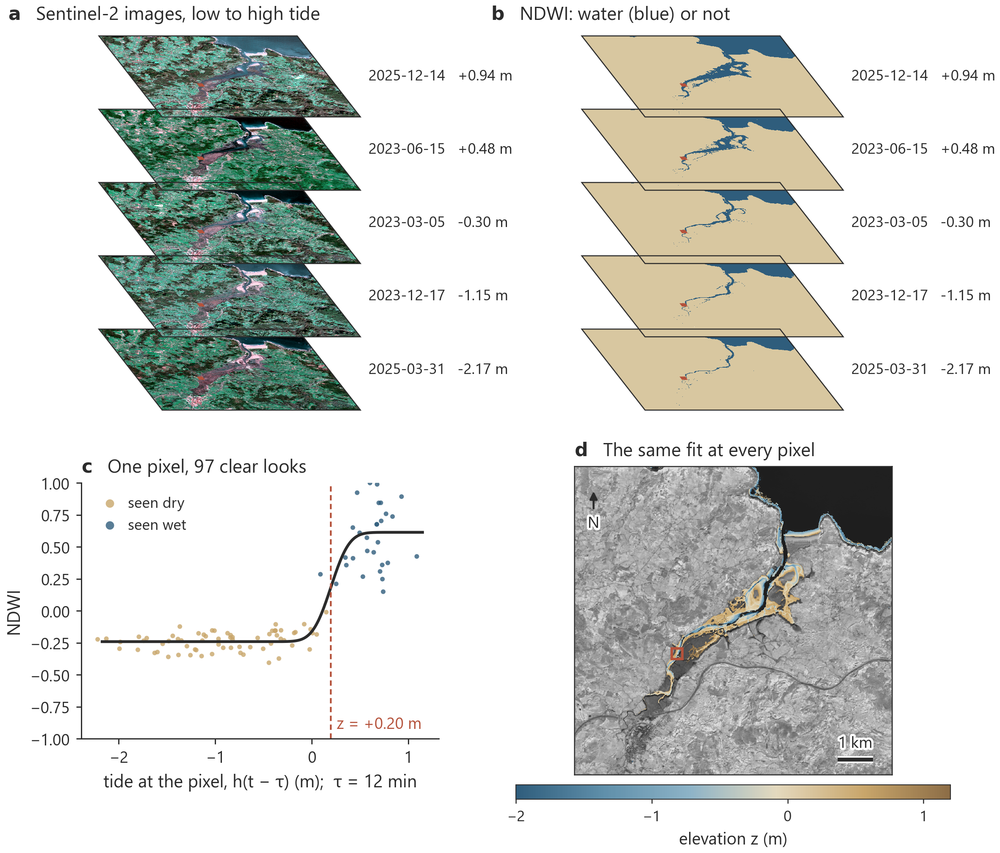
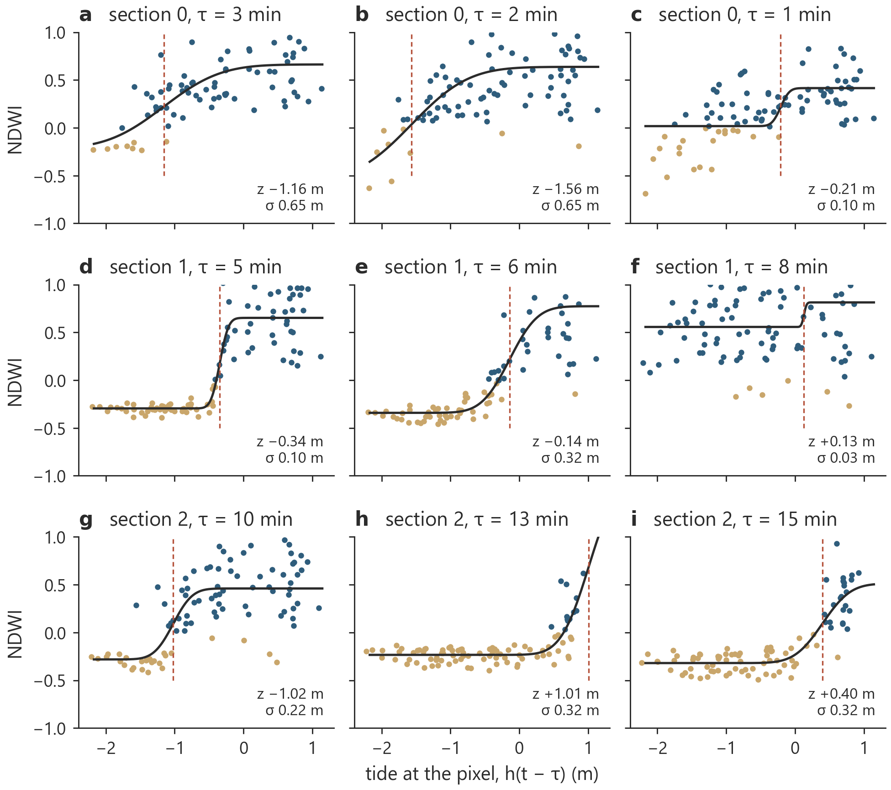
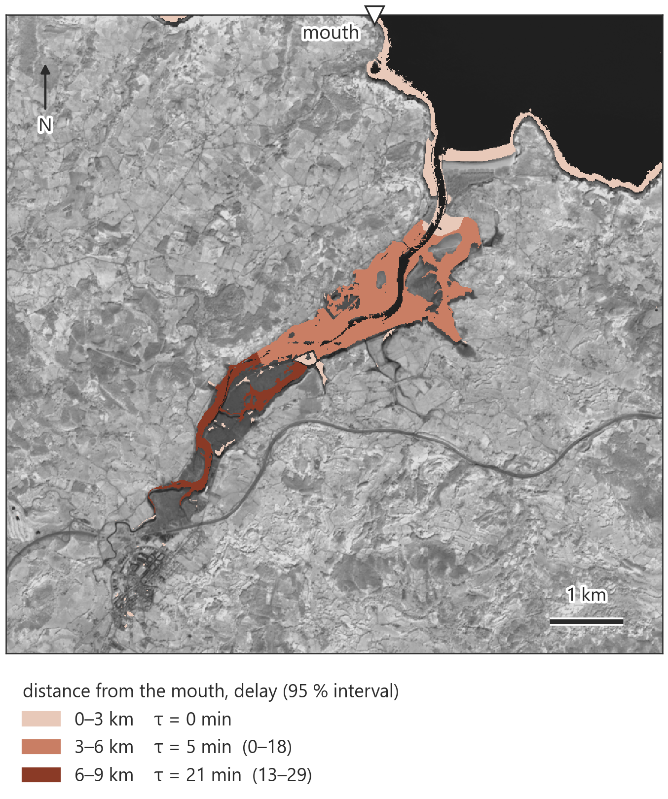
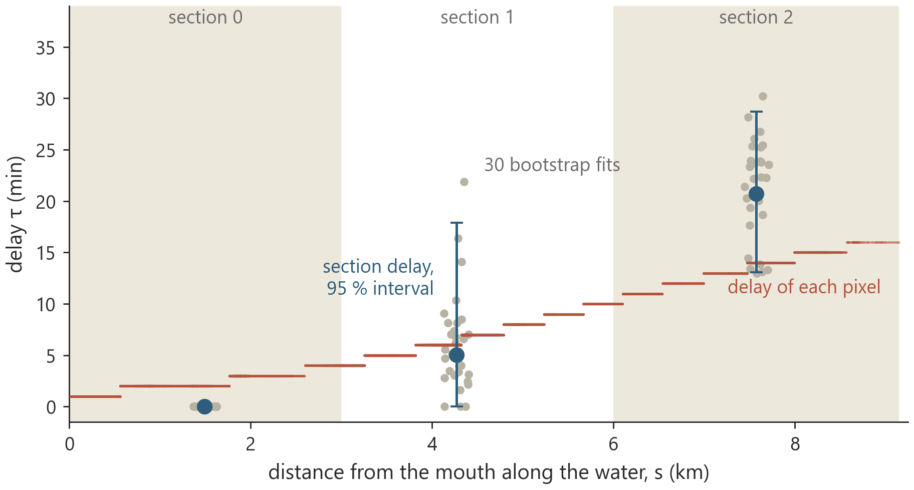
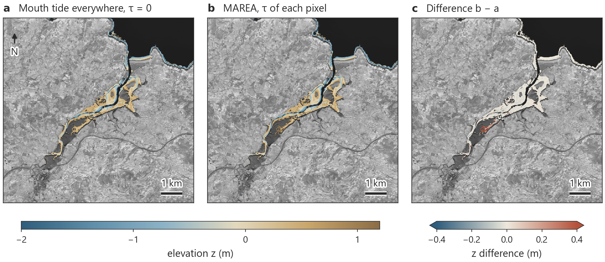
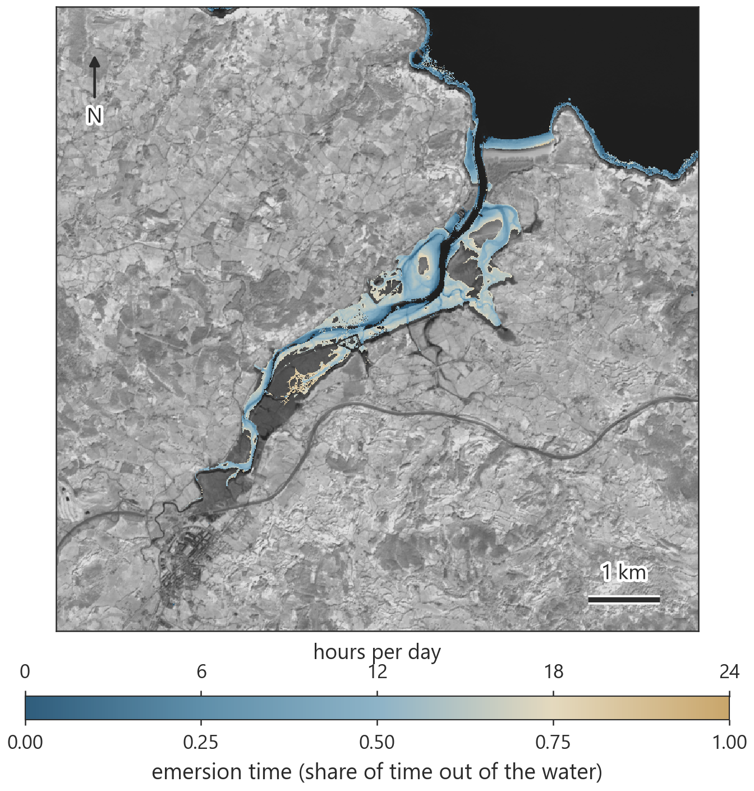
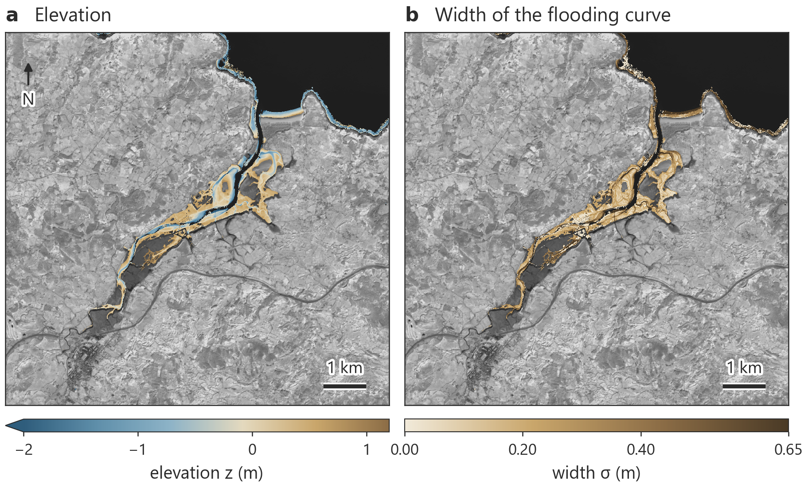
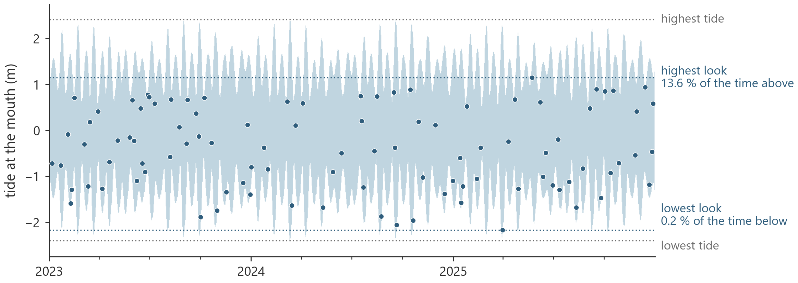

# How MAREA works

* **What this page is for:** the method in words, three equations and real figures, from
  one pixel to the maps.
* **Who it is for:** coastal scientists, ecologists and managers. No statistics
  background is assumed.
* **Time:** about 15 minutes of reading.

Every figure on this page shows real data of the Ría de Villaviciosa (Asturias, Spain):
its Sentinel-2 images, its tide, and the 10 m MAREA product made from the 97 images of
2023–2025 kept by the cloud screening. That product is in
[`products_marea/`](../products_marea/README.md), and
[`REPRODUCE.md`](REPRODUCE.md) rebuilds it. Heights are in metres on the scale of the tide
at the mouth, about mean sea level. To read them in NMMA, add C = 0.3778 m
([`DATA.md`](DATA.md#3-heights-nmma-and-the-constant-c)).

## 1. What MAREA maps

MAREA maps two things for every 10 m pixel of a tidal flat, from the Sentinel-2 archive:

* the **elevation** of the ground, with its uncertainty;
* its **emersion time**, the share of time the ground spends out of the water.

Elevation says where the flat sits in the tidal frame. Emersion time says how long the
plants and animals living there are exposed to the air. Together they are a base layer
for the potential habitat of the seagrass *Nanozostera noltei*, whose limits ecologists
set.

The method was built on the Ría de Villaviciosa, a narrow ría whose flats reach about
9 km from the mouth along the water.

*From the images to the map: (a) Sentinel-2 images from low to high tide; (b) water or
not; (c) one pixel's looks and its fitted curve; (d) the same fit at every pixel.*

## 2. One pixel, seen many times

Sentinel-2 passes over the site every few days, always at about the same time of day.
Over three years, one pixel is photographed at many stages of the tide. MAREA downloads
the archive of a site as one data cube, through openEO on the Copernicus Data Space
Ecosystem. The cube holds the green (B03), near-infrared (B08) and scene-classification
(SCL) bands at 10 m.

**Screening.** A scene is kept if at most 5 % of the whole frame is cloudy or, failing
that, at most 10 % of the transition zone between permanent water and land, where the
flats are. A scene overcast inland can still be clear over the estuary.

**Looks.** A look is a cloud-free view of the pixel: one whose scene classification is
vegetation, bare soil, water or unclassified (SCL classes 4 to 7). Each look has a water
index, NDWI = (B03 − B08) / (B03 + B08). Water absorbs near-infrared light, so NDWI is
high over water and low over dry ground. A look is **wet** when NDWI is above 0 and
**dry** otherwise.

**Which pixels.** MAREA maps the pixels with more than 30 clear looks that are seen wet
in more than 10 % and less than 90 % of them: neither permanent sea nor dry land.

**The record.** The looks that enter the fits come from the record: the screened scenes
of the product's period that have an acquisition time and a tide level at the mouth. At
Villaviciosa the period is 2023–2025 and the record holds 97 scenes, from 2023-01-06 to
2025-12-28.

**The flooding curve.** A pixel is not simply wet or dry: the sensor averages whatever
lies inside its 10 m. With part of the pixel under water, NDWI sits between the pixel's
own dry value and its flooded value. The ground inside a pixel is not flat either, so as
the water rises it floods the low parts first. If the small bumps inside the pixel are
spread like a bell curve around a mean height, the flooded fraction follows an S-shaped
curve of the water level, and so does NDWI.

**Eq. 1, the flooding curve:**

$$
\mathrm{NDWI}_{pt} = a_p + b_p \, \Phi\left( \frac{h_p(t) - z_p}{\sigma_p} \right)
$$

where

* $a_p$ is the dry level: the NDWI of pixel $p$ when it is fully dry;
* $b_p$ is the dry-to-wet jump, so that $a_p + b_p$ is the flooded level;
* $z_p$ is the **elevation**: the midpoint of the curve, the water level at which half
  of the pixel is under water (m);
* $\sigma_p$ is the **width**: how gradually the pixel turns from dry to wet (m);
* $\Phi$ is the cumulative standard normal distribution, the S shape;
* $h_p(t)$ is the water level over the pixel at the time $t$ of the look (m).

Because $a_p$ and $b_p$ belong to each pixel, a dark mud and a bright sand can both be
fitted.

*Nine pixels of the product, three per section, drawn at random by a seeded rule: their
looks against the tide that reaches them, and their fitted curves.*

Everything therefore hangs on $h_p(t)$, the water level over the pixel at the moment of
each look. Inside an estuary, that is the hard part.

## 3. The tide arrives late

Each look is given the water level at the moment its scene was taken. MAREA reads that
moment, the UTC start of the datatake, from the Sentinel-2 STAC catalogue. Global tide
models such as EOT20 give the tide at that moment at the open coast: at the **mouth** of
the estuary. Tide gauges, where they exist, also stand near the coast.

Inside the estuary the tide travels up the channel as a wave and arrives later. On a
rising tide the water inside is still lower than at the mouth; on a falling tide it is
still higher. A flat near the head can be seen dry while the level read at the mouth
says its ground is under water.

MAREA models the water over a pixel as the tide at the mouth, read a few minutes earlier.

**Eq. 2, the delayed tide:**

$$
h_p(t) = h_B\big(t - \tau(s_p)\big)
$$

where

* $h_B(t)$ is the tide at the mouth (the *boundary tide*): EOT20, the nearest tide
  gauge, or the mean of the two (m);
* $s_p$ is the distance of pixel $p$ from the mouth measured along the water, the path
  the tide travels, not as the crow flies (km);
* $\tau$ is the delay in minutes, positive when the water inside is later than at the
  mouth, and never negative.

How much a delay matters is plain arithmetic. On a semidiurnal tide of range $R$ and
period $T$, the level changes by at most $\pi R / T$ per unit of time. With $R$ = 3 m and
$T$ = 12.42 h (745 min), that is about 1.3 cm per minute, so a delay of 20 min shifts the
level of a look by up to about 0.25 m.

MAREA shifts the tide in time only. It does not change its height: the images can time
the tide, but cannot measure how much it is amplified inside the estuary
([section 9](#9-what-the-images-cannot-tell)).

## 4. Reading the delay from the images

The delay is not taken from any model of the estuary. MAREA reads it from the same looks
it uses for the elevation.

**Flood and ebb disagree under the wrong delay.** Read against the mouth level, an
inland pixel is seen dry on the rising tide at levels where it should already be wet,
and wet on the falling tide at levels where it should already be dry. Its flood looks
and its ebb looks then put the dry-to-wet step at two different levels, and no single
elevation explains both. Under the right delay they agree. Granadeiro et al. (2021) used
this contradiction to read tidal-stage lags from Sentinel-2.

**Every candidate delay gets its best case.** For the delay, each look is reduced to wet
or dry, so the pixel's own dry and flooded levels ($a_p$ and $b_p$) play no part. For
each candidate delay, every pixel first takes the elevation and width that best explain
its own wet and dry looks under that delay; only then are the candidates compared. The
delay under which the wet and dry looks of all the pixels are most probable wins. In
statistical terms this is a *profiled Bernoulli likelihood*. Profiling matters: a wrong
level offset is absorbed by the pixel's elevation, but a wrong delay reorders the levels
across dates (look A had more water than look B, yet A is dry and B is wet), and no fixed
elevation can repair that.

**One delay per 3-km section, zero at the mouth, never decreasing inland.** The mouth is
the permanent sea that touches the edge of the frame. The distance of every pixel is
measured from it through water and intertidal pixels only. The intertidal pixels are cut
into *sections* of 3 km of that distance; a section with fewer than 500 pixels joins its
neighbour. Section 0, at the mouth, is the anchor where the tide at the mouth is trusted:
its delay is 0 by construction. Each section further in may only add to the delay of the
one before it, because a delay of propagation accumulates.

**Eq. 3, the delay objective:**

$$
\hat\tau_1, \dots, \hat\tau_{K-1} = \arg\max_{0 = \tau_0 \le \tau_1 \le \dots \le \tau_{K-1}} \ \sum_{k=0}^{K-1} \omega_k \sum_{p \in Q_k} \ \max_{z,\, \sigma} \ \sum_{t} \Big[ w_{pt} \log \pi_{pt} + d_{pt} \log\left( 1 - \pi_{pt} \right) \Big], \qquad \pi_{pt} = \Phi\left( \frac{h_B(t - \tau_k) - z}{\sigma} \right)
$$

where

* $K$ is the number of sections and $\tau_k$ the delay of section $k$ (min); in
  $\pi_{pt}$, $k$ is the section of pixel $p$;
* $Q_k$ is a seeded sample of at most 1,200 pixels of section $k$, each with at least 6
  looks;
* $w_{pt}$ and $d_{pt}$ are 1 when the look of pixel $p$ in scene $t$ is wet (or dry),
  and 0 otherwise, including when there is no look;
* $\pi_{pt}$ is the probability that the look is wet: the flooded fraction of Eq. 1 with
  $a = 0$ and $b = 1$, kept a little away from 0 and 1;
* $z$ and $\sigma$ are profiled per pixel, over 60 levels spanning the mouth levels of
  the record with a 0.3 m margin, and 6 widths from 0.06 to 0.45 m;
* $\omega_k$ is one over the mean number of looks per pixel of $Q_k$, so that each
  section scores as an average per look, weighted by its number of pixels.

**An interval for every delay.** An estimator always returns some number, even where the
true delay is zero. MAREA therefore refits the delays on 30 resamples of the scenes,
drawn with replacement, and reports the range of the middle 95 % of the fits as the
interval of each section.

At Villaviciosa the three sections receive delays of 0, 5.0 and 20.7 min, with 95 %
intervals of 0 to 0, 0 to 17.9 and 13.1 to 28.7 min. The middle section's interval is
wider than its delay: the images decide it only loosely.

*The 3-km sections of the ría and the delay of each.*

## 5. From sections to every pixel

The section is the unit of estimation; the pixel is the unit of application. A smooth
curve through the section delays (a Gaussian kernel of 3 km along the distance), pinned
at 0 min at the mouth and never decreasing inland, gives each pixel its own delay from
its distance $s_p$, rounded to the whole minute. The curve blends neighbouring sections:
at Villaviciosa the pixels of section 0 receive 1 to 4 min, borrowed from section 1, and
the pixel delays run from 0 to 16 min. Pixels that water cannot reach from the mouth have
no distance and keep a delay of 0.

*The delay of each section, with its interval and bootstrap fits, and the delay each
pixel receives.*

Each pixel then gets its elevation and width from Eq. 1, fitted to the NDWI value of
every look (not only wet or dry) on its own delayed tide, Eq. 2. The candidate elevations
are 50 levels between the lowest and the highest mouth level at the image times; the
candidate widths are 8 values from 0.03 to 0.65 m. A pixel is left empty unless it passes
every guard:

* **enough looks:** at least 8 cloud-free looks;
* **a plausible curve:** a dry-to-wet jump $b$ between 0.15 and 2.5, and a dry level $a$
  between −2.5 and 2.5;
* **the quality rule:** at least 3 looks taken with the water below the fitted elevation
  and 3 with the water above it, so that the elevation is read from the pixel's own
  record and not pinned to an edge of the levels the satellite saw. It is the default of
  `marea.reconstruct` (`quality_min_bracket=3`). The Villaviciosa product was made
  before the rule existed, without it.

What does the delay change in the map? The figure inverts the same record twice, once
with the mouth tide for every pixel and once with MAREA's delays, on the same grids and
guards. It shows what the correction changes, not which map is closer to the ground.

*(a) Mouth tide everywhere, (b) MAREA, (c) their difference.*

## 6. Emersion time

The emersion time of a pixel is the share of time its delayed tide, $h_B(t - \tau_p)$,
stays at or below its elevation $z_p$. It is computed on a continuous tide series over
the period of the record (every 10 minutes in the scripts, every minute for the website
maps), not at the image times, which sample the tide unevenly. A value of 0.5 means the
ground is out of the water half of the time; multiplied by 24 it gives hours per day.
`marea.reconstruct` does not store it: `scripts/marea_tools.emersion_time` computes it
from the stored elevation and pixel delays and the same tide at the mouth.

Over a period of years, shifting the tide by a few minutes hardly changes how often each
level is reached. Emersion time is therefore, in practice, a function of elevation
through the local tide; the delay matters through the elevation itself.

*Emersion time of the Villaviciosa product, 2023–2025.*

## 7. The maps

The product holds the elevation $z$ and the width $\sigma$ of every mapped pixel, with
the delay and the distance from the mouth of every pixel. At Villaviciosa, 29,728 of the
32,120 intertidal pixels have an elevation; the others failed a guard.

*Elevation z and width σ of the Villaviciosa product.*

## 8. Uncertainty

**Of the delay.** The 95 % interval of each section's delay, from the 30 scene
resamples (`tau_lo_min`, `tau_hi_min` in `marea.npz`).

**Of the elevation.** The uncertainty the maps show is the width $\sigma$ of the pixel's
fitted flooding curve. It is found together with $z$, pixel by pixel, by a grid search:

1. The candidate elevations are 50 levels evenly spaced between the lowest and the
   highest level of the mouth tide at the image times. The candidate widths are 0.03,
   0.06, 0.10, 0.15, 0.22, 0.32, 0.45 and 0.65 m.
2. The level of each look is the mouth tide read the pixel's own delay earlier.
3. For every candidate pair $(z, \sigma)$, $a$ and $b$ are solved in closed form by least
   squares on the NDWI of the pixel's cloud-free looks.
4. The pair with the smallest sum of squared residuals gives the stored $z$ and
   $\sigma$.

So $\sigma$ is always one of the eight widths, and the uncertainty map has eight classes.
A transition sharper than 0.03 m or more gradual than 0.65 m is reported at that end.

How to read it: $\sigma$ says how gradually the pixel turns from dry to wet as the water
rises. In the pixel model it is the spread of the ground inside the pixel; in practice it
also absorbs any error in the water level given to each look, which blurs the transition
in the same way. It is not a standard error of $z$: it does not come from the scatter of
the fit and does not shrink as more looks are added. Nor is it an accuracy measured
against an independent survey.

## 9. What the images cannot tell

* **The timing of the tide, not its size or its zero.** Wet and dry looks fix the delay,
  but not how much the tide is amplified or damped inside the estuary, nor the zero of
  the levels: both are taken from the tide at the mouth. This is why the heights need a
  constant to be read in a national datum ([`DATA.md`](DATA.md#3-heights-nmma-and-the-constant-c)).
* **One phase of the solar tide.** Sentinel-2 passes at nearly the same solar time every
  day, so the solar constituent S2 of the tide is always seen at the same phase.
* **The extremes are seen rarely.** Because the overpass time is fixed, the images
  sample only part of the tide's cycle. At Villaviciosa they reach down to near the
  lowest tides but never see the highest ones (figure below), and no elevation is read
  beyond the levels the satellite saw.

*The tide at the mouth over 2023–2025 and the levels the 97 images saw.*

## 10. The steps in the code

The functions behind each step. The module names are those of
[`pyintertidal/`](../pyintertidal/); the record helper is in
[`scripts/marea_tools.py`](../scripts/marea_tools.py).

1. Download the Sentinel-2 cube: B03, B08, SCL at 10 m (`SentinelCube.ensure`).
2. Get the acquisition time of every scene (`overpass.get_overpass_times`).
3. Screen the scenes (`stability.reference_and_clouds`, `filter_dates`).
4. Extract the looks and the intertidal mask (`marea.extract`).
5. Build the record (`scripts/marea_tools.build_record`).
6. Read the tide at the mouth (`boundary.PyTMDBoundary` or `make_boundary`).
7. Find the mouth, the distance along the water and the 3-km sections
   (`geometry.mouth_seeds`, `along_distance`, `tide_estimators.make_bands_fixed`).
8. Fit one delay per section, with its interval (`tide_estimators.m2a_rasch`,
   `bootstrap_lags`).
9. Give every pixel its delay (`tide_estimators.smooth_lag_profile`).
10. Fit each pixel's elevation and width on its delayed tide (`marea.invert_series`,
    guards, quality rule).
11. Make the products: hypsometry, GeoTIFFs, emersion time
    (`hypsometry.curve_with_uncertainty`, `raster.write_geotiff`,
    `hydroperiod.hydroperiod`).

`marea.reconstruct` runs step 6 (EOT20 by default, or the boundary it is given), steps
7–10 and the hypsometry of step 11, on an extraction (step 4) that it computes or is
given. Notebook [`01_marea_villaviciosa`](../notebooks/01_marea_villaviciosa.ipynb)
follows steps 4–11 on real data, and
[`03_new_ria_openeo`](../notebooks/03_new_ria_openeo.ipynb) shows steps 1–3 for a new
estuary.

## References

1. Bishop-Taylor, R. et al. (2019). Between the tides: modelling the elevation of
   Australia's exposed intertidal zone at continental scale. *Estuarine, Coastal and
   Shelf Science* 223, 115–128.
2. Granadeiro, J. P. et al. (2021). Using Sentinel-2 images to estimate topography,
   tidal-stage lags and exposure periods over large intertidal areas. *Remote Sensing*
   13(2), 320.
3. Hart-Davis, M. G. et al. (2021). EOT20: a global ocean tide model from multi-mission
   satellite altimetry. *Earth System Science Data* 13, 3869–3884.
4. Schramm, M. et al. (2021). The openEO API – harmonising the use of Earth observation
   cloud services using virtual data cube functionalities. *Remote Sensing* 13(6), 1125.
